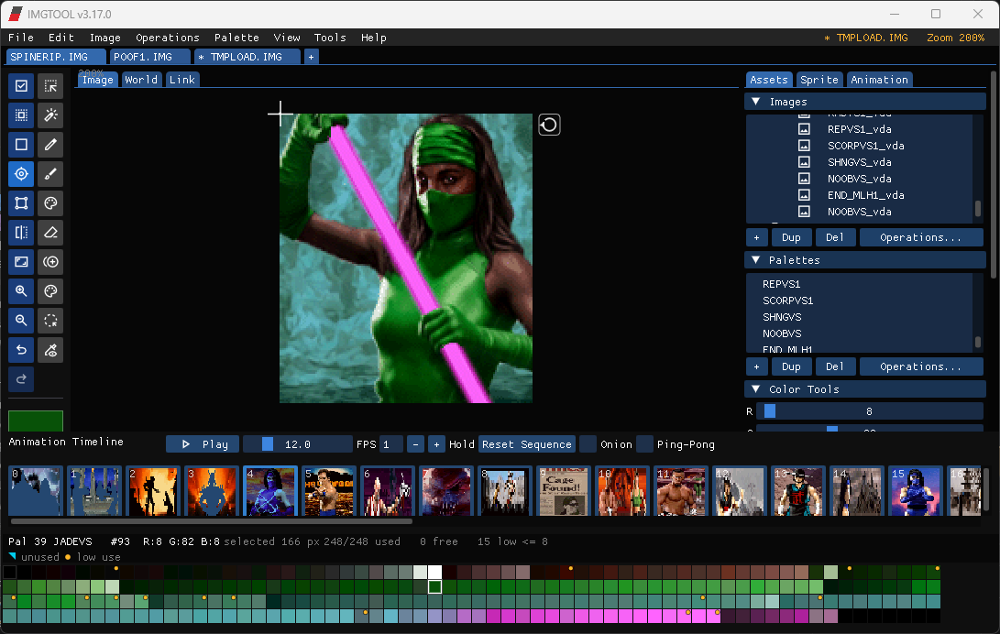

# midway-imgtool

Sprite and palette editor for the IMG container files used by 1990s Midway arcade games — Mortal Kombat II/3, NBA Jam, NBA Hangtime, and others. Loads, edits, and saves `.IMG` libraries plus their LBM, TGA, and PNG siblings, preserving proprietary point-table and animation data from the original tools.



> **Status:** pure C/C++ port. Originally a 1992 DOS tool with ~34,000 lines of x86 assembly — now fully rewritten in C++ with SDL2 + Dear ImGui. No assembler, no DOSBox, no virtualization. Runs on Windows (x64/x86), Linux (x64), and macOS (Intel + Apple Silicon).

---

## Studio preview (separate application)

`imgtool-studio.exe` is a new artwork and animation-alignment editor. Classic
`imgtool.exe` keeps its existing interface and workflows; `imgtool-cli.exe`
remains the automation entry point. All three are built together.

Studio opens with a compact home screen: Open IMG, New library, Explore sample,
a saved-project shortcut, and recent libraries with folder paths and hover details.
Unavailable recent files can be removed from the list without deleting files.
Studio has a red-accented workspace with a searchable thumbnail library,
resizable canvas and inspector, new/rename/duplicate/delete/reorder commands,
indexed LBM/TGA import and export with reviewed sprite sheets, sprite resize/canvas-size/trim/rotate/flip with reviewed batch geometry and parent/child restoration, reviewed LOD library loading and TBL/IRW/ANILST exports, PNG import/export, reviewed sprite-sheet/GIF imports,
pencil/erase/clone/variant/blur/smudge/heal/defringe, line previews, color replacement/matching fill and rectangle/wand/lasso selection tools, palette-aware
copy/paste with a placement preview, shared palette editing, and animation
anchor controls with engine-aware flip previews. The Animation & alignment
workspace adds a fixed playfield, floor guide, onion skin, multipart
reconstruction, timeline playback/scrubbing, and references from open libraries.
Studio projects add authored actor lanes and cross-file frames, saved timing,
placement and facing, an independent scene history, and current-scene PNG export.
Each open library owns its
undo history, including geometry, sprite/palette metadata, and selection.
Stable sprite identities keep preview references attached when the list changes.
Reordering updates embedded sequence image indices; deletion refuses to remove
a referenced sprite. Saves validate a temporary file before replacing the destination;
failed saves leave the document dirty, and external file changes are detected.

This is an **artwork editing preview**, not feature parity with classic. It
currently accepts validated IMG layouts `0x60a`–`0x631` and `0x634`–`0x654`.
Older WIMP libraries preserve their original format on Save / Save As, including
stored sequences/scripts, point tables and alternate palettes. The status bar
shows their format. **Every Save and Save As keeps the original IMG version and
record layout. Studio offers no format conversion.** A save refuses edits that
cannot fit that format and leaves the destination intact.
Pre-`0x60a` and transitional `0x632` / `0x633` layouts, additional legacy image variants, ASM animation,
full script execution, advanced WAX rules, and game-source editing remain in classic.
Studio exposes embedded sequence frames and script calls while preserving their
other metadata.

**Palette clipboard:** in Palette manager, **Ctrl+C** copies every marked
palette (or the selected one when no marks exist), including palettes hidden by
the search filter. Right-click Copy for **Copy selected only**. **Ctrl+V** appends
all captured palettes in one Undo step and selects the first addition. Names are
numbered when needed; colors, depth and palette metadata are retained. Sprite
assignments stay unchanged. The clipboard survives closing the source library;
**Clear** beside Paste releases it. Save separately in the original IMG format.

**Swatch clipboard:** right-click a color, or choose **Copy / paste colors...**,
to copy one color or the Ctrl/Shift-selected swatches with their slot numbers.
Paste reviews the original indices, appended slots, or one existing opaque slot.
The before/after sprite preview shows shared-color changes; the review lists
palette growth, declared depth and LOAD2 PPP impact. Destination index zero stays
unchanged. Its copied color can be appended or pasted into an opaque slot.
Every color must fit within 256 slots; nothing is silently dropped. Apply uses
one Undo step, retaining pixels and palette assignments. This clipboard survives
source closure and stays separate from whole-palette Ctrl+C/V and pixel copying.

**Sprite overlay (L):** while placing or transforming pasted pixels, press **L**
to retain a separate overlay. Move (**Shift+V**) then targets the overlay; drag
and release for one Undo step, hold Shift to lock an axis, or nudge with arrows
(Shift = ten pixels). Escape/Undo cancels a drag. Choose **Base selection** in
the inspector to move selected pixels beneath the stationary overlay. The
inspector also positions, flips, hides, flattens or removes it, with Undo/Redo. Index zero stays transparent. Save
includes visible overlays as flattened pixels in the **unchanged IMG format**;
the live layer remains editable for this session. Hidden overlays are excluded,
and reopened files contain flattened pixels. Paint and pixel Copy target the
base. Flatten before geometry changes, palette remapping or pipeline export.

**Side toolbar and color wheel:** the left rail contains the 18 migrated pixel
tools as icons with names, shortcuts and instructions on hover. The active tool
uses Studio's red highlight; its settings remain in the inspector. A hue wheel
and saturation/value triangle sit directly below the tools, editing the active
palette index. The swatch shows that index; **0** toggles to transparency and back
to the last opaque index. Index zero is locked against color edits.

Click the swatch or **Edit...** for larger RGB/HSV/hex controls. Colors are stored
as RGB555 and shared-palette edits affect every sprite using the entry. Each drag
is one undo step; Escape or Undo cancels an unfinished wheel drag. Palette state
belongs to each library and follows sprite/swatch changes. Pending pixel previews
disable wheel edits. The existing indexed swatches remain below the canvas.
Keep the executable's **assets** folder beside it for the bundled toolbar icons;
short labels provide a fallback when the font is unavailable.

**Painting:** Pencil/Erase/Line/Replace/Clone/Variant/Blur/Smudge/Heal/Defringe share round or square brushes, a radius
control and **[ / ]** size shortcuts. Fast strokes interpolate continuously.
**Line (Shift+K)** previews a straight stroke without changing the IMG. Hold Shift to
snap horizontal, vertical or diagonal; release to apply one undo step, or press
Escape/Undo to cancel (including while Shift is held). The preview reports the
number of changing pixels. A changed source discards the pending line.

**Replace (B)** picks its source index at the start of a stroke and replaces only
matching pixels under the brush with the selected palette index. Crossing another
color does not change the source. Enable **All matching pixels** for a click to
replace throughout the sprite or active selection. **Fill (G)** and **Smart erase
(E / U)** support connected or global matching; smart erase writes transparency.
By default matching uses the exact index. Enable **Match palette colors** to use
RGB555 color distance and tolerance, including duplicate colors in different
slots. Transparency remains separate from opaque black. All tools restrict writes
to the selection; connected fills cannot travel through excluded pixels.
These edits retain palette words, anchors, points and other sprite metadata.
**Clone (C)** uses **Alt-click** to choose a source on the current sprite, then
copies it under the brush as you drag. A gold marker shows the sampled position;
red indicates sampling outside the sprite, where pixels are skipped. Each stroke
freezes the source, so overlapping repairs do not feed back into themselves.
**Aligned strokes** keeps the offset between strokes; disable it to start each
stroke at the chosen source. **Copy transparent pixels** explicitly allows source
transparency to erase the destination (off by default). Clone writes respect the
selection, including holes; sampling can read outside the selection. Release
commits one undo step; Escape restores the unfinished stroke and keeps its
selection. Switching sprites or changing dimensions clears the source. This first
clone workflow samples within one sprite; cross-sprite copying uses the clipboard.
**Variant (V / T)** recolors painted pixels in the current palette while preserving
those pixels' colors under the library's other palettes. Choose an opaque target
swatch, drag to preview, then **Apply/Enter** or **Cancel/Escape**. **Preview selected
pixels** applies the same review to a rectangle/wand/lasso selection. Transparent
pixels stay transparent and selection holes stay untouched.

The review reports changing pixels, reused/assigned slots, palettes that change
or grow, and color counts crossing the chosen LOAD2 PPP packing limit. **Show
original** and the palette dropdown compare appearances without changing the IMG.
Slots unused by all current sprites and their saved baselines may be repurposed;
existing painted colors stay intact. Missing alternate color entries are treated
as black. Palette growth raises addressing depth as needed. No suitable slots
blocks the whole edit. Apply changes pixels and palettes together in one undo
step; cancel/Undo discards the pending preview. Source or workspace changes close
an unapplied preview.

**Blur (O)** softens neighboring colors under the brush. Every stroke samples one
frozen source and applies each covered pixel once; start another stroke to build
up the effect. **Smudge (S)** pulls paint from the previous brush position as you
drag. Fast drags process each pixel interval; the initial click alone does not
change pixels. Both tools have a **Strength** control and blend actual RGB555
colors, then choose an existing opaque palette entry. They preserve transparent
pixels and sprite outlines, and restrict both sampling and painting to the active
selection, including holes. Sparse palettes can limit the visible result. Palette
entries, geometry, anchors and other sprite metadata stay intact. Release commits
one undo step; Escape restores the unfinished stroke and keeps its selection.
**Heal (J)** replaces a brushed blemish by carrying surrounding colors inward.
The accumulated brushed area is recomputed from one frozen source per stroke;
repairs do not sample earlier changes. **Fill depth** controls how far color can
travel from the rim. Pixels without usable surrounding colors stay unchanged.
This is local color diffusion using the existing palette.

**Defringe (F)** cleans outline color spill from the sprite interior. Drag to
clean locally, or click **Clean all edges / Clean selected edges** in the
inspector. **Edge width** chooses a 1-4 pixel band; canvas borders count as edges.
Thin features without an interior color source stay unchanged. Both repair tools
preserve transparency and geometry, and selections limit sampling and writes.
Release groups a stroke into one undo step; Escape cancels it and keeps its mask.

**Smart erase (U)** now has **Clean erased edges** enabled by default. In the
same undo step as erasure, surviving adjacent pixels adopt safe neighboring
colors. Cleanup only uses local colors outside the erased/matching region and
inside the selection; it does not erase additional pixels. Turn it off for a plain
matching erase. Clicking existing transparency does nothing.

**Batch geometry:** library checkboxes mark sprites independently of the active
sprite and pixel selection. **Marks** can mark every sprite shown by search or
clear membership; the adjacent count shows active marks. Marks belong to each
open library and follow stable identities through reorder and Undo. They are
session view state and do not write IMG flags or persist after closing a library.

Click **Batch...** or **Sprite > Batch geometry...**, then choose Marked sprites,
Shown by search, or All sprites in the current library. The review supports trim,
resize by percent or exact dimensions (nearest/palette-aware smooth), canvas
size with nine placements, and five rotate/flip operations. Anchor/point options
follow the existing single-sprite commands. Trim and canvas placement rebase
anchors and point tables; entirely transparent trims keep their original canvas.

Select a row to compare **Before / After** at the same world anchor target.
The table shows old/new sizes and cropped visible pixel counts; primary anchors
appear below it, with secondary/point details on hover. Uncheck rows to exclude
them. Finish editing a control to refresh its preview; Apply waits for matching
settings and valid limits. **Apply batch** changes all enabled rows in one Undo
step. **Cancel / Escape** discards the preview. These operations edit whole
sprites. Palettes, saved baselines, raw names and embedded references are retained;
geometry changes can affect LOAD2 packing. Pipeline exports remain pending.

**Sprite > Batch rename...** previews names for Marked sprites, Shown by search,
or All sprites in the current library. Choose numbered names, prepend text, or
append text plus a number, with a starting number and optional zero padding.
Rows follow library order. Uncheck a row to keep its current name; the remaining
previewed numbers stay fixed. The review checks the final names against the whole
library, including excluded sprites, using case-insensitive matching. Overlong,
empty, non-ASCII or spaced names block Apply instead of being silently shortened.

**Apply names** changes included rows in one Undo step; Cancel discards the
preview. Pixels, palettes, anchors, point tables, raw trailing name bytes and
embedded animation references remain intact. Existing IMGs retain their version
and record layout. External ASM / TBL references are not rewritten, and new names
can change name-based LOAD2 allocation. Save the IMG through its normal save flow.

**Sprite > Copy / move to another library...** transfers sprites to another open IMG
library. Open both libraries, then start from the source and choose Marked sprites,
Shown by search, or All sprites. Review copied names, palette assignments and the
source preview; uncheck rows to exclude them. An optional prefix resolves name
conflicts. Names must fit 15 ASCII characters without spaces; existing sprites are
never replaced and names are never silently shortened.

Required primary and alternate palettes are copied once per source palette.
**Reuse identical palettes** reuses existing destination palettes only when colors
and metadata match exactly; disable it to keep the copied palettes independent.
Pixel indices, padding, anchors, point tables, baselines and opaque sprite/palette
metadata are retained. Alternate table references are remapped, with default
palette references and bytes past the terminator retained. Unrepresentable
alternate indices or metadata unsupported by the destination layout block the row.
Both libraries must remain open and unchanged while the review is active.

**Copy sprites** appends the included rows and required palettes in one destination
Undo step. Copies have new stable identities; source data and history are unchanged.
The destination keeps its existing IMG version and record layout. Apply never
saves automatically. This pass transfers listed sprites and palettes only, without
source sequences/scripts. Use the separate sprite clipboard below when the
source library needs to close before pasting.

**Move from source** is optional; Copy is the default. Move appends the reviewed
sprites to the destination and removes them from the source together, after
preparing both libraries and their Undo entries. Sprites used by embedded
sequences or current open scenes are protected; **Exclude referenced sprites**
lets you keep them in the source. At least one source sprite must remain.
Remaining source sequence indices are remapped, while scripts and source palettes
stay in place. Embedded animation records are not transferred by this workflow.
External game references and closed scene projects are not scanned.

Each library has its own Undo step: undo each separately to reverse the entire
move. Save both libraries separately when ready. Neither is saved automatically,
and each retains its original IMG version and record layout. A stale review,
incompatible destination, or preparation failure leaves both libraries unchanged.

**File > Copy IMG animations to library...** (also **Animation > Copy to another
library...** in IMG animations mode) transfers embedded sequences and script call
lists between two open libraries. Select source records; choosing a script adds
its called sequences automatically. Clear choices or uncheck the script to remove
those dependencies. An animation-name prefix resolves collisions without replacing
existing records. Each resulting name must fit 16 printable ASCII characters.

By default, the destination uses its existing referenced sprite artwork. The review
matches unique sprite names without case or outer spaces. **Destination sprite
prefix** matches prefixed artwork, such as source `SENTINEL3` to destination
`ART_SENTINEL3`; it does not rename sprites. For differently named or duplicate
sprites, open that row's **Destination sprite** dropdown and search by name or
exact sprite index. Each choice shows its index and dimensions, with anchors in
the tooltip. Explicit choices distinguish sprites even when their visible names
are identical; multiple source sprites can deliberately share one destination.
Unresolved rows block Apply. Enable **Copy missing artwork** below, or copy artwork
first with the sprite-transfer tools.

**Manual** choices survive prefix edits and animation selection changes.
Changing the destination library clears them. Choose **Automatic name match** in
a dropdown to reset that row, or **Reset sprite choices** to clear all overrides.
The binding table shows exact sprite indices and dimensions; anchor/geometry
differences are marked. Bindings do not compare pixel content.

**Copy missing artwork** is optional and off by default. It appends only sprites
required by the selected animations (including script dependencies) whose unique
names are absent from the destination. The destination sprite prefix also names
new sprites. Existing matches and explicit bindings stay in place; ambiguous
names still need a manual choice. Repeated animation references copy a sprite
once. Other sprites, including child pieces not explicitly referenced, stay out.

New sprite rows are labelled **Copy**, with their future destination indices.
The summary lists sprite/palette additions; hover it to review required palette
names, indices, reuse and color counts. Primary and active alternate palettes are
remapped; only palettes with identical stored metadata and colors are reused.
New buffers include pixels, baselines, anchors, point tables and alternate tables.
Unsupported names, layers, palette references, destination limits or layout fields
block Apply. Existing sprites and palettes are never replaced.

Artwork, palettes and animation records are prepared together before changing
the destination and become one **Copy animations and artwork** Undo step. Cancel,
stale reviews and failed preparation add nothing. Undo/Redo restores/removes the
whole transfer, including stable sprite IDs. Copying records with existing artwork
also prepares its history before publishing changes.

Copy appends sequences before the destination script block, keeps existing
sequence indices and existing script calls intact, and remaps incoming sprite and
sequence calls. Stored timing (including zero ticks), offsets, flags, negative
sentinels and opaque bytes stay intact; a name prefix overwrites only its visible
name and terminator. Both libraries are checked again at Apply. One destination
Undo step removes the additions. The destination opens in IMG animations mode
for inspection; the source library and existing destination artwork stay unchanged.

Copy never saves automatically and never changes either IMG version or record
layout. Unsupported far-pointer fields are blocked for older destinations.
Resolved damage-table bindings are included: the review follows sequence/script
and damage dependencies transitively, including cycles, and remaps their global
reference slots along with record and artwork indices. Hover **Damage bindings**
to inspect each source/destination slot and target animation. Only reached slots
are copied; identical remapped pairs share a slot. Existing destination table
bytes remain intact. New references must fit signed-byte slots 0–127. Unresolved
bindings, exhausted slots and damage data incompatible with the destination's
original layout block Apply. One Undo includes the damage table. External engine
bindings are not transferred.
Script runtime execution is still outside Studio's current playback scope.

**File > Copy IMG animations to clipboard...** captures selected embedded records,
called sequences and all required sprite artwork/palettes into an independent
snapshot. You can close the source library afterward. Capture keeps original
names and does not change source artwork, history or saved files. Choose at least
one record; source sprite names must be unique. Resolved damage dependencies
and their table slots are owned by the snapshot; the ordinary transfer constraints
still apply. Cancel or failed capture keeps the
previous animation clipboard.

**File > Paste IMG animations from clipboard...** opens the transfer review
against any open library. All captured records start selected and **Copy missing
artwork** starts enabled. You can select fewer records, change prefixes, choose
existing destination sprites and review palette additions before pasting. The
usual name/layout/reference checks and one destination Undo step apply. Save
separately. The destination always retains its original IMG version and layout.

The **Animation** menu offers these commands in IMG animations mode.
**Edit > Clear animation clipboard** releases the session copy. Clipboard contents
last until replaced, cleared or Studio closes; they do not use the OS clipboard
or persist across restarts. Pixel, palette and sprite clipboards stay separate.
An already-open paste review retains its snapshot until that review closes.

**File > Split IMG animations to new library...** (also **Animation > Split to
new library...** in IMG animations mode) creates a new IMG tab from selected
native sequences/scripts. Scripts and damage bindings include their required
animations transitively. The review
shows exactly which records, sprites and palettes will be included; Select all
and Clear choices adjust the set. Original names are retained. Only referenced
sprites and their primary/active alternate palettes are copied, with incoming
indices remapped. Unreferenced artwork stays in the source.

**Create library** opens the result in IMG animations mode. It is initially
unsaved, with no creation Undo entry; subsequent edits use normal Undo/Redo.
Closing it prompts for unsaved changes. Save it when ready. The new library
inherits the source IMG version and record layout, including supported legacy
reserve metadata. The source library, its saved files, history and all clipboards
stay unchanged.

Choose at least one animation that references artwork. Empty sequences can be
included alongside it; a new library containing only records without artwork
is refused. Source sprite names must be unique. Resolved damage dependencies
are retained; other transfer limits still apply. This extracts native IMG records; scene
projects and external game bindings remain separate.

**Sprite > Split to new library...** creates a separate IMG tab from Marked,
Shown by search, or All sprites, with optional child pieces and per-row exclusions.
The default is **Copy**, leaving the source unchanged. Enable **Move from source**
to remove the included sprites after the new library is ready. Names stay intact;
only required primary/alternate palettes are copied. The new library inherits the
source IMG version and record layout, including older layouts.

With Copy, enable **Include IMG animations** to keep sequences that use only
included sprites, plus scripts whose called sequences are all included. This
never adds extra artwork: change the sprite scope, child-piece option or row
exclusions to cover a complete animation. **Animation records: copied / skipped**
shows every source record and explains skipped records. Damage-bound records
are included only if their full dependency chain uses reviewed artwork. No extra
sprites are added. Empty records without dependencies, outside references,
unresolved damage bindings and records depending on skipped animations stay out. Invalid or colliding names in included records block the
review. Pixel data, raw record metadata and timing are retained, with sprite and
sequence indices remapped. Extra reviewed sprites stay in the new library even
when no animation references them. The source stays unchanged. This option is
available with Copy; Move continues to protect source animation references.
For manual record selection or empty records alongside artwork, use **File >
Split IMG animations to new library...** instead.

Move protects sprites used by embedded sequences or current open Studio scenes.
**Exclude referenced sprites** keeps them in the source; per-row labels and the
selected preview show those uses. Open scene references are checked again when
applying. At least one sprite must remain in the source. External game references
and closed projects are not scanned. Remaining embedded sprite indices are
remapped; source palettes and embedded sequences/scripts stay in the source.
Move does not transfer sequences or scripts to the new library.

The new tab starts unsaved and participates in the normal close/quit save guard.
Move is one source Undo step: Undo restores the source sprites while the new
library remains open. Copy does not add source history. Save the new IMG when
ready, and save the source too after Move. No files are written automatically.
Source palette cleanup stays a separate explicit operation.

**Sprite > Copy sprites to clipboard...** captures Marked, Shown by search, or
All sprites after review. Include child pieces is optional; uncheck any rows to
leave them out. A successful copy replaces the previous sprite clipboard. Cancel
or a failed capture keeps it. Copy leaves the source artwork and history untouched.

The snapshot owns its sprite pixels, padding, baselines, anchors, point tables,
raw name metadata, primary palettes and required alternate palettes. Source edits
and closing its tab cannot change what was copied. It stays in memory for this
Studio session, separate from pixel Ctrl+C/Ctrl+V and palette-color Copy/Paste.
It is not the Windows clipboard and does not survive closing Studio.

Open or create the destination and choose **Sprite > Paste sprites from
clipboard...**. Review names, a prefix, exact palette reuse and per-row exclusions.
The captured set stays fixed; copy again to choose another scope. Name collisions
and metadata unsupported by the destination's existing IMG layout block affected
rows. Paste appends sprites and required palettes in one destination Undo step,
with new sprite IDs, unchanged pixel indices and remapped alternate references.
You can paste repeatedly or into the same library using a prefix to avoid clashes.
Neither Paste nor capture saves automatically, and the destination IMG version
and record layout never change. Sequences, scripts and external game references
are not captured. **Clear sprite clipboard** (Sprite or Edit menu) releases the
snapshot without clearing the pixel or palette clipboards.

Both bulk copy and bulk deletion offer **Include child pieces** (off by default).
This adds direct children of sprites in the chosen scope using the classic naming
rules (`BASE1A`, `BASE_1A`, `BASE_1`, `BASE1`) and matching source-library labels.
The review counts added pieces and labels each with its parent. It does not add
siblings or recurse into descendants; explicitly scoped children can bring their
own direct children. Ambiguous parents are skipped and reported, with names on
hover. Select those sprites explicitly if needed. Each row can still be excluded;
excluding a parent does not silently exclude its reviewed children. These are
name-based editing relationships, with no new metadata stored in the IMG.

**Sprite > Delete multiple sprites...** reviews Marked sprites, Shown by search,
or All sprites with a sprite preview and per-row exclusions. Referenced rows show
their embedded sequence or open Studio scene; **Exclude referenced sprites** keeps
them automatically. Remove references first if those sprites must be deleted.
Open scene uses are checked again when deleting, including changes made after the
review opened. At least one sprite must remain in the library.

**Delete selected sprites** removes the included rows in one Undo step and remaps
remaining embedded sprite indices. Script sequence indices, palettes and surviving
sprite identities are retained. Undo restores deleted pixels, metadata and the
previous selection. Save and Save As retain the loaded IMG version and record
layout. The review deletes only listed rows, including child pieces added with
the explicit option. External ASM/TBL files and closed projects are not scanned.
Deletion can change game build allocations; Apply never saves automatically.

**Palette > Assign to multiple sprites...** reviews a destination palette for
Marked sprites, Shown by search, or All sprites. **Match source colors** maps each
opaque color to the nearest opaque destination slot; transparency stays at index
zero. **Keep pixel indices** changes the palette reference without changing any
pixel bytes, for intentional recoloring or correcting an old palette assignment.
A destination that cannot hold the retained indices is blocked. Select a row to
compare its primary-palette appearance before and after, and exclude rows as needed.

Matching that changes indices is blocked for sprites with active alternate
palettes; retaining indices preserves those alternate appearances. Matching can
approximate colors, so review the preview and select **Allow approximate colors**
when needed. The destination palette's colors and order are never modified. The
PPP indicator reports newly crossed LOAD2 color-count limits; palette-size changes
can also affect packing, so use the packing report before a game build.

**Apply palettes** commits all included, compatible sprites in one Undo step.
Cancel discards the review. Whole sprites are edited independently of canvas
selections. Anchors, points, alternate palettes, raw names, baselines and embedded
animation references are retained. Existing IMG version/layout stays fixed. Apply
does not save the library or change game build settings.

**Sprite > Restore child sprites...** reviews parent-to-child restoration in the
current library. Choose Marked children, Shown by search, or All sprites; parents
can be outside the child scope. **Name rule** uses one capture to find each parent:
`^(.+)[A-Z]$` maps `WALK1A` to `WALK1`. Matching ignores ASCII case, and ambiguous
parent names are reported. Patterns are limited to 128 characters, one capture,
character classes and simple wildcards; counted repeats and repeated groups are
not supported. **One parent** instead offers a searchable picker showing dimensions
and library position. Build the preview after changing settings.

Four modes preserve the original restoration meanings:

- **Reconstruct opaque pixels** copies differing parent pixels only where both
  parent and child are opaque, preserving both silhouettes.
- **Propagate parent edits (Diff)** copies indices that differ from the parent's
  load-time baseline, including transparency. It needs a baseline of the same
  dimensions; new or resized parents may not have one. Palette color changes alone
  are not pixel-index changes.
- **Replace child from parent** clears the child's visible pixels, then copies
  the anchor-aligned parent overlap. Uncovered child art is cleared.
- **Fill child transparency** copies opaque parent pixels into transparent child
  pixels, retaining existing child detail.

Every row shows parent, coverage and changed pixels. Palette mismatches, missing
or ambiguous parents, missing Diff baselines, self matches and no overlap are
excluded. Partial pairs start unchecked; tick a row to include it deliberately.
Changing restoration settings resets partial inclusion. **Before / After** compares
owned results, and **Changes** highlights edits in gold and erasure in pink.
**Parent context** draws child bounds in gold and uncovered areas in red. Added
and erased pixel counts show when silhouette changes may affect LOAD2 packing.

**Apply restoration** commits all included children in one Undo step. Frozen
parent snapshots make the result independent of processing order, even when a
parent is another child in the batch. **Cancel / Escape** discards the review;
source changes require a fresh preview. Geometry, anchors, palette words, points,
alternate tables, saved baselines, raw names, padding and embedded references
remain intact. Whole child sprites are edited; pixel selections remain view state.
Cross-library restoration and unchecked force-copy across palettes remain outside
this workflow.

**Artwork selections:** use **R/W/L** for rectangle, wand and lasso. Choose
Replace/Add/Subtract/Intersect in the inspector, or hold Shift to add, Alt to
subtract, Shift+Alt to intersect. Wand matches palette colors with adjustable
tolerance and optional connectivity; transparency stays separate from opaque
black. **Ctrl+A** selects all, **Ctrl+D** deselects, **Ctrl+Shift+I** inverts,
and **Select artwork** selects nontransparent pixels. Paint, erase and fill
stay inside the selection, including holes and disconnected areas.

**Ctrl+C / Ctrl+X / Delete** copy, cut and clear selected pixels. A masked copy
preserves selected transparency, which clears destination pixels when pasted;
unselected holes leave them untouched. The paste preview tints those transparent
pixels. Copying without a selection keeps the earlier transparent-overlay behavior.
**Alt+arrows** nudges selected pixels by one; **Shift+Alt+arrows** by ten.
Moves keep anchors and geometry unchanged and require the entire selection to
fit the canvas. Escape restores the prior selection during an unfinished drag.
Selections are session view state; pixel commands have their own undo steps.
**Move (Shift+V)** drags selected pixels into a floating preview. **Ctrl+T**, **Edit >
Transform selection...**, or the inspector's **Move / transform...** opens the
same controls. Drag corners to resize, edit numeric position/size, flip, rotate in
90-degree steps, reset, fit to the canvas, or enable **Duplicate instead of move**.
Nearest-pixel scaling preserves palette indices and samples the original selection
on every change; repeated preview resizing does not progressively resample it.
Holes stay excluded and selected transparency clears the destination. The canvas
shows the complete result, including the remaining source and overlapping pixels.

**Enter / Apply** commits one undo step; **Escape / Cancel / Ctrl+Z** discards the
preview. While previewing, arrows move it by one pixel and Shift+arrows by ten.
The whole transformed selection must fit the sprite canvas. Primary/secondary
anchors, points, alternate palettes, geometry and animation metadata stay in place.
Changing the source or workspace discards an unapplied preview; other editing
commands wait until Apply or Cancel. Clipboard paste still uses its separate
click-to-place preview. Arbitrary-angle rotation and smooth selection sampling
remain outside this workflow.

**Sprite > Extract selection...** reviews the selected shape as a new sprite,
retaining holes as transparency. **Sprite > Split body parts...** starts from
suggested head/arms/torso/legs regions. Pick a part, move its box or drag its
corners, edit bounds and names, and enable the parts to create. Undetected arms
start disabled with editable boxes. The heuristic is a starting point; adjust
it for the artwork. Source/Extracted pixels/Remaining source views show the scope.
Optional trimming removes transparent borders; **Cut from source** clears the
selected pixels after every child is ready. Copy is the default.

Children share the source palette and alternate palettes. Primary anchors are
rebased to preserve placement; secondary anchors, point tables and frame metadata
start empty. The source metadata and existing embedded references stay on the
source sprite. Duplicate names receive reviewed `_COPY` suffixes. One undo restores
the whole extraction. Overlapping regions are reported because they duplicate art
in multiple children. Appending sprites and cutting silhouettes affect LOAD2
packing; extraction does not rewrite game-source tables or animation references.

**File > Import indexed LBM / TGA...** reviews one sprite with its full source
canvas, a new palette in the source color order or matching to an existing palette,
and an editable primary anchor. Click the preview to place the anchor; source LBM
hotspots are used when available. Import adds a sprite/palette in one undo step.
LBM/IFF and indexed TGA drag-and-drop use this review. These imports never convert
the IMG file format. New sprites start with unused secondary-anchor sentinels.

The indexed reader supports PBM and 1–8-plane ILBM, raw / ByteRun1 rows, transparent
colors and ILBM mask planes; indexed TGA supports raw / RLE, 8-bit pixel indices,
nonzero palette origins, 15/16/24/32-bit color maps and both image origins.
Unmasked artwork treats index zero as IMG transparency. Explicit mask/alpha may
move an opaque color zero to an available slot; the review reports this. Colors
reduce to RGB555 without reordering by frequency. Partial alpha, 256 distinct
opaque entries plus IMG transparency, HAM, IFF ANIM and background-dependent
destination merging are rejected. Full-color TGA still uses the sprite-sheet review.

**ILBM DEST plane mapping** uses the same import review for files whose
`DEST` chunk specifies every destination bit. Stored source planes scatter into
`planePick` positions; unpicked positions use `planeOnOff`. Destination depths
1–8, zero-plane constant images, raw/ByteRun1 rows, masks, transparent-color keys
and GRAB anchors are supported. Keys are matched before scattering, as specified
by the [Electronic Arts ILBM specification](https://documentation.help/LightWave/ilbm.html).
Bits above the destination depth are ignored. Extra Halfbrite interpretation
uses the effective destination depth after mapping.

The review explains the remapping and retains palette order. Keep that palette
or match an existing one, then import with the normal Undo/Redo and original-layout
IMG saving. A partial `planeMask` depends on existing background bits and is
rejected explicitly; merge that source with its background first. PBM DEST,
malformed mappings and missing referenced colors are also rejected. LBM/TGA
export writes resolved indexed pixels rather than recreating `DEST` metadata.

**Extra Halfbrite ILBM** also uses this review. An ILBM with six destination planes,
the Halfbrite CAMG flag and at least 32 base palette entries expands to 64 RGB555
colors: the base 32 and their derived half-bright counterparts. Stored upper
palette entries are ignored in favor of derived colors; the review explains
that choice. Raw and ByteRun1 rows, mask planes, transparent-color indices and
GRAB anchors use the existing import path. Without a source mask, index zero
uses the same IMG-transparency policy as ordinary indexed import. With a mask,
opaque color zero can move to a free slot to preserve its color.

Keep the resolved palette or match an existing one, then Import for one Undo.
Save/reopen keeps the destination IMG's original version and record layout.
LBM/TGA export writes the resolved palette as an ordinary indexed image; it does
not recreate Amiga display-mode metadata. HAM and background-dependent destination merging
remain unsupported. The display-mode interpretation follows the
[Amiga Hardware Reference Manual](https://www.amigadev.elowar.com/read/ADCD_2.1/Hardware_Manual_guide/node0098.html)
and [ILBM property specification](https://documentation.help/LightWave/ilbm.html).

**File > Export selected LBM... / TGA...** reviews an indexed output with the
source palette order and visible pixel indices. LBM writes uncompressed IFF PBM
with transparent index zero and a GRAB primary-anchor hotspot. TGA writes an
uncompressed indexed image with palette alpha; IMG animation anchors have no TGA
representation. Export leaves IMG metadata, format, dirty state and history intact.
Rebuild after settings, artwork or destination changes; replacement is atomic and
cannot target an open IMG. These selected-sprite commands write one sprite; the
bulk PNG and sheet exporters below handle marks.

**File > Export sprites as PNGs...** writes one transparent PNG per marked sprite.
Mark rows in the sprite library, open the command, and choose an existing output
folder with **Browse...** or enter its path and **Build review**. The scope can
also be Shown by search, All sprites or Selected sprite. With no marks, it defaults
to the selected sprite. Uncheck review rows to exclude them without changing marks.

The review shows each sprite's filename, original dimensions and New/Replace
status, with a transparency preview. Filenames use sprite names; unsafe characters
become underscores, reserved names get a prefix, and duplicates receive `__2`,
`__3`, etc. Confirm **Replace reviewed PNGs** before overwriting existing files.
Source or destination changes require a new review. Visible overlays are included;
PNG does not carry IMG anchors, point tables or animation records.

Exports retain full sprite dimensions and each sprite's palette colors, with
transparent index zero and opaque nonzero indices (including black). IMG bytes,
format, marks, selection, dirty state and history stay unchanged. Reviews support
up to 2000 sprites and 128 MiB of combined source/output/backup snapshots. Every
output and backup is prepared before publication; ordinary replacement failures
attempt to restore earlier outputs. Separate files cannot be globally atomic
against interruption or concurrent external changes. Open source files and link
aliases are protected; blocked outputs can be excluded from the review.

**File > Export TGA sprite sheet...** reviews Marked, Shown by search, All or
Selected sprites. Exclude rows without changing marks; inspect rectangle positions,
primary-anchor crosses and face order. Scroll to zoom, drag with the middle/right
button to pan, or use Fit preview. Full canvases pack tallest first with editable
spacing; no sprites are cropped, scaled or silently omitted.

Identical palettes retain their indices. Mixed palettes merge the exact used
RGB555 colors, preserving opaque black separately from transparent index zero.
More than 255 opaque colors blocks indexed output; choose **RGBA sheet** without
ANF or export smaller groups. RGBA keeps every sprite's colors and transparency.

**Classic ANF face map** writes a companion `.ANF` with the primary anchors and
face rectangles in library order. This mode uses a 256-wide, bottom-up indexed
TGA with 15-bit palette words, sprites up to 256×256, at most 1000 faces and 6000
sheet rows. Its count-minus-one and face ordering follow the original DOS writer.
TGA-only output allows widths up to 8192 and four million sheet pixels, with a
maximum height of 8192. TGA does not carry sprite names or IMG anchor metadata.

Build the review after settings, source or destination changes. Both output files
are prepared before replacement, and a failed second replacement restores the
first when it still matches Studio's output. Two separate files cannot be globally
atomic against a crash, power loss or concurrent external changes; an unsuccessful
restore retains the backup and reports its path. The exporter never changes IMG
format, pixels, metadata, history or marks. This is a new packed sheet layout,
not preservation of previously allocated ROM addresses.

**File > Import sprite sheet / GIF...** opens a separate batch review. Sheets can
use automatic/island detection or a fixed grid with margins, gaps, padding and
optional border cleanup. Inspect the source rectangles or indexed result, choose
frames and a shared new/existing palette, name the batch and optionally create an
embedded sequence. Previous/Next and Play preview the reviewed frames. Settings
need **Rebuild preview** before **Import batch** becomes available. One batch is
one undo step; Cancel leaves artwork untouched. Raster/GIF drag-and-drop opens
the same review.

Cropped sheet anchors retain the original cell's center/floor. GIFs use one shared
crop to preserve frame registration; **Place shared anchor** lets you click the
result to set a common source-space anchor. GIF delays round to MK2 ticks; absent
delays use 100 ms and long holds become repeated sequence entries. Border cleanup
uses sampled edge colors: disable it when those colors belong to the artwork.
GIF border-color trimming does not remove interior background. This is indexed
image import; the digitize workflow below adds keying and material fitting.
Video capture feeds that same review as described below.
Input limits are 64 MiB encoded, four million pixels per frame, 2000 frames and
128 MiB decoded RGBA/library pixels. Grid extraction includes full cells only.

**File > Digitize frame(s)...** accepts a batch of PNG/raster frames or GIFs.
Use Source to sample the backdrop, rebuild the matte, then add materials and
click Materials to fill each region on frame zero. Later frames classify by
those learned hues; fill, brush and erase can correct any frame. Pink marks
opaque pixels without a material. Rebuilding the matte resets all masks while
retaining the material list. Keying honors source alpha; disable **Key backdrop**
to use it directly. Cleanup includes backdrop-blend removal, despill,
alpha-weighted downscaling, alpha cut and edge shrink.

**Fit and review** chooses linear/Lloyd ramps by measured fit, or uses the
method chosen for each material. Recoloring a material preserves its shading
and pixel indices. Existing palettes can supply detected blocks or explicit
start/count ranges; their colors are unchanged. Preview Source/Matte/Materials/
Result, set inclusion or a frame range, edit holds, and right-click to place a
shared floor point. Trimming rebases that floor into each sprite's coordinates.
Import requires complete masks unless **Allow transparent gaps** is explicitly
enabled. A palette budget overflow reports an error instead of dropping a
material. The sprites, optional sequence and new palette apply in one undo step.

Source loading, matte rebuilding, material fitting and later-frame reseeding run
in background jobs with progress and **Cancel processing**. Source/matte/material/
result views and frame selection can inspect the previous review while a job runs;
editing waits for completion. Cancellation or failure restores that review, and a
result is discarded if its library changed during processing. **Close review**
cancels work before closing. The fallback source picker accepts paths one per line.

**File > Capture video frames...** (or a video drop) opens a frame grabber.
Scrub or step the preview; **I/O** set In/Out and **P** toggles individual picks.
Capture an In/Out range every Nth frame or use the picked set. Wheel zoom,
middle-drag pan and **Fit** help position the crop; drag around the actor and
right-click to place the shared floor. Numeric crop/floor controls are also
available. **Preserve source timing** rounds intervals to MK2 ticks; turning it
off uses a fixed hold. **Deinterlace footage** is optional.

Metadata, preview and capture decode on a cancellable worker. Preview is scaled
for display; capture retains full crop resolution, including odd coordinates and
dimensions. Captures are limited to 2000 frames, four million pixels per frame and
128 MiB of RGBA. The first video stream is used consistently. Source size/time
checks reject changed files, and an incomplete capture reports missing frames.
Cancel never installs a partial batch. **Capture and digitize** opens the source
review; the IMG changes when its reviewed digitized batch is imported.

Requires `ffmpeg` and its sibling `ffprobe`: set `IMGTOOL_FFMPEG`, put them beside
Studio, or install them on PATH. No FFmpeg libraries are linked. Timeline positions
use average FPS; irregular-frame-rate footage should be normalized when exact
seeking matters. Studio reports estimated counts and differing rate hints.

**File > Open LOD libraries...** reviews a LOAD2 manifest before opening its
IMG references as separate Studio tabs. Open IMG / Ctrl+O, drag-drop, recent files
and a command-line LOD path reach the same review. The table shows line numbers,
resolved paths, sprite counts, carried-forward PPP and missing/invalid/repeated
libraries; selecting a row previews its first sprite. Paths relative to the
manifest are tried first, then the working folder and IMGDIR. The optional override
folder forces each basename into that folder; editing either folder requires
**Rebuild review**. UTF-8/BOM, quoted paths, spaces, mixed separators and comments
are supported. Unknown directives or invalid PPP report their source line.

PPP starts at LOAD2's default 0 (auto), and each `PPP>` changes subsequent libraries.
New tabs inherit that setting for packing checks. Existing open tabs keep their
current artwork, unsaved edits, histories and PPP. Repeated file paths open once;
the first occurrence supplies the setting. Missing/invalid rows start included,
so resolve them or explicitly exclude them before **Open libraries**. All included
files and the manifest are checked again before installing tabs; changed files
require rebuilding. Cancel leaves the workspace intact. Other LOAD2 directives
(including sprite-selection, packing/compression, ROM/ASM/table outputs) are shown
but do not execute. This is library loading, not a LOAD2 build or append/merge.
The review is bounded to 128 entries, a 1 MiB manifest, 64 MiB per IMG and 128 MiB
of accepted decoded sprite/baseline pixels. Larger libraries can be opened directly.

**File > Export pipeline** opens a review for **TBL image table**, **IRW raw pixels**,
or **ANILST sprite list** in the current library. Choose Marked, Shown by search,
All, or Selected whole sprites; rows stay in library order. Without marks the first
review starts with the selected sprite. Per-row inclusion is separate from marks
and canvas pixel selection. Options and destination changes require **Build review**;
row exclusion rebuilds the output. Source changes require an explicit rebuild.
The table shows depth, SAG and blocked reasons, with assembly or binary previews.
The destination is shown before **Export file** / **Replace output**. Existing-output
changes after review are rejected; a successful write replaces one file atomically.
Source data, flags, dirty state, history and marks stay unchanged. The library keeps
its last successful export settings/scope/exclusions for this session; canceled
settings do not replace them.

TBL and IRW share one **new uncompressed layout**. Export them separately with the
same included sprites, ROM base and packing options to keep SAGs consistent. Fixed
1-8 bpp blocks indices that would be truncated; Auto palette size and Auto used
indices choose a depth for each sprite. Word / Nibble / Packed alignment inserts
16-bit / 4-bit / no inter-sprite gaps; the complete IRW stream ends on a word.
The ROM load base must be word-aligned, and overflowing addresses block export.
Dual-bank addressing sets the IRW bank and applies LOAD2's +/-0x02000000 TBL SAG
adjustment. The review's IRW view shows both physical and table addresses.
TBL uses the runtime depth control word, supports signed primary anchors, optional
MK3 secondary anchors and an optional palette pointer on **every** included record.
Invalid/duplicate sprite labels, conflicting palette labels and invalid visible
indices are blocked. Referenced palette definitions are exported separately.

IRW uses the actual DOS layout: a 44-byte header (16-bit version checksum/magic),
one 24-byte record and little-endian packed words with their 32-bit checksum.
This matches shipped MK2 IRWs and the existing `makevrom.py` parser. Studio's
single record also supports sprites starting between words under Packed/Nibble
alignment. ANILST reproduces the sequential `.asg 1,N` / `.word N,index` list;
it does not export embedded animation sequences or scripts.

These exports do **not** preserve existing ROM allocations or reproduce LOAD2's
compression, deduplication, scaling, multipart boxes or manifest directives.
Use LOAD2 for those builds. Classic's exporters keep their existing behavior.
Source reviews, outputs and existing-destination snapshots are bounded to 128 MiB;
geometry is bounded as for direct Studio editing. The export cannot target the
source IMG or another open library; source-path aliases are checked as well.

Build and launch on Windows:

```powershell
# Run from the repository folder
.\build-studio.ps1
.\launch-studio.ps1
```

You can also double-click `launch-studio.bat` in the repository. The launcher
always uses the current default build and verifies its executable and SDL2.dll.
Pass `-BuildRoot` when using a different build, or `-File path/to/library.IMG`
to open artwork. If Studio closes during startup, try
`.\launch-studio.ps1 -SoftwareRenderer` (or
`launch-studio.bat -SoftwareRenderer`) to bypass accelerated rendering.
The executable also accepts `--software-renderer` directly. Both modes use the
same editor and files. Startup stages, renderer name and native exception details
are written to `%APPDATA%\midway-imgtool\studio\startup.log` on Windows; the
file is replaced on each launch. Unhandled Windows memory faults also record the
read/write/execute address and save a uniquely named `startup-crash-*.dmp` in that
folder. Dumps remain available across subsequent launches. Release builds produce
`imgtool-studio.pdb` beside the executable for interpreting those crash stacks.
SDL/window/renderer failures display their reason and log location. Hidden smoke
checks write diagnostics beside their PNG instead.

The Studio helper uses x64 Release and cached SDL2 2.32.10. Its default output is
`build-studio-motion\build\Release\imgtool-studio.exe`; it also builds the separate
classic and CLI binaries. VS 2022 with the C++ build tools is required. Override
the output with `-BuildRoot .\my-studio-build`. If PowerShell blocks script execution,
run `powershell -ExecutionPolicy Bypass -File .\build-studio.ps1`.
The general `build.ps1` remains available with its original default output under
`%LOCALAPPDATA%\imgtool-build\build\Release` and `-Arch x86` support.

For an isolated workspace build, use `-BuildRoot .\build-studio`; the executable
is then `build-studio\build\Release\imgtool-studio.exe`. Keep `SDL2.dll` beside
the executable. On other platforms, build the CMake target `imgtool-studio`.

For the current list of remaining ports and known boundaries, see
[Studio port status](STUDIO_PORT_STATUS.md). Older checkpoint notes below describe
earlier stages of the migration.

Open an IMG or choose **Explore sample**. **H / F1** opens searchable Help,
with the current keyboard reference, Studio workflows, frame-origin/anchor and
file-format explanations, and the original DMA2 hardware reference. **F9** toggles
read-only diagnostics. The guide identifies remaining classic-only behavior;
it does not advertise missing sprite layers as implemented.

Mouse wheel zooms, middle-drag pans, and **Ctrl+0** fits the sprite. **P/G/I/R/W/L**
select Pencil/Fill/Pick/Rectangle/Wand/Lasso; **E / U** selects Smart erase,
**Shift+E** plain Erase, **V / T** Variant, **Shift+V** Move, **Shift+H** Pan,
**Shift+K** Line, **B** Replace and **C** Clone (Alt-click sets its source).
**K** plays/pauses; tapping **Space** marks a sprite in Artwork and plays in animation
workspaces. Hold **Space** and left-drag to pan without marking or painting. **Shift+M / M** marks/unmarks all. **Ctrl+Tab / Ctrl+Shift+Tab** switches
libraries; **Tab** switches Artwork/alignment. **Ctrl+Left/Right** reorders the
current temporary preview, stored IMG entry or project frame according to mode.

**Ctrl+C/X/V** copies/cuts/places pixels. During Paste, **H/V** flips, arrows
position (**Shift** = ten pixels), **Ctrl+T** opens transform, **Enter / Ctrl+E**
applies and **Ctrl+J** stamps while keeping a floating duplicate. **Escape / Ctrl+Z**
cancels an active floating preview. **Ctrl+Shift+C/X** reviews extraction into a
new sprite; **Ctrl+Shift+V** pastes pixels into a new sprite in one Undo step.
**Ctrl+R / F2** renames, **Ctrl+P** reviews point tables, **Alt+PageUp/PageDown**
reorders sprites and **Shift+Delete** reviews deletion. **Delete / Backspace**
clears a selection; without a selection, **Delete** reviews sprite deletion.
**[ / ]** changes brush radius, or opens marked/selected palette assignment when
no brush is active. **Shift+R** opens palette Rename, **\*** Merge review, and
**;** a marked-sprite smooth reduction review. **Alt+L / Ctrl+L** imports indexed
LBM/TGA, **Alt+S** exports LBM and **Ctrl+B** reviews a TGA sprite sheet.

**Ctrl+Z / Ctrl+Y** undoes/redoes (**Ctrl+Shift+Z** also redoes); **Ctrl+S** saves.
Shortcuts pause in text entry and modal reviews. Palette manager owns its palette
copy/paste, browsing, unused deletion and Undo/Redo keys; source editors retain
separate histories. Flip preview is read-only; turn it off to edit. Palette edits
show how many sprites share colors. Studio stores its layout and recent files
separately from classic. [Shortcut migration notes](doc/STUDIO_SHORTCUTS.md) list
intentional differences and remaining gaps.

Use **File > New IMG library** (**Ctrl+N**) to start with a blank sprite, or use
**Sprite > New sprite** to add one. **F2** renames, **Ctrl+J** duplicates, and the
Sprite menu or a library row's context menu exposes ordering and geometry actions.
The inspector's **Resize** button adjusts artwork; **Canvas size** moves/crops
content without resampling it. Resize and transform dialogs explicitly control
anchor/point adjustments. Geometry changes still need a LOAD2 compatibility check.

**File > Import PNG sprite** can generate a new palette using classic's RGB555
median-cut quantizer, or match the original PNG colors directly to an existing
palette. Alpha below 128 becomes transparent; opaque black remains an opaque
palette entry. PNG export writes the selected sprite with transparency. The
inspector can assign a palette by matching colors or keeping pixel indices,
and **Make palette private** copies/assigns it in one undo step so color edits
affect only that sprite.

Open **Palette > Manage palettes** or **Manage...** beside the swatches to browse,
create, rename, duplicate and transfer palettes between libraries. Copy/Paste in
the manager stores palette colors separately from the pixel clipboard; pasting
adds a new palette without assigning it. Import/export supports raw RGB555
`.PAL` and Adobe `.ACT`, including ACT color-count footers. ACT transparency must
be index zero or unspecified. Removing an unused palette updates sprite and
alternate-palette references; referenced palettes cannot be removed.

**Palette > Remove unused palettes...** reviews cleanup across the whole library.
Palettes referenced by any sprite or active alternate-palette entry are protected.
Unused palettes start selected for removal; uncheck any to keep them, or use
**Keep all** / **Select all unused**. **Only unused** hides protected rows. Select
a row to inspect its colors; the table shows current and resulting palette indices.

**Remove selected palettes** uses one Undo step and remaps all retained primary
and alternate references. Pixel indices, colors, palette sizes/depths, sprite IDs,
anchors, points and embedded sequences/scripts stay intact. Default alternate
references and bytes after their terminator are preserved. Invalid palette data
or unresolved references block cleanup. The library must keep at least one palette.
Apply never saves automatically, and Save retains the original IMG version and
record layout. External palette-name references in ASM/TBL files or closed
projects are not scanned; keep palettes still needed by those sources.

**Palette > Merge duplicate palettes...** reviews exact matches across the library.
Matching requires identical complete RGB555 words (including index zero and stored
high bits), color count and declared depth. The earliest matching palette keeps
its name and metadata. Later duplicates start checked for merging; uncheck any
separately named palette you still need, or use **Keep all**. **Only duplicates**
hides unique palettes; select a row to inspect its survivor and resulting index.

**Merge selected duplicates** remaps primary and active alternate references in
one Undo step, preserving pixel colors and indices, layers, anchors and embedded
data. Default alternate references and bytes after the terminator stay intact.
Colors and depth differences stay separate. Cancel edits nothing; a changed
library requires reopening the review. Save separately in the original IMG format.
External palette names in ASM/TBL or closed projects are not scanned, so keep
palettes still required by those sources.

Click a swatch to select one color, **Ctrl-click** to toggle colors, or
**Shift-click** for a range. **All opaque** and **Used in preview** provide quick
selection. RGB555 and hue/saturation/lightness adjustments use a before/after
sprite preview. **Apply colors** commits one undoable edit to all sprites using
that palette; **Reset preview** or **Close (discard preview)** leaves stored colors
untouched. Index zero stays transparent. Browsing a palette does not assign it;
**Assign to preview sprite** explicitly matches colors or keeps pixel indices.
The preview displays existing indices, so matching on assignment can look different.
**Invert selected** previews the RGB complement of selected opaque colors.
**Reverse selected order** flips their order across the selected slot numbers,
including nonadjacent slots; select at least two colors. Both build on the current
color preview and leave transparency, pixel indices, palette size/depth and
assignments intact. Reversing a ramp changes the artwork's shading. **Apply colors**
commits the combined preview in one Undo step; **Reset preview** or **Close**
discards it. With **None** selected, both effects are disabled.
Right-click a swatch for **Copy this color**, **Copy selected colors**, reviewed
**Paste at original indices**, **Append copied colors**, or **Paste copied color
here**. The last choice requires one copied color and an existing opaque slot.
Original-index paste can grow the palette, filling new gaps with black; existing
pixels retain their indices. Append retains all existing colors. Review shared
users and LOAD2 PPP impact before applying. Cancel retains the clipboard without
changing the library. Clear copied colors releases only the swatch clipboard.
To merge several palettes, mark source rows with their checkboxes or **Space**,
select the destination palette, then press **\*** / keypad multiply or choose
**Merge marked...**. **Shift+M** marks all palettes; **M** clears marks; **Mark shown**
uses the search filter. A destination mark is ignored. Exclude sources in the
review without clearing their marks. All enabled sources map to the same final
combined destination; review per-source skips, combined colors, approximation
and packing impact before **Apply marked merge**. Approval for approximate colors
stays beside Apply and resets when the mapping changes. Apply records one Undo
step and does not save automatically.

**Remove sources that become unused** removes only merged palettes without any
remaining primary or alternate references. Sources with skipped alternate-palette
sprites stay; unused marked sources stay unchanged. Existing destination slots,
transparent pixels, sprite metadata and baselines are retained. Marks are per-library
view state and clear after structural edits/history restores that change palette
identities. Cancel leaves marks and IMG data intact. Save retains the original
IMG version and record layout.

To merge sprites onto one palette, select the destination in the manager and
choose **Merge...**, then select the source. **Grow for exact colors**
adds used source colors up to the 256-color limit while keeping existing target
indices stable. The before/after preview uses the same remap as **Apply merge**;
the impact list reports changed indices, approximated colors, and sprites crossing
the chosen packing PPP limit. Approximation is disabled until **Allow approximate
colors** is explicitly checked. **Cancel merge** leaves the IMG unchanged.

Merge applies to the source palette's primary sprites. Sprites with active
alternate palettes are skipped, and their source palette remains available.
**Remove source palette after merge** is optional and works only when no references
remain; merging and removal undo together. The existing destination's sprites keep
their colors, and transparency remains index zero.

**Full-canvas overlay frames:** select pixels and choose **Sprite > Split
Selection to Overlay Frame...** or **Copy Selection to Overlay Frame...**;
both actions are also in the selection inspector. Review the original source,
remaining source and new frame. Split moves selected opaque pixels; Copy keeps
the source unchanged. The new sprite retains the full source canvas, original
pixel coordinates, palette, flags, both animation points, alternate palette table
and source group. Selection holes stay transparent. This creates a separate
sprite, distinct from a pasted overlay layer or region-sized extraction.

The frame name defaults to the first twelve source-name characters plus `OVR`;
collisions receive an independent `_COPY` suffix. The new record starts with
frame number zero and no point table or packing baseline, matching classic's
command. Existing source metadata, palette words, padded bytes and animation
references remain fixed. Pasted overlays must be flattened or removed first.
Apply creates the frame and any source clearing in one Undo, selects the child
and clears canvas selection. Cancel, empty, stale or failed reviews leave the
document/history intact. Save keeps the original IMG layout; review LOAD2
packing after adding a frame or changing a silhouette. Search Help for
**Split / Copy Selection to Overlay Frame**.

**Sprite Ramp Gradient:** open **Sprite > Sprite Ramp Gradient...** or the
Sprite inspector's **More...** action to move original tones across a new
palette-index ramp. Review current, selected-mask or marked sprites with
individual exclusions. **Colors** provides an index ceiling, requested size,
free-run fill, 2–11 RGB stops, source-tone seeding and reverse. **Sweep** has
axes/radial/edge-inward directions, original-luminance shading width, endpoints,
content/canvas bounds, depth bands and None/Noise/Checker/Bayer dithering.
**Saved** shares Studio palette-gradient presets; saving affects settings only.

The same lowest free block must fit all included palettes. Usage reserves all
primary/active-alternate users and hidden/off-canvas overlays. Exclusions
recalculate placement; reduced ramp sizes are reported. The ceiling limits new
indices; actual pixel depth and palette count/depth/PPP impact are reported
separately. Palette size/depth can grow and never shrink. Other live colors,
silhouettes, geometry, metadata and padding stay fixed. Changed overlay/active-
alternate targets need resolution or exclusion. Apply installs every palette
and included sprite atomically in one Undo; stale/failed/tampered reviews cannot
leave partial ramps. Empty scopes retain Redo. Save keeps the original IMG
layout; verify LOAD2 packing after new indices or growth. Help has a searchable
**Sprite Ramp Gradient** topic.

**Sprite opacity gradient:** choose **Sprite > Opacity gradient...** or the
Sprite inspector's **More...** action. Review **Current sprite**, **Canvas
selection**, or **Marked sprites**, with individual exclusions and before/after
base-pixel previews. Directional/radial fades, silhouette-following edge feather,
classic noise/checker/Bayer patterns, seed, opaque-content/canvas bounds and
depth limits control which pixels become transparent index zero. This writes
pixels rather than storing alpha or recoloring palette swatches. Selection
masks limit writes; the original silhouette and content/canvas still define
the gradient. Release a control or press Enter to refresh its reviewed output.

Optional **Trim changed sprites** rebases anchors and point coordinates, crops
only sprites that lose pixels, and retains the canvas for empty results. It
starts off. Changed overlay/active-alternate rows require resolution or exclusion;
trim coordinate overflow and unknown indices block affected rows. Apply uses one
Undo step; Cancel, stale or allocation-failed reviews preserve artwork/history,
and unchanged scopes retain Redo. Surviving colors, palette size/depth, assignments
and saved baselines stay fixed. Without trim, geometry/points/padding also stay
fixed. Save retains the original IMG layout; verify LOAD2 packing after a fade
or trim. Help has a searchable **Sprite opacity gradient** topic. Sprite Ramp Gradient is a separate pixel-recolor workflow.

**Remap Similar Regions:** select a feature on the canvas, choose an opaque
destination swatch and open **Palette > Remap Similar Regions...** or the
selection inspector's action. Palette manager's swatch context action uses the
clicked destination on the artwork sprite's own palette. Review each included
frame's matched outline and before/after preview. The source uses its exact mask
with holes; other primary users use animation-point-relative seeds and connected
source indices. These are heuristic suggestions and can match the wrong feature.
Destination-colored pixels never seed or bridge matches, allowing partial remaps
to be reviewed without reseeding already recolored pixels.

**Matched**, **Source only**, **All**, **None** and individual checkboxes set
scope. The source can be excluded; no-match rows start unchecked and including
one changes nothing. Changing the destination rematches and resets scope.
Only matched pixels on included frames change indices. Actual remaps on frames
with overlays or active alternate references require resolution or exclusion.
Palette words, count/depth, transparency, silhouettes and outside pixels stay
fixed; the destination must be an existing opaque slot. Apply uses one Undo step,
keeps the canvas selection and highlights the destination. Cancel, stale reviews
and allocation failures preserve artwork/history; unchanged scopes retain Redo.
Save retains the original IMG version/layout. Help contains a searchable
**Remap Similar Regions** topic. Matching uses the same bounded budgets below.

**Isolate colors across frames:** select a feature on the canvas and choose
**Palette > Isolate selection across frames...**, **Across frames...** in the
single-sprite review, or the source palette's swatch context action. This reviews
all primary users of that palette in the current IMG, independently of sprite
marks and stored animation sequences. The source keeps its exact opaque mask;
other frames use animation-point-relative seeds, matching source indices and
connected components with size/distance gates. Suggested regions may expand or
match the wrong feature: inspect every included outline and before/after preview.

The source is pinned. **Matched** includes it and suggested matches; **Source
only** isolates just the source; **All** explicitly includes no-match frames.
No-match rows start unchecked. Including one remaps all of its reserved-index
pixels away from the feature indices, so it will stop following later feature
recoloring. Excluded and alternate-only users retain their indices; the review
counts remaining references that can still follow shared recoloring.

One shared plan covers contested colors outside all included regions. Exact
stored words, safe unused slots and appended duplicates preserve appearance.
Full-palette approximation requires approval when RGB changes, reset by inclusion
or packing changes. Actual remaps on a frame with an overlay or active alternate
references require resolution or exclusion. Source cannot be excluded, and every
contested color needs a destination. Usage includes hidden/off-canvas overlays
and active alternate users. Count/depth growth and PPP crossings are reviewed.

Apply records one Undo step for the palette and all included frames, then selects
reserved swatches for later recoloring. It recaptures/rematches and validates
sources, masks, scope and outputs before publication. Cancel, stale reviews and
allocation failures leave document/history intact. Already-exclusive scopes keep
Redo. Matching is bounded by a 256 MiB pixel/mask/output/scratch budget and 64 Mi
work steps, with up to 2000 palette users and 4 Mi-pixel sprites. The canvas
selection, clipboards, transparency, silhouettes, metadata, baselines, points,
padding, IDs and assignments stay fixed. Save retains the existing IMG
version/layout; verify LOAD2 packing after count/depth growth. Help contains a
searchable **Isolate colors across frames** topic.

**Isolate selection colors:** make a Marquee/Lasso/Wand canvas selection, then
choose **Palette > Isolate selection colors...** or the selection inspector's
button. The Palette manager's swatch context menu also offers **Isolate canvas
selection colors...**; choose the artwork sprite's own palette first. Selected
opaque pixels keep their indices, while pixels outside the captured mask that
use those same colors move to duplicate slots. Mask holes count as outside.
This prepares independent recoloring of a feature within the current sprite.

The planner uses exact stored-word matches, then unused slots, then appended
duplicates. Usage includes every primary/active-alternate source user and all
overlays, including hidden/off-canvas overlays. A full palette can use nearest
unreserved colors only after **Allow approximate outside colors** is checked
when RGB changes. Changing packing settings resets approval. If any contested
color has no destination, the whole operation is blocked. Resolve a target's
overlay or active alternate references before changing its outside indices.

Review reserved colors and outside mappings, unchanged shared-user previews,
recycled/appended/approximate destinations, count/depth and LOAD2 PPP impact.
Selection outlines show the protected mask. **Other frames keep their indices**;
the review counts references that still share the reserved colors. Use **Across frames...** for the separate cross-frame matching/inclusion review.

Apply records one Undo step and selects the reserved swatches for later palette
editing. No recoloring of the selected feature happens automatically. Already
exclusive selections keep Undo/Redo history, while missing or transparent-only
selections are refused. Cancel changes nothing; stale sources and allocation
failures preserve document/history. Palette growth raises depth only when needed.
Transparency, silhouettes, metadata, baselines, points, padding, IDs, assignments,
the canvas mask and independent clipboards remain intact. Save retains the
original IMG version/layout; verify LOAD2 packing after palette growth/depth
changes. Help has a searchable **Isolate selection colors** topic.

**Move selected colors to the end:** select opaque swatches in Palette manager
and choose **Move to end...** (**Move...** in a narrow panel), or use **Move selected
colors to end...** on a swatch's context menu. With no selection, the context
action uses the clicked opaque color. The review can change the set. Unselected
colors come first, selected colors last; both groups keep their original order.
Unused colors and complete stored words are retained. The result swatches and
old-to-new map show the outcome.

Every primary palette user remaps together to preserve its appearance. Sprite
marks and canvas selections do not limit this shared edit. Resolve blocked
overlays or alternate appearances before moving their referenced indices; moving
unused colors is allowed when every guarded index stays fixed. Alternate-only
previews retain their indices to show the affected appearance. No users can be
excluded. Palette count/depth, transparency, silhouettes, metadata, baselines,
points, padding, identities and assignments stay fixed.

Apply uses one Undo step, and the chosen swatches/highlight follow their new
indices. Cancel leaves the IMG intact. Already-final or all-opaque selections
are no-ops, retain Redo and add no history; empty sets are refused. Changed sources
invalidate review; allocation failure preserves document/history/Redo. Canvas
selection and independent clipboards stay intact. This differs from **Reverse
selected order**, which changes colors at fixed indices. Save keeps the existing
IMG version/layout. Help has a **Move palette colors to end** topic.

**Copy index zero to an opaque color:** choose **#0 to opaque...** in Palette
manager, or right-click a swatch for automatic placement or **Copy #0 here...**.
The default **Copy color only / leave pixels** copies index zero's complete
stored color word into a nonzero slot. Index zero stays unchanged and transparent.
Automatic placement appends while space remains; a full palette first finds a
slot unused by every primary/active-alternate user and overlay (including hidden
and off-canvas overlays), then tries an identical stored color. Explicit placement
can grow through slot 255, filling gaps with black. Growth raises declared depth
only when needed.

Optionally **Remap current artwork sprite** or **Remap canvas selection only**
to make its base zero pixels opaque. Current includes the transparent canvas
background; selection respects arbitrary mask holes captured at review entry.
The target is the selected artwork sprite on this palette, independently of the
manager's preview selector. Resolve target overlays or active alternate references
before remapping transparent pixels. Copy-only remains available.

The review shows shared users, destination usage/colors, before/after composite
previews, pixels made opaque, palette growth/depth and LOAD2 PPP impact. Replacing
an already-used destination with different RGB requires explicit approval to
recolor its existing users; changing settings resets approval. Other sprites'
pixel indices and assignments stay fixed. Apply is one Undo step, Cancel changes
nothing, and changed sources invalidate review. Identical no-op copies retain
Redo and add no history. Canvas/swatch selections and independent clipboards stay
intact; the destination is highlighted after Apply. Save retains the original
IMG version/layout. Check LOAD2 packing after palette growth or silhouette changes.
Help has a searchable **Copy zero color to opaque** topic.

**Remove palette slots:** select opaque swatches in Palette manager and choose
**Remove slots...**, or **Remove selected color slots...** on a swatch's right-click
menu. The review shows all primary and active alternate users, the old-to-new slot
map, cleared pixels, shifted indices, and before/after appearance. Matching primary
pixels become transparent; surviving stored colors keep their order and shift down.
Index zero is protected. All opaque slots can be removed, leaving zero only.

Slot removal changes the shared palette, so individual sprites cannot be excluded
and canvas selections/marks do not limit it. Resolve every blocked user first.
Overlays and alternate appearances whose referenced indices would change are
blocked; unused-tail removal is allowed when every relevant index stays fixed.
Unused palettes have a palette-only review. Declared depth, other metadata,
assignments, baselines, points, alternate tables and padding stay unchanged.

**Apply** records one Undo step for the palette and all primary pixel remaps.
**Cancel** changes nothing. Palette swatch selection clears because slot numbers
changed; the highlighted slot follows the mapping, and the canvas selection stays.
The PPP control compares color-count limits without changing depth. Check LOAD2
packing after palette-size or silhouette changes. Save retains the original IMG
version/layout. Pixel, palette and swatch clipboards are independent.

**Make colors transparent:** in Palette manager, select swatches and choose
**Make colors transparent...**, or use the action on a swatch's right-click menu.
With no opaque colors selected, the clicked/highlighted nonzero swatch is used.
The review can toggle colors and choose **Current sprite**, **Canvas selection
only**, **Marked on this palette**, or **All sprites on this palette**. Current
and canvas selection refer to the selected artwork sprite at entry, independently
of the palette preview selector. Scope stays on the chosen palette; alternate-only
users and marked sprites on other palettes are excluded. Canvas masks keep holes.

Review before/after base pixels and uncheck rows to exclude them. Overlays, active
alternate appearances and unresolved indices that need attention are shown as
blocked rows. Apply makes matching pixels index zero in one Undo step. Palette
words, slots, count/depth, assignments, baselines, points and pixel padding stay
fixed. This does not remove palette entries or shift higher indices. Empty edits
add no history; Cancel changes nothing. Selected palette swatches and the canvas
selection remain intact after Apply, and clipboards are independent. Save retains
the IMG version/layout. Removing pixels changes silhouettes and can affect LOAD2
zero-shape packing; verify packing before building game data.

**Alternate costume tint:** choose **Palette > Alternate costume...** with a
sprite selected, then **Tint material ramps**. Choose the source palette, tint color and strength,
then select detected ramps or enter manual slot ranges such as `1-5, 10-32`.
The first detected ramp starts selected as a suggestion; confirm the material.
Review before/after sprites and source/copy swatches. Tinting uses the original
tool's luminance-preserving colorization. A blank name uses the source and tint
hue; collisions receive a unique number. Names allow up to nine letters, digits
or underscores.

**Create only / unassigned** is the default. Optionally assign the new palette
to the selected sprite, marked sprites on the source palette, or all primary
users of that palette. Copy creation and assignments undo together. Pixel
indices, transparency, source colors, the copied palette's count/depth metadata
and alternate references stay fixed; the library gains one palette. Overlays use
the new primary colors while alternate appearances retain their palettes.
Cancel changes nothing; changed source data requires a fresh review. Save
retains the IMG's original version/layout.

**Borrow costume materials:** in **Palette > Alternate costume...**, choose
**Borrow material colors**, then a different reference palette. Name each
material and enter its slot ranges on both palettes (for example `1-5, 10-32`
here and `31-48` in reference). Add up to 16 sections; enable the materials to
borrow. Enabled sections must own separate slots on both sides. The before/after
sprites and highlighted source/copy/reference swatches show the result.

Choose **Costume family's pixel coverage** (default), **This palette's pixel
coverage**, or **Equal shade weights**. Coverage matches shades by their share
of base pixels, preserving brightness order even when ramp lengths differ.
Family coverage pools same-size palettes sharing at least a quarter of opaque
slots, independently of section ranges/order. Counts show pooled palettes and
sprites plus each section's pixels. Padding, overlays and alternate-only users
do not contribute coverage; an empty side falls back to equal weights.

Borrowing creates a copy with the source's slot layout/count/depth and metadata.
It preserves transparency, unselected words and stored high bits. Reference
palettes and sprite pixels stay fixed. Automatic names combine source/reference
stems; optional primary sprite assignments undo with the copy. Changes to colors,
family membership or captured sprite data require a new review. Save keeps the
existing IMG version/layout. Use Saved mappings to keep material sections for reuse.

**Saved costume mappings:** in Borrow material colors, click **Saved mappings...**.
**Paired templates** store both palettes' ranges. **One-palette layouts** replace
only **This palette** or **Reference palette**, pairing material names without
regard to case. An associated layout is suggested by palette name and color
count. Review the mapping table, then **Use mapping** to update the costume draft.
Nothing is applied automatically. Incompatible color counts, out-of-bounds ranges
and overlaps are blocked without clipping; unmatched materials are disabled until
you fill the missing side and enable them in the costume editor.

**Save current** stores enabled materials only. Preset names allow 1-31 characters;
saved material names allow 1-15, without separators `| ; = ,`. Colors, coverage
choice and sprite assignments are not stored. Updating a matching name requires
**Replace existing**. **Delete selected preset** leaves the current draft intact.
Saving/deleting takes effect immediately and persists if you later Cancel the
costume editor. **Reload presets** reads external changes; malformed files block
writes, and changed files require reload before replacement. Preset operations
leave IMG data and Undo history unchanged.

Studio keeps `palette_layouts.txt` and `costume_templates.txt` in its settings
folder (hover the displayed filename for its full path), using the original tool's
text format. Each file supports 256 presets / 1 MiB. Classic settings are not read
or changed automatically. Presets never enter an IMG file; Save and Save As keep
the original IMG version and record layout.

**Transfer palette by ramps:** choose **Palette > Transfer palette by ramps...**
with a sprite selected. Pick a destination and transfer the selected sprite,
marked sprites on its source palette, or all sprites on that palette. Review
and correct the automatically suggested ramp pairings. **Relative shading**
stretches dark/light positions within the paired ramp; **Match brightness** uses
nearest luminance inside it. Adjust the split angles to re-detect ramps, choose
another destination ramp, or explicitly use nearest-color fallback. The review
shows each source/result strip and previews every sprite. Scope usage counts
include excluded sprites; change and packing summaries cover included sprites.

Uncheck rows to exclude them. Overlays and remaps that would alter active
alternate appearances need resolution or exclusion; identity maps retain
alternate tables. **Allow color changes** is required when included pixels
change appearance and resets after settings/inclusion changes. Apply transfers
all included sprites in one Undo step. Cancel changes nothing. Both palettes,
their colors/depth/metadata, sprite identities, baselines, point tables, padding
and independent clipboards stay unchanged. Index zero stays transparent and
opaque pixels remain opaque. Save retains the original IMG version/layout;
review the LOAD2 packing report before building game data.

**Downscale palette:** choose **Downscale...** in Palette manager and review a
4-8 bpp color limit (16-256 total colors). The review keeps the original colors
and indices when they already fit, packs used colors exactly when possible,
and otherwise uses the original tool's pixel-weighted color merging. Preview
all affected sprites and result swatches, then check **Allow approximate colors**
when colors change. Changing the limit resets that approval. **Apply downscale**
commits one Undo step and sets the declared depth; Cancel changes nothing.

Transparency stays at index zero; opaque pixels always map to opaque slots.
Names, other metadata, sprite assignments, baselines and pixel padding stay
fixed. Alternate references and overlays block downscaling until resolved.
An unreferenced palette gives all opaque slots equal weight and still requires
approval for color loss. Review color-count/depth and LOAD2 PPP impact before
building game data. Save retains the IMG's existing version and record layout.

**Inherit palette colors:** in Palette manager, mark one other palette, select
its destination and choose **Inherit colors from marked...**. Review the before/
after sprites, color approximations and LOAD2 packing impact. RGB matching
follows the original tool; perceptual matching is optional. Used colors that
change require **Allow approximate colors**; changing matching resets that
approval. Apply copies the marked source's colors, count, depth and padding into
the destination and remaps its sprites to opaque slots in one Undo step. The
destination keeps its name, other metadata and assignments. The source and all
clipboards stay unchanged. Cancel discards the review. Active alternate references
and overlays block this operation until resolved to protect shared appearances.
Save retains the IMG's original version and record layout.

**Clean palette copy:** choose **Clean copy...** in Palette manager to create a
trimmed, sorted palette without editing the source or assigning the result.
The review names the new palette and previews its colors. Choose original,
dark-to-light (default), or hue-family order; depth recalculation is separate
and defaults off. **Create clean copy** appends a uniquely numbered palette in
one Undo step. Cancel adds nothing; Save keeps the original IMG version/layout.

Usage includes primary and active alternate references plus all opaque overlay
colors, including hidden/off-canvas overlays. Base colors under overlays stay
available too. Sorting is allowed for the copy because source indices and
assignments never move. An unreferenced palette retains all its colors rather
than treating them as disposable. Source metadata and full stored words are
copied; obsolete raw name bytes clear when the new name is numbered. Pixel,
swatch, whole-palette, sprite and animation clipboards stay independent. Source
changes invalidate the review; allocation or capacity failure appends nothing.

**Palette color organization:** in **Usage / compact...**, enable **Pack used
colors together**, then choose **Original order**, **Dark to light**, or **Group
like colors**. Grouping puts neutral shades first and creates a dark-to-light
ramp for each hue family, following the original tool's ordering. The resulting
swatches and old/new index table show the changes. Sprite appearance stays exact:
used pixels remap with complete stored color words, keeping transparency,
opaque black, high bits and separate duplicate live slots intact.

Turning packing off keeps indices/order fixed and trims only unused tail slots.
Alternate-palette users lock shared indices and disable sorting; flatten or
remove relevant overlays before compaction/organization. **Recompute declared
color depth** stays an independent, opt-in choice. Review PPP/count/depth impact,
then **Apply organization** for one Undo step or **Cancel compaction** to discard.
Source changes require reopening the review. Apply validates the captured colors,
metadata, pixels and alternate references before changing anything. Save retains
the original IMG version and record layout.

The usage histogram lists primary/alternate pixel counts and old/new indices.
Used duplicate colors remain separate, and no colors are approximated. Digitize
imports provide material-mask and footage-ramp fitting in their own source review.

Select swatches, then **Shading / gradients...** to recolor that selection.
**Single-color shading** combines a base color with each original swatch's
brightness, with strength, brightness and contrast controls. **Gradient** uses
2–11 editable stops, maps by original brightness or selected index order, and
supports seeding, reverse and absolute stop HSL shifts. Click a stop number and
either sprite preview to sample a color. **Apply ramp** commits one undo step;
**Cancel ramp** leaves stored colors unchanged. Pixel indices, palette size,
declared depth and index-zero transparency stay fixed. **Saved Studio gradients**
stores named presets separately from classic; saving an existing name replaces
that preset, and malformed preset files are left intact.

Choose **Animation & alignment** (or press **Tab**) for the World View. Its
sequence groups come from sprite names, with numeric frame ordering and recognized
subframes drawn together. They do not interpret embedded IMG or ASM scripts.
Use the thumbnail strip or scrub slider to seek; **Space** plays/pauses and arrows
step frames. Frame holds are measured in preview ticks, defaulting to four ticks
at MK2's 54.7068 Hz. A 60 Hz preview is also available.

Choose **IMG animations** to edit sequences actually stored in the library.
Sequences show frames in playback order, accounting for the reversed disk order.
Create/rename sequences and scripts; add, duplicate, reorder or delete entries;
choose a sprite or called sequence and edit stored ticks and animation-point deltas.
The thumbnail timeline plays/scrubs sequences at MK2's clock with flip preview.
Ticks retain the full 0–255 byte range; zero stays stored as zero and previews for
one tick. **Ctrl+Z/Y**, **F2**, **Ctrl+J** and **Ctrl+S** work on the IMG in this
workspace. Header fields, damage references and entry spare bytes are preserved.

Scripts show their stored call list; **Open sequence** previews the called sequence.
This does not execute script control flow. **Create scene snapshot** copies a
sequence's order, timing, offsets and facing into a separate composition. Snapshot
edits stay in that scene; they do not update the original embedded sequence.
**Edit stored metadata...** in the animation inspector reviews record flags,
signed Start X/Y, six damage references and the selected entry's three spare
words. Damage choices resolve existing sequence/script targets; **None** clears
a binding. Existing unusual bytes stay fixed until edited; new bindings must
resolve and fit the original IMG layout. Empty records have no entry spares.
Start coordinates are stored game/WIMP data and do not move Studio's stage.
Apply records one Undo step; Cancel/stale/allocation-failed reviews preserve data
and history. Other header/entry bytes, pixels, palettes and the global damage
table stay unchanged. Save retains the original IMG version/layout. Help has a
**Stored animation metadata** topic. Saved WAX embedded sprite-sequence rows now
import as scene snapshots; embedded-script previews and script runtime execution
remain incomplete; whole-record deletion is an extension
beyond classic's entry-deletion controls.

**Feet to floor** places the current frame once; the anchor target then stays
fixed while you browse. Drag an opaque piece to adjust its primary IMG anchor.
**Drag the whole frame** adjusts all displayed pieces in one undo step. In the
Artwork workspace, Select can drag the yellow anchor handle. **Escape** cancels
an unfinished drag. Facing, onion skin, timing, playfield and reference placement
stay in the preview session until you create a project; actual artwork/anchor edits
save to IMG.

Use **Project > Create from current preview** to turn the current animation and
reference into an editable composition. **Add actor lane**, **Add frame** and
**Replace frame** in the inspector use sprites from any open library. Each frame
can have its own hold, offset, depth and X/Y flips; actor lanes add placement,
start tick, opacity, looping and hold-at-end controls. Dragging an actor changes
its scene offset while leaving its IMG anchors untouched. **Ctrl+Z/Y** acts on
the project in this workspace and on artwork in the Artwork workspace.

**Magnification** in the actor inspector offers 1x–4x preview/export scale.
Sprites and their anchor offsets grow together around the actor origin, including
multipart spacing, frame/second-copy offsets and motion. Actor/world placement
and timing stay fixed. Picking, dragging, onion skins, facing ghosts and scene
PNG export use that same scale. This does not resize or edit IMG pixels, anchors,
palettes or format, and each actor has an independent scale with project Undo.

Expand **Motion & timing** for scheduled effects: **Show at** is inclusive and
**Hide at** is exclusive, in ticks from the actor's start. Zero Hide leaves the
end open; setting both to zero with **Independent timing** off restores ordinary
frame sequencing. Scheduled
entries can appear together. Motion X/Y is measured in pixels per tick before
actor magnification
(positive right/down), with optional maximum travel. **Freeze actor at** stops
that actor's clock and motion while other actors continue. **Second copy** adds
another instance of the frame with its own offset and depth. These settings have
project undo and use the same playback and PNG evaluator. Replacing a frame's
artwork retains its timing, motion and placement settings.

**Swap with subframes...** in the scene frame inspector reviews a timed
parent-to-composite handoff. Choose a parent-only frame, set the actor tick and
review the matched children and before/after scene. Child names follow classic's
rules (for example `POSE1A`/`POSE1B` for `POSE1`, or numbered/grid suffixes) and
must share its source group. All matched children draw together at the original
anchors; no IMG pixels, metadata or format are edited.

The command preserves facing/depth and carries remaining motion/travel caps
through the handoff. The new composite has one copy; the parent's second copy
ends with the parent. Parent hold follows classic's 1–120 tick clamp. Retiming
can move later sequential frames and their following effects. An adjacent
matching handoff is replaced with its identity retained; unrelated composites
are preserved. Apply has one project Undo; no-op retiming keeps Redo. At tick
zero, explicit **Independent timing** makes the composite visible immediately.
The Motion & timing **Clear** action restores ordinary sequential playback.

This authoring command saves full piece references in `.ISTUDIO`. The classic
WAX writer omits its generated composite piece lists; imports with subframe/
waterline settings remain guarded rather than guessing them. Search Help for
**Timed subframe swap**.

**Cut at waterline...** reviews a moving parent handing off to individual fine
pieces. Set a world Y line or **Use floor**, then choose an open IMG and its
fine-piece parent. The moving parent can be a composite, and fine artwork can
come from another library. Scrub the original/proposed scenes and review each
piece's hide tick before applying. The red line is only a preview guide.

The parent hides when its full canvas bounds first cross the line; each fine
piece hides on its own crossing. Calculations include actual motion, remaining
travel caps, vertical facing, actor scale and freeze. A parent unable to cross
within 9999 actor ticks is refused; a fine piece unable to cross stays visible.
Transparent margins count. Parent hold is retained, facing/depth/motion continue,
and its second copy ends. Inserted one-tick entries can shift later sequential
frames/effects. A complete adjacent matching run is replaced with frame IDs
retained; unrelated entries remain. Apply has one project Undo, saves full
references/timing in `.ISTUDIO`, and leaves IMG bytes/format unchanged.
Classic's crossing estimate ignores caps/scale/freeze; Studio's review follows its
actual playback and PNG evaluator. Search Help for **Waterline cutting**.

**Project > Build dummy body...** (also in the scene inspector) reviews a stock
body actor from any open IMG. Pick a DECAP family, inspect its seven frames and
scrub the original/proposed scenes. Whole `LKDECAP1`–`LKDECAP7` frames take
priority; otherwise all seven frames need `LKDECAPLEG` and `LKDECAPTORSO` parts.
Matching is case-insensitive, head sprites are excluded and legs draw before
torsos at their existing anchors. Duplicate whole-frame names block the review.

The classic pattern is `1,2,3,4,3,4,3,4,3,4,5,6,7` with holds
`48,6,6,10,10,10,10,10,10,6,6,6,6` (13 entries, 144 ticks). A new actor faces
opposite the selected actor by default, does not loop and holds its last frame.
**Reset selected actor** rebuilds its sequence, clearing local offsets, motion,
schedules and second copies while retaining actor settings and surviving frame
identities/facing/depth. Effects following retained entries stay linked; an
effect following a removed entry blocks reset until detached. Apply has one
project Undo; identical resets preserve Redo. The resulting actor uses existing
Studio controls, `.ISTUDIO` saving and PNG export. IMG data/format stay fixed.
This is the canned body preview. WAX import now recovers generated dummy lanes
when their saved source and body prefix resolve to a complete family. Search Help for
**Dummy decapitation body**.

**Follow frame timing** connects an effect actor to a particular frame in another
actor. Choose the source actor and frame, then **Follow frame**. The effect's
start follows that frame's first authored tick as you retime or reorder it;
**Delay after source** adds a delay without changing the effect's own frame rate.
Effects can follow other effects. This connects timing only: placement and
visibility remain the effect's own settings. **Detach** keeps its current start
as an independent actor. Both actions undo, and Studio protects source frames
and actors from deletion while another effect uses them.

The actor inspector's **Actions** button and the **Project** menu provide
**Duplicate actor**, **Bring actor forward** and **Send actor backward**.
Duplication copies every frame, multipart piece, cross-file reference and actor
setting into an adjacent actor with fresh identities. The copy starts
independently at the original actor's current resolved start tick; existing
effects keep following the original. Drag the copy to reposition it.

Forward/backward moves one step in draw order: at equal depth, the actor farther
forward draws on top. Explicit frame depth takes priority. Timing links,
placement, the selected frame and current timeline tick are preserved. Each
action uses one project Undo step, and Redo retains identities. Duplication
respects the 32-actor, 8192-frame and 65536-reference limits and requires a
resolved start no later than tick 100000. Save as `.ISTUDIO` to retain these
changes; IMG bytes, original format, marks and artwork history stay unchanged.

**Split actor here** in the scene timeline ports classic's row-splitting command.
Select a frame after the first frame, then click the button, right-click its
thumbnail and choose **Split actor at this frame**, or use **Project > Split
actor at selected frame**. The selected frame and all later frames move to a new
adjacent actor; the earlier frames remain in the original actor.

Both sequential frame lists begin at the original actor's current start tick.
Show/Hide windows keep their actor-relative values. Multipart pieces, cross-file
references, holds, facing, motion/caps, freeze, second copies, scale, opacity and
placement are retained. The new actor has independent timing; if the original
follows another actor, its current resolved start becomes the new actor's fixed
start. Effects following moved frames follow the new actor using the same frame
identities. One project Undo restores both rows and their effect links; Redo
retains identities. The 32-actor limit applies. Save as `.ISTUDIO` to keep the
split. IMG pixels, stored sequences/scripts, version and layout stay unchanged.

Save referenced artwork with **Save referenced IMGs**, then **Save project** to
write an `.ISTUDIO` file. Scene saving checks that its sources are saved and match
their disk files; it never silently saves IMG edits. Projects remember sprite
identities, portable relative paths and fallback paths. Reopening stages all
dependencies first and offers **Locate IMG** for missing files. Unsaved scenes
have their own close/quit prompt, and libraries used by a project's history stay
open until that project is closed. **Project > Export current scene PNG** exports
the current tick on the chosen background, including enabled reference scenery,
without editor guides or ghosts.

**Create scene from ASM** in **Tools > ASM animations** turns a complete
inspected frame table into an editable Studio composition. Open its IMG libraries,
resolve missing or duplicate symbols with **Review artwork**, then **Create
scene...**. Review all multipart pieces at their existing anchors, scrub the scene,
and set the preview hold, object origin, facing and loop. **Build review** after
changing settings; **Create scene** checks source data and artwork again. Existing
unsaved projects use the usual Save/Discard/Cancel flow.

The new scene references the original artwork and starts unsaved, without a
creation Undo entry. Later scene edits use ordinary project Undo. Save as
`.ISTUDIO`; reopening needs the referenced IMGs, not the ASM. Source artwork,
embedded records, histories, ASM files and IMG versions/layouts remain unchanged.
Timing is the chosen preview hold, not a claim about game-caller speed. Partial
expansions, no-sleep frames and unresolved/ambiguous/stale artwork block creation.
Runtime calls, sound and strike overlays are not converted into scene behavior.
Direct ASM-driven WAX recovery still needs the omitted artwork-resolution choices;
use the inspector/review workflow to rebuild those scenes explicitly.

**WAX dummy-body recovery** resolves a saved body source and DECAP prefix to
whole-body or leg/torso references. Legacy 10-row and newer saved slot boundaries
are supported, with saved facing, scale, depth, complete timing arrays and uniform
following effects. A pending body reset or incomplete timing array uses classic's
stock reset behavior. Inactive reserved slots stay inactive.

Binding is atomic across all dependencies: a missing or ambiguous body family
leaves the current composition in place and opens the source-location dialog.
Retry loading or Cancel there. Imported bodies become ordinary Studio actors;
Save as `.ISTUDIO` keeps every piece and its identity. No WAX or IMG is rewritten.
Files lacking a saved body selection, custom body-source overrides and spawned
dummy rows still need rebuilding. Arbitrary generated composites omitted by WAX,
plus ASM-driven rows and embedded-script previews, remain separate import work.

**WAX embedded sequence recovery** imports the saved sprite-sequence row as a
Studio composition snapshot, alongside other recoverable rows. Legacy 10-source
and newer saved special-slot boundaries are supported. The embedded source IMG,
per-frame source overrides, saved frame order, holds, labels, placement, facing,
magnification, depth, visibility, motion/caps, freeze ticks and second copies are
retained. Uniform effects following an embedded entry retain their timing links.
Missing source files or sprite indices use the existing location/retry/Cancel
flow without changing the open scene. Save as `.ISTUDIO` preserves complete source
references and stable identities. Source WAX/IMG files and embedded records stay
unchanged. Studio uses the saved row rather than replacing it with the current
IMG record. Empty saved rows and omitted generated composite lists remain guarded.
Embedded-script rows still need separate handling: classic shows representative
sequence-call thumbnails and pauses playback; they are not sprite sequences.

**Open project / import WAX** (**Ctrl+Shift+O**) reads native Studio projects and
classic WAX/WVP files containing explicit sprite rows. WAX import converts classic
anipoint offsets to screen offsets and preserves frame holds, facing, cross-file
references, depth order, solid background, visibility windows, capped motion,
freeze ticks, second copies and per-row magnification (clamped to classic's
1x–4x range). Uniform spawned-effect rows import as frame
timing bindings. Rows whose first Show tick was moved, or whose Show/Hide windows
were edited into a custom schedule, import with their saved absolute timing and
stop following the original frame, matching classic. Their motion, freeze ticks,
second copies and other settings are retained. **WAX import notes** beside the
scene name explains each detached link; reviewing notes does not add Undo history.
Save as `.ISTUDIO` to retain the complete composition and its independent timing.

Incomplete schedules, missing source rows/frames, cycles, and intact following
runs combined with a freeze tick still require resolution in classic. Substitution rules,
ASM-driven rows and embedded-script call previews are reported as unsupported. This imports the stored rows and origin; it does not
reconstruct runtime game placement or settings absent from the WAX file. Imports
save to `.ISTUDIO`; the original WAX is kept as the classic project. Studio reads
versions 1–6. It writes version 3 normally, version 4 when a frame exceeds
120 ticks, version 5 for actor magnification, and version 6 for explicit
independent timing (including a handoff at tick zero). Older builds
reject those projects instead of silently losing their scale or long holds.
These are Studio project versions; the original IMG version/layout stays fixed.

**View > Stage reference...** loads a matching BDD/BDB pair behind animation,
embedded-sequence, and scene previews. Choose either file, select a plane, then
use **Align plane to floor**, camera X/Y and opacity to place the scenery.
Dropping a BDD/BDB opens this review. Failed loads retain the previous scenery;
missing placements/colors are reported. These are owned read-only reference
pixels. Settings stay in the library session, appear in scene PNG exports, and
must be reloaded after reopening a project. Game parallax, camera offsets and
runtime floor layers require game source and are not reconstructed here.

**View > Link animation anchors...** selects reference and target sprites from
any open libraries. Click matching opaque features, or drag from Reference to
Target; choose each facing, mirror convention and the target staging offset.
The aligned preview leaves artwork untouched until **Apply target anchor**.
The target receives one undoable primary-anchor edit; its pixels, secondary
anchors and the reference remain intact. **Undo target**, **Redo target** and
**Save target IMG** address that library even when it is not the active tab.
Escape resets the points. Changed sources require picking the features again;
coordinates outside signed 16-bit range are refused. No sequence propagation.

**Sprite > Point table...** (also in the inspector) edits the IMG's existing
optional ten-point block. Enable/disable the table, type signed X/Y coordinates,
drag handles, or right-click to place the selected point. Connecting points is
only a preview aid. **Apply** is one undo step; **Cancel** leaves stored data
unchanged. **Reload stored points** refreshes a stale review. Points can sit
outside the sprite; zoom and middle-drag pan help locate them. These are generic
IMG coordinates, not MK2 strike boxes. Saves keep the original IMG layout.

**File > Compare existing TBL...** (or dropping a TBL) compares dimensions,
primary/secondary anchors and palette labels for marked, shown, all or selected
sprites. Select a row to inspect individual differences and reveal its sprite;
**Copy report** copies the findings. Runtime DMA flags and ROM SAG addresses are
informational because IMG metadata cannot verify them. Parser warnings remain
visible; duplicate names/labels and overflowing decimal words are refused.
The comparison reads a TBL snapshot: **Compare / refresh** rereads the file and
current IMG scope. Neither file, marks nor artwork history are modified.

**Tools > MK2 strike tables...** opens a separate ASM source workspace. Load
`MKSTK.ASM`, browse/filter records or fighter tables, and edit box offsets/sizes,
routine/sound operands, hit/block damage and score. Shared alias labels are listed
because their source data changes together. Incomplete/unusual declarations stay
visible with editing disabled; extended fighter-table names are supported.

Select a sprite from any open library for a manual preview. Its object origin,
facing and IMG mirror convention determine placement; the box follows `JOY.ASM`
`strike_check`: normal X = origin + offset - width, flipped X = origin - offset,
Y = origin + offset. Drag corners to resize the preview, then **Apply record**
commits one source-history step. **Undo source**, **Redo source** and Ctrl+Z/Y
address the ASM document. Escape resets the unapplied preview. Previewing and
editing strikes leave IMG pixels, anchors, history and format untouched.

**Save source...** / **Save source As...** review changed lines and the destination
before **Write source**. Unedited bytes, comments, indentation, BOM, mixed line
endings and the final newline survive. External file changes require a new review
or Save As; a failed write retains the existing destination. Close, source
replacement and application quit offer Save/Discard/Keep editing for applied
unsaved ASM changes. Numeric fields are checked against their native word/long
ranges. Symbolic operands are preserved; this does not evaluate includes,
conditional assembly, expressions or game script control flow. Active-frame
timing and authoring new phase lists remain separate migration work.

**Tools > ASM animations...** loads a read-only character/exported animation ASM.
Open the move's IMG libraries first, or use **Open IMG library...** in the viewer.
Browse/filter animation labels, step frames with the arrows, or play/pause with
Space. Multipart pieces resolve across all open libraries by stable identities.
Choose a preferred library when sprite names repeat; other ambiguous/missing
pieces are listed rather than silently substituted. **Feet to floor**, object
origin, facing, pan and zoom affect the preview only.

The viewer reads frame groups, label aliases, word adjustments, horizontal/vertical
flips, segments, source jumps and exported local anchor tables. Jumps traverse each
source block once; preview Loop repeats the collected frames. Runtime calls are
reported without running them; unknown/conditional commands stop with a partial
preview warning. Includes and conditional assembly are not evaluated. Preview
hold ticks override timing, including steppable no-sleep frames; source segments
do not determine when game code calls each stage.

With strike tables loaded, select a suggested or manual strike association and
show its overlay. **Edit associated strike...** opens that source record with the
animation preview. In the strike editor, **Animate** and the animation selector
replace manual sprite preview; box resize/apply/source undo keep working while
you step frames. Associations do not prove active-frame timing. Both viewers leave IMG pixels,
anchors, history and disk format untouched.

**Tools > Reactions...** opens the reaction view of the same ASM inspector.
Load a character ASM and its IMG libraries, then browse Hit, Stagger, Knockdown,
Thrown, Getup and Death groups. Search matches labels, source comments, thrower
names and classification reasons. Family and **Show other animations** filters
help inspect entries the name-based suggestions missed. The selected entry shows
its classification reason; these groups do not establish game behavior.

The **Frame anchors** table lists each frame's pieces, stored signed anchors and
placement relative to object origin. Select a row to scrub, then **Open selected
sprite** to edit its IMG anchor in the artwork workspace. Reopen Reactions to
check the result; edits and Undo refresh the table. Facing and each library's
`ani2` / `ganiof` mirror convention use the same placement as the preview, including
source offsets and vertical flips. Missing and ambiguous pieces remain visible;
choose a preferred library when names repeat. Library changes refresh resolution.
Very large animations show at most 32768 table rows with an explicit notice.

Browsing changes no IMG data or source files. Opening artwork for edits uses its
normal history and save flow; its existing IMG version/layout stays fixed. Source
ASM is read-only. The preview does not run game routines, infer attack/reaction
synchronization, or save reaction classifications. Use the All animations view
for strike associations and the full source preview controls.

**Tools > Fatality source...** keeps up to 16 ASM sources open in this Studio
session. Use **Add source** for MOVES.ASM, button-combo or character animation
files, then switch with the source selector. Applied edits, Undo/Redo and the last
selected block stay with each file. The source list marks modified files and
shows an unsaved count. Adding an already open path or file alias selects its
existing document without rereading it or losing edits.

Search labels/routines/triggers or filter block types/body endings. **Open linked
button combo** prefers matching combos in the current source, then a unique match
in another open source. Multiple matches require an explicit source/line choice;
missing combos remain visible. No files are loaded automatically to guess a match.

The label line stays fixed. Edit the indented body, then **Apply block** to put
that change in the source's own Undo history. **Reset block** discards the review;
choosing another block or source also resets unapplied text. Existing labels cannot be
renamed or new labels introduced in the body. Inline data on a label line is
read-only in this pass. Body edits can insert or remove instructions/data lines;
this is raw source editing, without assembler or game-code validation.

**Save source...** and **Save As...** review the destination's actual text against
the applied edits before writing. Apply or Reset pending text first. In-place
saves reject external source changes; every write rechecks its destination and
uses a temporary sibling file before replacement. Close, reload and quit protect
applied unsaved edits. **Reload source** rereads the selected file after Save or
Discard; **Close source** removes that document after its guard completes. Done
hides the editor after handling the active file; other loaded sources stay in
memory. Quit checks every modified source, including inactive files. Each source
saves separately; Save As cannot replace another open source. Source Undo/Redo
remains independent of IMG history.
Untouched bytes, BOMs and line endings stay intact; edited bodies use their label
line's ending, and no-op reviews preserve mixed endings exactly.

**Inspect animation...** snapshots the applied text in all open fatality sources
and expands the selected animation in the bounded ASM inspector. Jumps and
multipart frame groups prefer definitions in the referring file, then a unique
match in another open source. Missing jumps and ambiguous definitions stop with
a partial-preview message; source names remain case-sensitive. Local anchor
tables use the same lookup and are skipped if ambiguous. Frames show their
operand's source filename and line, with the full path on hover. Open the needed
IMG libraries to resolve artwork independently of the ASM definitions.

The snapshot includes applied unsaved source edits. Returning to editing, Undo,
reload or closing a source does not alter a preview already captured; inspect
again to refresh it. **Back to fatality source** returns to editing. Preview is
limited to 16 sources, 4 MiB per file / 16 MiB total, 200000 total operands and the
existing expansion limits. Unsupported code stays visible as a preview limitation.
Nothing here assembles code, follows includes, runs routines, or infers
attacker/victim timing. The source collection is session-only, without a project
manifest or batch Save. Asset staging remains separate. IMG artwork and its
existing version/layout remain unchanged.

**Review artwork...** in the ASM / Reactions preview lists all artwork symbols
used by the selected expanded animation, with use counts, first frame/source
locations and matching open IMG libraries. Filter by name or **Unresolved only**;
**Copy unresolved names** copies the complete animation's missing, ambiguous and
unavailable choices as one list, independent of the visible filter.

Select a symbol to choose among matching sprites, jump to its first frame, or
open its resolved sprite in the artwork workspace. A per-symbol choice overrides
the preferred-library rule for this loaded source preview and is shared with the
canvas and reaction anchor table. **Automatic** restores normal lookup. Choices
use stable library/sprite IDs: moving a sprite keeps the choice, while closing its
library, deleting it or changing its name makes the choice visibly unavailable.
Studio does not silently substitute another match. Undo can restore a valid choice;
reopening a library gets a new identity and requires choosing again.

Choices remain while browsing animations in the same loaded source. Reloading
the ASM or capturing a new source snapshot clears them; **Refresh** in the artwork
review rebuilds the inventory and retains choices. They are session-only and do not rewrite ASM,
IMG names, pixels or file formats. Artwork edits use the normal IMG Undo/Save.
Partial ASM previews explicitly list only the pieces the inspector expanded.
**Prepare artwork library...** captures every resolved piece into an owned review,
combining sprites from the chosen open libraries. Resolve missing, ambiguous or
unavailable choices first. All contributing IMGs must use the same version; the
new library inherits that original layout. Mixed versions are refused. Partial
ASM previews require **Include expanded frames only** before preparing the review.

Review each sprite, its source library and palette/anchor details, then choose
**Create unsaved IMG**. The review stays fixed if a source changes or closes;
return to the artwork list and prepare again to capture newer edits. Creation
opens a separate tab with no placeholder sprite or creation Undo step. Save As
writes it through the normal IMG save flow. Source files, edits, selections and
Undo histories are unchanged by collection. Back to artwork review cancels the
prepared snapshot without creating a tab.

Pixels, names including raw trailing name bytes, primary/secondary anchors, point
tables, baselines and alternate appearances are retained. Required palettes are
reused only when colors and metadata match exactly; otherwise they are copied,
with references remapped. The review supports up to 2000 required symbols and the
usual IMG copy limits. It includes artwork only: ASM, embedded sequences/scripts,
external game references and build outputs are separate. Unopened libraries are
not searched automatically.

**Copy to existing IMG...** in the captured review opens a destination copy
review. Choose any open destination with the same IMG version, set an optional
prefix and exclude rows you do not want. Existing sprite names cannot be
replaced: collisions block copying until resolved by a prefix or exclusions.
A prefix changes the copied names; ASM references are not rewritten. Excluding
rows copies a subset of the animation's captured artwork.

Copy appends the reviewed sprites/palettes in one destination Undo step; save
the destination separately. Source libraries and the session sprite clipboard
remain unchanged. Cancel returns to the owned captured review. If the destination
changes, cancel and reopen that review before copying. If it closes, Studio
returns to the captured review; reopening the same path creates a new destination
identity and requires a fresh review. The captured data remains usable when its
original sources change or close. Mixed destination layouts are refused without
converting either IMG. Exact palette reuse still requires both colors and metadata
to match; otherwise palettes are copied and references remapped.

Enable **Reuse identical named sprites** to reuse a unique destination name match
instead of appending another sprite. This starts off. Each reused row shows its
existing destination sprite number. Pixels (including row padding), primary and
secondary anchors, point tables, stored metadata, raw name tails and palette
appearances must match. Alternate palette slots may differ numerically when
their stored palette data matches. Editing baselines, file offsets and source
list/group state are not part of the stored artwork comparison.

Different or ambiguous matches stay blocked collisions. You can still use a
prefix, exclude the row, or cancel; existing artwork is never replaced. Exclusions
remain distinct from reuse. Apply rechecks the chosen destination sprites against
the review. A mixed operation appends only missing artwork in one Undo step. If
all included artwork is reused, **Use existing artwork** closes the review without
changing IMG data, selection, dirty state, generation or Undo history. The session
sprite clipboard remains separate.


**Tools > Strike associations...** (or **Manage / save associations...** in the ASM
viewer) manages explicit move associations. Studio reads the original
`MKSTK.imgtool` sidecar beside `MKSTK.ASM` automatically. Choose **None** to disable
a suggestion, or **Suggest from names** / **Use suggestion** to remove an override.
In the sidecar, `a_move = stk_move` stores a pair and `a_move = -` disables it.
The classic viewer also treats `-` as a bound label with no matching strike.

Association changes have their own Undo/Redo, reviewed **Save associations...**,
and **Reload from disk...**. Saves preserve comments, unknown lines, unrelated
characters, BOM, whitespace and line endings; external changes require reloading.
Unusual assignments stay visible and cannot be rewritten through the picker.
Assignments to missing strike labels suppress the overlay rather than silently
falling back to a different box. Switching animation ASMs retains the strike
source's associations; switching strike ASMs keeps each sidecar's unsaved edits
available in the workspace's file selector. Strike Save As selects a separate
sidecar for the new source path; existing sidecar edits remain available.
Quit offers Save/Discard/Keep editing for each changed sidecar, independently of
ASM and IMG changes. Neither IMG format nor source ASM changes when saving
associations.

**Tools > Strike phase inspector...** (or **Inspect phase countdown...** in the
strike editor) previews the per-phase lookup declared in the loaded `MKSTK.ASM`.
Choose a character-table slot, a base move slot and a manually supplied active
window. Step or play the countdown; zero removes the strike overlay. The selected
box is red, with the base box shown in gray for comparison. **Edit selected
strike...** opens that box in the existing source editor. With the stkphase
preview assumption enabled, **Edit phase rows...** stages changes to existing
thresholds and strike slots. Preview the new countdown selection, then Apply or
Cancel. Thresholds must decrease strictly and end at zero; slots must resolve to
complete strike records for every active consumer of the list under the chosen
preview flags. Shared lists show affected character/base slots. Validation refuses
unresolved consumers, symbolic or conditional rows, and row-count changes.

Applied phase changes share the ASM source undo/redo history with box edits.
**Review source save...** opens the existing reviewed save dialog; no file is
written by Apply. Unchanged operands, comments, whitespace, line endings, BOM and
DOS EOF are retained. This edits word pairs in ASM, never the IMG format.

**Assume stkphase enabled** and **Assume wunit enabled** affect the preview only.
Both start off; they do not read or modify build settings. Conditional strike
slots follow those choices, including appended entries and inline slot labels.
For the existing Liu Kang low-kick example, enabling phase preview selects
`stk_lklokick_early` (slot 0x17 = 23) at countdown 6..4 and `stk_lklokick` at 3..1.
With phase preview off, slot 23 instead names `stk_lkdubknee` because the early
row is excluded. The resolver observes native word/long layout, the signed -1
long directory sentinel and the source's `PHASE_MAX` scan limit; malformed data,
symbolic values, unknown conditions and external tables report unavailable results.

Choose a sprite or an ASM artwork frame independently, with facing/origin/pan/zoom.
The tool does not infer startup, active timing, recovery, hit interruption or
which artwork frame the game draws during the active window. Includes and assembly
assertions are not evaluated. Opening, stepping or changing preview flags leaves
source ASM, association files, IMG data, history and format untouched. Applied
strike-box and phase-row edits use the existing ASM history and reviewed save
workflow. Build settings stay unchanged; validation uses the explicit preview
profile and does not establish behavior for other profiles.

The design rationale is in [the redesign assessment](UI_REDESIGN_AUDIT.md).

## What it does

Imgtool is a sprite-sheet editor for Midway's IMG format. Open a file, browse hundreds of frames, edit pixels and palettes, then save back out — bit-identical to what the original 1992 tool produced.

### Editing
- **Pixel tools** — pencil, eyedropper, flood fill, marquee, lasso, magic wand, clone stamp, smart eraser, smart remap, auto-sprite chopper
- **Floating paste with Free Transform** — Ctrl+V drops a floating selection that auto-enters scale mode; drag handles to resize (aspect-locked by default, chain icon unlocks), Enter commits
- **Adobe-standard shortcuts** — Ctrl+A select all, Ctrl+D deselect, Ctrl+Shift+I invert, Ctrl+J duplicate, Ctrl+E merge down, Ctrl+T free transform
- **Snap + center guides** — drag-to-move snaps to edges of the underlying content (Shift held) and shows live magenta guides when paste centers on the sprite's axis
- **32-level undo / redo** for pixel + animation point + hitbox edits

### Palettes
- **256-color palettes** with 15-bit RGB editing
- **HSL sliders** — hue / saturation / lightness with live preview, scoped to selected swatches or whole palette
- **Locate-on-canvas highlight** — multi-select swatches (Ctrl/Shift-click) and every pixel that isn't one of the selected colors dims on the canvas, so you can see where a color lives at a glance
- **Cross-file palette clipboard** — copy a palette from one IMG, paste it after opening another
- **Tools** — merge marked, delete unused colors, histogram, duplicate, rename, palette match for PNG import

### Animation
- **Animation points** — primary (X/Y) and secondary (X/Y/Z) anchors per sprite, rendered as DOS-style crosshairs, draggable on the canvas
- **Onion-skin registration** — when onion mode is on, the previous frame's anipoint shows as a dim gray crosshair underneath the active one, matching the original DOS tool
- **Hitbox editor** — drag-to-resize collision boxes with overlay rendering
- **Timeline strip** — Play/Stop, scrubbable thumbnails, drag-to-reorder, FPS slider, ping-pong playback, onion-skin ghosting
- **World View** — fixed playfield canvas (default 400×254) with sprite anchored at its anipoint, for aligning body parts across frames

### MK2 strike-table editor
- **Direct `MKSTK.ASM` editor** (`Tools → MK2 Hitboxes`) — parses the Mortal Kombat 2 source-of-truth strike-table file and edits in place. No `stk.bin` round-trip required; saves write back through the same `.ASM` line buffer, preserving comments, indentation, and symbolic literals like `sf_squeeze`.
- **3-pane navigator** — character → move → fields. Each strike record exposes `x_offset` / `y_offset` / `x_size` / `y_size`, `strike_routine` (raw token), `damage` (split into hit / block bytes), `score` (32-bit), and `sound`.
- **Magenta on-canvas overlay** — the selected move's collision box renders on the active MK2 sprite with drag-to-resize corner handles; coordinates flow straight back into the `.ASM`. The IMG-embedded hitbox overlay suppresses itself while an MK2 move is selected.
- **Per-record undo + unsaved-changes guard** on quit (separate from the IMG dirty flow).

### Import / Export
- **TGA, LBM, PNG** load and save. PNG import quantizes via median-cut in 15-bit RGB space, then maps every pixel by nearest color. Import-into-active-palette mode skips quantization.
- **GIF import** loads one frame or every frame, with blend mode and opacity controls before quantizing to an IMG palette.
- **Palette import/export** supports raw Midway `.PAL` data and Adobe `.ACT` RGB palettes.
- **Build TGA** from marked sprites, **Export PNG**, **ANILST** (assembly animation lists)
- **TBL export** — MK3-format with hardware padding (`/P`), 16-bit align (`/L`), dual-bank (`/E`)
- **IRW export** — raw binary ROM layouts with dynamic BPP (`/B`)
- **LOD parser** — read `.lod` manifests, resolve via `IMGDIR` or override (`/O`)

### Command line

Builds include the normal GUI executable plus `imgtool-cli`, a console-friendly
headless entry point for scripts and CI. The GUI executable also accepts the
same headless commands, but `imgtool-cli` gives normal stdout/stderr behavior
on Windows.

```bash
imgtool-cli --help
imgtool-cli --verify-load2 MK2MIL.IMG --ppp=6
imgtool-cli --export-tbl MK2MIL.IMG mk2mil.tbl --mk3 --include-pal --base=02000000
imgtool-cli --export-irw MK2MIL.IMG mk2mil.irw --bpp=auto --base=02000000
imgtool-cli --export-anilst MK2MIL.IMG anilst.asm
imgtool-cli --export-png MK2MIL.IMG png-out
imgtool-cli --build-tga MK2MIL.IMG marked.tga
imgtool-cli --build-lod MK2MIL.LOD rebuilt.img --override-dir=./img
```

Headless commands fail with a non-zero exit status on invalid arguments,
missing inputs, failed IMG loads, and LOAD2 breaking issues.

### File dialog
- **Drag and drop** `.img` / `.png` / `.gif` / `.tga` / `.lbm` files onto the window to open or import
- **Per-category last-dir** memory (IMG / PNG / GIF / palette / TGA / LBM each remember their own folder)
- **Preview thumbnails** for PNG, GIF, and TGA highlighted files
- **Sort** by name / date / size, asc or desc
- **Double-click to open**, **Recent Files** menu

### Validation
- **LOAD2 packing verifier** (`Tools → Verify LOAD2 Packing`) — cross-checks edits against LOAD2's destbits computation. Catches geometry drift, PPP-fallback palette overflow, per-row zero-shape drift that would misalign sprite addresses (SAGs) when the IMG is repacked into the game's IRW/ROM. Each break shows a per-row drift visualization on the sprite.
- **Bulk pixel restoration** — restore pixel data from a parent sprite across the entire file via regex or explicit selection. Three modes: Replace, Diff, Reconstruct-from-Parent (re-paints censored interior pixels using the master as ground truth).
- **Unsaved-changes prompt** before opening another file, so palette / hue edits aren't silently discarded

Press **`h`** in the app for the full reference — keyboard shortcuts, file formats, the Williams DMA #2 hardware document. See [CHANGELOG.md](CHANGELOG.md) for release-by-release feature history.

---

## Building from source

Requirements: **CMake 3.20+** and **SDL2 development libraries**. Visual Studio 2022 on Windows, GCC on Linux, Clang on macOS.

### Quick build (Windows) — auto-downloads everything

```cmd
build.bat              :: 64-bit (default)
build.bat x86          :: 32-bit
```
```powershell
.\build.ps1              # 64-bit (default)
.\build.ps1 -Arch x86    # 32-bit
```

Both scripts auto-download SDL2 and CMake to `%LOCALAPPDATA%\imgtool-build\`.
Output includes `imgtool.exe` and `imgtool-cli.exe`.

### Manual CMake build

**Windows (Visual Studio 2022):**
```cmd
cmake -B build -G "Visual Studio 17 2022" -A x64
cmake --build build --config Release
```

**Linux:**
```bash
cmake -B build
cmake --build build
```

**macOS (Apple Silicon / Intel):**
```bash
brew install sdl2
cmake -B build -DCMAKE_PREFIX_PATH="$(brew --prefix)"
cmake --build build
```

The build copies `SDL2.dll` (Windows) and the Material Symbols icon font next to the executable.

---

## Common keys

| Key | Action |
|-----|--------|
| `Ctrl+O` / `Ctrl+S` | Open / Save IMG |
| `Alt+L` / `Alt+S` / `Ctrl+L` / `Ctrl+B` | Load LBM / Save LBM / Load TGA / Build TGA from marked |
| `Ctrl+Z` / `Ctrl+Y` | Undo / Redo (paint, anipoint, hitbox, palette) |
| `Ctrl+C` / `Ctrl+X` / `Ctrl+V` | Copy / Cut / Paste |
| `Ctrl+Shift+X` / `Ctrl+Shift+V` | Cut selection to new sprite / Paste as new sprite |
| `Ctrl+A` / `Ctrl+D` / `Ctrl+Shift+I` | Select All / Deselect / Invert |
| `Del` / `Backspace` (with a selection) | Clear the pixels inside the selection |
| `Arrows` (after Paste as New Sprite / canvas resize) | Nudge the art inside its canvas (`Shift` = 10px) |
| `Ctrl+J` / `Ctrl+E` / `Ctrl+T` | Duplicate / Merge Down / Free Transform |
| `P` / `R` / `W` / `L` / `I` | Pencil / Marquee / Magic Wand / Lasso / Eyedropper |
| `G` / `V` / `E` / `C` | Paint Bucket / Variant Paint / Smart Eraser / Clone Stamp |
| `[` / `]` (Pencil mode) | Shrink / grow brush radius |
| `[` / `]` (no paint tool) | Set palette for marked / for current image |
| `Shift+R` / `Shift+8` / `Del` | Rename / Merge marked into / Delete palette |
| `Space` | Mark / Unmark current image |
| `Shift+M` / `M` | Set all marks (type "M") / Clear all marks (type "m") |
| `Shift+Del` | Delete image |
| `Ctrl+R` / `Ctrl+P` | Rename image / Toggle point table |
| `Alt+PgUp` / `Alt+PgDn` | Move image up / down in list (or drag a row onto another) |
| `Tab` | Swap between image lists 1 and 2 |
| `K` | Toggle timeline play |
| `Ctrl+Left` / `Ctrl+Right` | Step prev / next frame |
| `;` | Least-squares size reduce on marked |
| `Up` / `Down` / `PgUp` / `PgDn` | Navigate image list (or palette list if last clicked) |
| `H` / `F9` | Help / Debug info |
| `Esc` | Cancel current action |
| Mouse wheel / Middle drag / Space+drag | Zoom / Pan / Pan |
| Right-click on canvas | Eyedrop |
| Shift + left-click | Flood fill |

Full keyboard reference in the in-app help (`h`).

---

## File format support

| Format | Load | Save | Notes |
|--------|------|------|-------|
| **IMG** | Yes | Yes | Primary format. Pre-2.x IMGs auto-converted on open. Up to 2000 sprites/palettes per file. |
| **TGA** | Yes | Yes | 8-bit color-mapped Truevision Targa. Bottom-up pixel order. |
| **LBM** | Yes | Yes | IFF/ILBM chunk format. CMAP + BODY with RLE decompression. |
| **PNG** | Yes | Yes | Median-cut quantization on import, nearest-color mapping. *Import (Match to Active Palette)* skips quantization. |

---

## Source structure

| Path | Purpose |
|------|---------|
| `platform/main.cpp` | Entry point, SDL2 window creation, main loop |
| `platform/imgui_overlay.cpp` | Main UI: menus, toolbar, canvas, panels, palette, modals |
| `platform/img_format.h` | IMG/PAL data structures, allocators, palette helpers |
| `platform/img_io.{h,cpp}` | File I/O: IMG load/save, TGA/LBM/PNG import/export |
| `platform/mk2_hitbox.{h,cpp}` | MK2 strike-table (MKSTK.ASM) parser/writer |
| `platform/shim_vid.c` | SDL2 renderer init, palette tables |
| `platform/shim_input.c` | Keyboard input, DOS scan code mapping |
| `platform/shim_file.c` | File system emulation, path remapping, old-format conversion |
| `platform/shim_dialog.c` | Native dialogs, directory persistence |
| `platform/globals.c` | Global state: image/palette lists, selection indices |
| `imgui/` | Dear ImGui v1.91.0 (SDL2 renderer backend only, trimmed) |
| `CMakeLists.txt` | Build config |

---

## Environment variables

| Variable | Purpose |
|----------|---------|
| `IMGDIR` | Default directory for `.img` files |
| `TGADIR` | Default directory for `.tga` files |
| `MODELS` | Default directory for model files |
| `ITUSR1` / `ITUSR2` / `ITUSR3` | User-defined shortcut directories |

---

## Status

**`SDL-main` branch** — actively maintained. The original DOSBox build on `main` and the older `sdl-experimental` branch have been retired.

**What works:** Full 2D sprite editing parity with the DOS tool, modern UI, file dialog with previews, all MK1/MK2/MK3/NBA-era IMG files load and save correctly, PNG import with proper quantization, cross-platform Windows/Linux/macOS, pure C/C++ build with no assembler required.

**What's missing:** 3D model editor (the original `it3d.asm` was stubbed; this tool is 2D-only).

---

## Credits

Portions of this tool are based on agentic AI reverse engineering by [Asure007](https://github.com/Asure/), including work from [midway-loadimg](https://github.com/Asure/midway-loadimg).

---

Issues and PRs welcome at https://github.com/junkwax/midway-imgtool.
