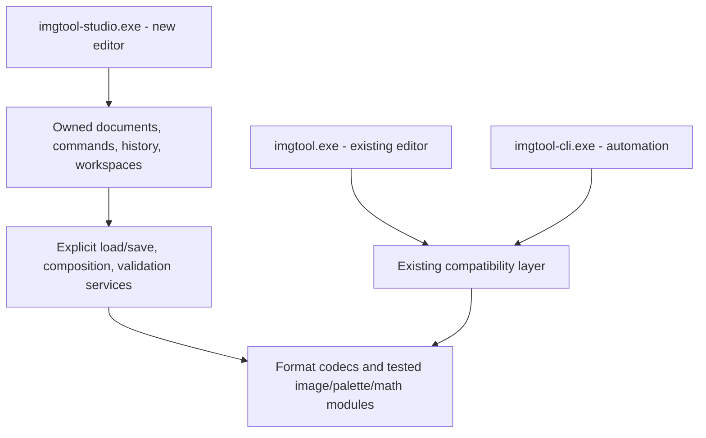

# Imgtool redesign assessment

2026-10-11 · source baseline `eab8366` · branch `feature/bddtool-style`

**Recommendation: retain the format knowledge and tested editing algorithms; build a separate editor application with new document ownership, command handling, and UI.** Keep `imgtool.exe` as the existing editor. Add `imgtool-studio.exe` as a separate target when implementation begins. Retain `imgtool-cli.exe` for automation. A full format/algorithm rewrite would discard valuable compatibility work. A theme or panel rearrangement would preserve the state and workflow problems described below.

This records the investigation made before implementation. The abandoned red-theme edits were reverted. The isolated `build-ui-audit` build contains the restored classic application. The earlier `build-bdd-style` executable is an obsolete experiment, not the fork.

**Implementation checkpoint (2026-10-11):** the first separate `imgtool-studio` target now lives in `platform/studio`. It reuses format/math code behind a scoped adapter, owns each library and its history, and provides an artwork workspace with red accents. Classic's overlay is not part of that target. See the [README preview section](README.md#studio-preview-separate-application) for build instructions, supported workflows, and limits. The broader migration below remains a roadmap, not a claim of implemented parity.

**Animation/alignment checkpoint:** Studio now has name-inferred sequence groups,
numeric frame order, multipart reconstruction, a timeline with per-frame preview
ticks, fixed World View, onion skin, normal/flipped/both facing previews, a floor
guide, reference sprites from open libraries, and undoable primary-anchor dragging.
The model has separate tests for grouping, playback, placement and whole-frame
anchor changes. Hidden UI checks exercise real pointer and keyboard gestures at
both window sizes. Preview settings do not alter IMG sequence data. The project
checkpoint below completes the authored composition part of Slice 2. The embedded
checkpoint adds stored sequence playback/editing; ASM and script runtime remain outstanding.

**Everyday editing checkpoint:** new libraries and sprites, rename/duplicate/delete,
reordering, resize/canvas-size/trim/rotate/flip, palette assignment/isolation, and
PNG import/export are implemented. History now owns complete sprite/palette
records, pixel and baseline buffers, points/alternate palettes, sequence bytes,
stable identities and selection. Reordering remaps sequence image indices while
leaving script indices untouched; deletion reports embedded references. PNG
quantization is shared with classic through a bounded memory adapter. Additional
tests cover structural/geometry history, reference remapping, Unicode PNG paths,
opaque black/transparency and metadata round-trips; hidden UI checks exercise
duplicate/undo/redo and applying/undoing the resize dialog. ASM animation,
legacy imports and additional paint tools,
batch operations and game-pipeline exports remain pending.

**LOD loading checkpoint (2026-10-13):** `studio_lod.{h,cpp}` and its owned
review dialog load references into separate tabs. Unicode/BOM/quotes/comments,
manifest-relative/as-written/IMGDIR resolution and forced basename overrides
are supported. PPP is per occurrence and carries forward, defaulting to LOAD2's
0 (auto). Duplicate paths are reported and open once; open tabs retain their
current PPP and unsaved state. Missing/invalid rows must be fixed or explicitly
excluded. Manifest bytes and every selected Artwork disk baseline are rechecked
before any tabs are installed. Staged libraries are independent of classic/global
state; opening cancels no dirty document. Other directives remain visible but do
not run a packing/build/export or subset selection. Review limits: 1 MiB manifest,
128 rows, 64 MiB per IMG, 128 MiB accepted sprite/baseline pixels. Larger direct
IMG loading remains available. File picker, drop, recent and CLI paths dispatch
through the same review; non-Windows path entry remains supported. Tab activation
now retains the requested document while ImGui applies its queued selection.

55/55 CTest suites pass. LOD tests cover per-file/default/auto PPP, Unicode and
mixed separators, duplicate/conflicting PPP, unresolved/invalid rows, folder
priority/override/fallback, changed manifest/library rejection, bounds/syntax,
and preservation of open dirty artwork/global packing state. Read-only CAVEYES,
BOSSHAM and FLAPJACK LOD fixtures pass. Hidden mouse checks at both sizes cover
Cancel/Escape, selecting/excluding rows, opening/reusing dirty tabs, source changes
and rebuild/failure. Home/tools/project/anchor checks also pass. TBL/IRW/ANILST
exports and remaining legacy/specialist workflows are still outstanding.

**Startup diagnostics (2026-10-13):** the user reported Studio crashing while
launching. Current and older workspace executables stayed running in local checks;
the exact failing launch path was requested and has not yet been supplied. The
current build rendered with existing user preferences using both Direct3D and
software, then closed through WM_CLOSE with exit 0. The user's specific failure
is not confirmed resolved. `launch-studio.{bat,ps1}` targets the current build,
checks required SDL2.dll, and offers `-SoftwareRenderer`. `--software-renderer`
explicitly bypasses accelerated renderer initialization. App state lives on the
heap; startup logging records stages, renderer, exceptions and initialization
errors, with error dialogs for normal launches. A forced unavailable SDL video
driver returned 1 and logged the precise reason in a quiet smoke launch. No
user preferences were deleted. The next failing startup.log should guide a
specific fix, rather than assuming the report was caused by an obsolete binary.

Startup memory follow-up: the user clarified a Windows memory-error message,
but its application name and wording are still unknown. A separate MSVC
AddressSanitizer build passes document/project/LOD model tests and hidden home,
tool-rail, LOD, project and editing checks. The current standard build remains
unchanged. An earlier direct LOD test run did have a memory fault after a malformed
test BOM caused planning failure; that test fixture and its failure guard were
fixed before the final 55/55 result. Its Windows dialog could explain the report
if titled `studio_lod_test.exe`; that identity is unconfirmed and was requested.
No matching Studio crash event was found. Do not equate clean tested paths or
ample current system memory with resolution of an intermittent user failure.

**Batch restoration checkpoint (2026-10-13):** Sprite > Restore child sprites
adds an owned parent-to-child review in the current library, using existing stable
marks, shown search results or all sprites. Name rules use one parent-name capture
(default `^(.+)[A-Z]$`), full ASCII-case-insensitive matching, and explicit missing/
ambiguous-parent results. Short regex rules allow classes/simple wildcards while
excluding counted/repeated-group constructs; invalid rules leave the IMG intact.
One parent provides a searchable picker with dimensions and library position.

Reconstruct applies the parent-nonzero AND child-nonzero guard, preserving both
silhouettes. Diff copies parent indices changed since load, including zero, and
requires a valid baseline with the current dimensions; this prevents the classic
current-stride/old-baseline overread after resize. Replace clears visible child
pixels and copies overlap. Fill changes only child transparency. All modes require
the same primary palette; no implicit index reinterpretation crosses palettes.
Sampling uses parent.anchor - child.anchor, matching existing restoration math.

The review reports coverage, exact changes/additions/erasures and skipped reasons.
Partial pairs start unchecked; changes to settings reset their inclusion. Before/
After renders owned results with optional change/erasure tint; Parent context
shows child bounds and uncovered areas. A short table expands after several rows,
leaving room for the art. Build preview is explicit, and stale sources/settings
block Apply. Whole child sprites are affected; canvas masks remain view state.

All parent pixels are frozen, including parent-as-child chains. Apply re-derives
and compares every source snapshot/result, rejecting stale/foreign/tampered plans
and unfinished prior edits, then allocates every replacement before one history
command. No-op batches do not create history. Geometry, anchors, palettes, load
baselines, points/alternate tables, raw-name tails, padding and embedded references
remain unchanged. Closed reviews release their snapshots and textures. Classic
restoration code is unchanged; cross-library and cross-palette force restore remain
outside this slice.

All three x64 Release targets build; **54/54 CTest suites pass**. New tests cover
four mode outputs, opaque-black/transparency semantics, anchor offsets, partial/
zero overlap, palettes, missing/resized/mutated baselines, name rules/errors/
ambiguity, frozen chains/order, inclusion/no-op history, stale/foreign/tampered/
pending plans, metadata and save/undo exact bytes. CAGE1/KITANA11/PURPRAIN temporary
batch round-trips undo to exact saved bytes. Hidden checks at both window sizes
cover row inclusion, three views/change toggle, Apply/Undo/Redo/save, Diff/Replace
menus, explicit rebuild, chosen parent, partial guards, Cancel/Escape, invalid regex
and stale blocking. Batch/tool/wheel/repair/filter/paint/clone/variant/selection/
floating/regions/palette/editing/anchor regressions pass. LOD and TBL/IRW/ANILST
pipeline exports and specialist workflows remain.

**Batch geometry checkpoint (2026-10-13):** library checkboxes and a Marks
menu introduce per-library batch membership, separate from active sprite and
canvas selection. Stable-ID marks survive reorder/history restores; absent IDs
are omitted from counts and recover on Undo. They remain session view state and
do not alter IMG flag bits. Batch... / Sprite > Batch geometry opens a review for
Marked, Shown by search, or All sprites in one library.

The planner reuses existing trim/resize/canvas/transform commands on isolated
single-sprite scratch documents. Resize supports percent or exact size, nearest
or palette-aware smooth sampling and anchor/point scaling. Canvas has nine
placements and visible-pixel crop counts. Rotations/flips retain existing anchor
conventions and optional anchor/point transforms. Empty trims keep their canvas.
Before/After previews use one world anchor target, with per-row dimensions,
primary anchor changes and secondary/point tooltips. Rows can be excluded.
Controls finish editing before regenerating the preview; pending settings and
stale sources disable Apply. Preview and live decoded-pixel limits are enforced.

Apply re-derives every reviewed result against the unchanged owner/generation,
source fields/pixels/points/palette, then allocates every replacement buffer
before opening history. It refuses unfinished prior edits. All enabled changes
commit once; no-ops retain padding/history. Palettes, baselines, secondary Z,
alternate tables, raw-name tails, flags and embedded references remain intact.
Structural synchronization refreshes artwork previews after Apply/Undo. Cancel
and Escape discard the review, and classic code is unchanged.

All three x64 Release targets build; **53/53 CTest suites pass**. New tests cover
preview isolation, trim/empty/no-op behavior, percentage/exact/smooth resize,
canvas offsets/crops, rotation/flip anchor/point results, row exclusion, all-or-
nothing invalid plans, stale/foreign/pending sources, metadata/baselines/references,
history/save/reopen and exact undo bytes for CAGE1/KITANA11/PURPRAIN fixtures.
Hidden batch checks pass at both sizes: native marks, active/pixel scope separation,
row exclusion, before/after, Apply/Undo/Redo/save, operation/scope menus, Cancel/
Escape and stale-source blocking. Tool/wheel, repair/filter/paint/clone/variant/
selection/floating/regions/palette/editing/anchor UI regressions pass.
Batch restoration, LOD/export pipelines and specialist workflows remain.

**Healing/defringe checkpoint (2026-10-13):** Heal (J) and Defringe (F) bring
the rail to 18 tools. They reuse round/square radius, brush cursor and bracket
shortcuts. Heal diffuses selected opaque rim colors into the accumulated brush
coverage, recomputing from a frozen source each update. Fill depth controls
synchronous waves; a frontier avoids the classic quadratic region lookup.
Unreachable cells retain their original pixels instead of leaving holes.

Defringe classifies an eight-connected 1-4 pixel outline band, including canvas
borders, then diffuses clean interior colors outward. Brushing limits writes;
Clean all/selected edges cleans the full scope in one step. Thin regions without
an interior remain unchanged. Both tools match fractional RGB555 color averages
to existing opaque entries, with current indices winning ties. Transparency,
palette words/depth, sprite geometry and metadata remain intact. Selection
limits reads and writes, but selection boundaries do not define sprite edges.

Smart erase now stages matching erasure and optional edge cleanup together;
Clean erased edges defaults on. It samples original non-killed neighbors outside
the matching color range, inside selection, then picks a neighboring color near
their RGB mean. It cannot invent palette entries or erase additional pixels.
Disabling cleanup retains plain matching erase. Clicking transparency is a no-op.

Owned repair state checks owner/generation/stable ID, live pixels/palette,
coverage/shape/dimensions/indices and silhouette before writes. Actual changes
open history; release groups a gesture; Escape restores pixels and keeps the
mask. No classic paint or game asset changes. The compact wheel reserves less
unused space so the added tool row keeps a usable picker at minimum width.

All three x64 Release targets build and **52/52 CTest suites pass**. Independent
repair tests cover RGB means/aliases, depth and unreachable areas, frozen fast/
segmented strokes, transparency and excluded sampling, edge bands/thin features,
cleanup on/off/connectivity, malformed/stale/foreign snapshots, clipped extreme
paths, history/cancel, metadata/padding/baseline/reference preservation and save.
Temporary CAGE1/KITANA11/PURPRAIN repairs undo to exact saved bytes. Hidden checks
at both sizes cover native toolbar/inspector buttons, J/F shortcuts, fast brushes,
mask holes, Undo/Redo/Escape/save and the cleanup checkbox. Existing tools/wheel,
filters/paint/clone/variant/selection/floating/palette/editing/anchor checks pass.
Batch/pipeline and specialist animation/game-source workflows remain.

**Blur/smudge checkpoint (2026-10-13):** Blur (O) and Smudge (S) add two
working tools to the left rail, with inspector Strength, round/square radius,
brush cursors and bracket shortcuts. Bare O/S select tools; Ctrl+O/Ctrl+S retain
their file commands. Both blend actual RGB555 colors and select existing opaque
palette entries, retaining palette size/words/depth, transparency and silhouette.
The active selection limits both reads and writes, so excluded pixels cannot
bleed into a selected region. Sparse palettes may limit the visible effect.

Blur samples a frozen source and visits each covered pixel once per gesture;
another stroke builds up the effect. Smudge processes a bounded pixel-unit path,
using the preceding position and staged stamp writes to carry paint without
within-stamp feedback. Transparency and excluded gaps break the carry. Fractional
color means survive until nearest matching; destination indices win exact ties,
preserving duplicate-color aliases and avoiding rounding-induced oscillation.
Smudge lazily caches index-pair results; exact RGB555 matching is also cached.

Owned snapshots check dimensions, mask, indices, owner, generation, stable sprite
ID and matching live pixels/palette before writes. Only actual changes open
history. Release commits one gesture; Escape restores pixels and keeps selection.
Padding, load baselines, raw-name tails, anchors/points/alternate palettes and
embedded records remain intact. No classic paint implementation changed.

All three x64 Release targets build; **51/51 CTest suites pass**. Independent
color expectations cover fractional averages, strength, aliases, frozen passes,
fast/segmented carry, gaps, masks, footprints and extreme clipped paths. Tests
also cover invalid/stale/foreign snapshots, history/cancel, padding/metadata and
save/reopen; temporary CAGE1/KITANA11/PURPRAIN edits undo to exact saved bytes.
Hidden filter checks at 1440x900 and 1000x680 exercise icon clicks, O/S/bracket
shortcuts, fast drags, masks/transparency, grouped history, Escape and save/reopen.
Toolbar/wheel, paint/clone/variant/selection/floating/palette/editing/anchor UI
regressions pass. Healing/defringe and batch/pipeline workflows remain.

**Side-toolbar/color-wheel restoration (2026-10-13):** the user identified the
Photoshop-style left toolbar and wheel as essential missing editor controls.
Studio now places all 14 migrated tools in a two-column icon rail using the
existing Material Symbols family, red active state and explanatory shortcut
hover text. Pixel tools disable during alignment/embedded workspaces, flipped
preview or owned pixel previews. The current tool and Fit stay above the canvas;
that header reserves the same height during previews so gestures never shift.

The active indexed swatch, transparency toggle and visible hue/SV wheel sit below
the tools. Clicking the swatch or Edit opens RGB/HSV/hex controls. Edits quantize
through shared RGB555 math and update the library's palette entry; slot zero
stays locked. Per-tab float state avoids repeatedly feeding quantized values back
into a drag. Only changed words write; a complete drag commits one undo entry.
Escape/Undo cancels an unfinished gesture and preserves its selection mask.
Tab/sprite/swatch/history changes resynchronize ownership and color. Existing
palette assignment/isolation and the indexed swatch bar remain available.

CMake copies the existing icon font beside Studio, resolved relative to the exe;
missing glyphs/fonts use short labels. The four-column workspace keeps the rail
fixed and adjusts initial library/inspector widths at 1000x680. The old inspector
RGB sliders are replaced by the wheel and exact-value pop-out.
50/50 CTest suites pass. Hidden tool checks at both sizes exercise icon/hotkey
selection, hue drags, grouped history, locked transparency, toggle-back, Escape,
RGB pop-out, tab ownership and save/reopen. Related paint/clone/variant/selection/
floating/palette/editing/anchor regressions pass. Classic UI and source assets
remain unchanged. The rail contains implemented tools; blur/smudge/heal/defringe
and the rest of the migration still require their own workflows.

**Opening-screen refinement (2026-10-13):** replaced the full-height empty welcome
panel and edge-aligned content with a centered two-column home layout. Baked
32/20-pixel heading fonts keep title text sharp, and explicit gutters/padding
separate Open IMG, New library, Explore sample and Open Studio project actions.
The recent-files card adapts its height to the list and scrolls after four rows.
Each native selectable row shows filename, tail-preserving folder text, full-path
hover details and a file marker; identical filenames keep independent path IDs.
Unavailable entries are disabled and can be removed through their context menu,
without deleting files. Availability refreshes on home entry, list changes or Refresh.
Existing commands and native file dialogs handle all navigation.

A separate x64 Release build in `build-studio-welcome/build/Release` was used
while the user's Studio was running. After that window closed, the normal
`build-studio-motion/build/Release/imgtool-studio.exe` was rebuilt too. Hidden opening-screen captures pass at
1440x900 and 1000x680, including empty and ten-entry lists, long names and missing
files. Pointer checks exercise New library, Explore sample and opening a recent
library, returning to home after each. Core editing code is unchanged; all 50 CTest suites pass, along with hidden
paint, variant and structural-editing regression checks. Original assets and user settings were not
edited by the smoke runs, which use their own build-folder fixtures/preferences.

**Variant painting checkpoint (2026-10-13):** Variant (T) paints an owned preview
or reviews the active selection before applying. It recolors only the requested
opaque pixels in the target palette, using shadow indices that retain their
original words under every other library palette. Matching slots are reused;
otherwise globally unused slots are assigned. Current pixels and load baselines
reserve their indices, with baseline scans using their own dimensions after
geometry edits. Missing alternate entries use black. Transparency and selection
holes remain intact; original swatches and baseline buffers are retained.

The inspector reports changed pixels, assigned/reused slots, palette edits/growth,
and newly crossed LOAD2 PPP color limits. Show original and alternate-palette
preview compare appearances without editing the document. Release opens the
review; Apply/Enter commits pixels and palette updates together, one undo step.
Escape/Cancel/Undo discards the preview. No available slots blocks the complete
edit. Apply re-captures the source and checks owner, generation, stable sprite ID,
exact pixels/palette words/depths/used indices, then validates the reviewed plan.
All replacement buffers are allocated before history opens. Growth raises depth
as needed, while preserving palette/sprite metadata, padding, raw names, embedded
records and references. The minimum-width tool shelf now wraps Fit using its
actual width so adding Variant does not force a spare third row.

All three Release targets build; **50/50 CTest suites pass**. New tests exercise
alternate appearance preservation, slot allocation/reuse/exhaustion, masked
coverage/transparency, absent alternate colors, palette growth/PPP/depth, baselines
after geometry changes, stale/foreign/tampered plans, no-ops and metadata/history/
save. Temporary CAGE1/KITANA11/PURPRAIN edits and undo restore exact saved bytes.
Hidden checks at both sizes cover brush preview, selection review, Apply/Enter,
Cancel/Escape/Undo, redo/save, original/alternate previews and source invalidation.
Clone/paint/selection/floating/palette/editing/anchor regression checks pass.
Blur/smudge/heal/defringe and batch/pipeline workflows remain.

**Clone painting checkpoint (2026-10-12):** Clone (C) adds Alt-click source
placement and visible source/offset markers to the Artwork workspace. Aligned
strokes retain the offset; unaligned strokes restart at the source. Transparent
source pixels skip by default, with an explicit option to copy them as erasure.
One frozen indexed source and destination selection per stroke prevent overlap
feedback and protect selection holes; sampling may read outside the destination
mask. Paint and clone share bounded interpolation and round/square footprints.
Release groups the gesture into one history step; Escape restores the pixels and
preserves the selection. Sprite/dimension changes clear the source, and generation,
owner, stable ID and palette checks reject unavailable snapshots. Clone keeps
geometry, anchors, points, raw-name tails, padding and palette words intact.
This slice samples within one sprite; cross-sprite transfers remain clipboard based.

All three Release targets build and **49/49 CTest suites pass**. New tests cover
overlap and repeated stamps, masked source/destination, transparency, padding,
footprints, extreme endpoints/offsets, no-ops, invalid/stale/foreign snapshots,
history/cancel and save/reopen. CAGE1/KITANA11/PURPRAIN temporary edits and undo
restore exact bytes. Hidden clone checks pass at both sizes, testing real Alt-click,
fast strokes, mask holes, aligned/restarted offsets, Escape, undo/redo/save,
sprite switches and Ctrl+C routing. Paint/selection/floating/editing/anchor
regressions pass. Variant/blur/smudge/heal/defringe and batch/pipeline work remain.

**Masked editing checkpoint (2026-10-12):** rectangle/wand/lasso selections now
support replace, add, subtract, intersect, invert, select all and select artwork.
Wand uses the tested palette-color tolerance math and separates transparency from
opaque black, with connected/global modes. Lasso fills pixel centers by even/odd
scanline crossings. The canvas draws mask boundaries; the inspector exposes scope.
Painting, erasing and connected fill stay within selected pixels. Copy/cut/clear
respect holes; clipboard coverage distinguishes selected transparent pixels from
unselected areas. Masked paste clears covered transparency, shown tinted in its
placement preview; unselected holes retain destination artwork. Plain whole-sprite
copy keeps its transparent-overlay behavior. Alt+arrows nudges pixels without
changing anchors, with strict canvas bounds and one undo step. Escape cancels an
unfinished selection gesture back to its previous selection. Selection shapes are
session view state, independent of IMG pixel history.

All three Release targets build, **45/45 CTest suites pass**, and hidden gesture
checks pass at 1440x900 and 1000x680. Tests cover padded rows, duplicate palette
colors, tolerance/transparency, connectivity, polygons/holes, scoped painting/fill,
masked clipboard color mapping, overlap moves, no-op/invalid/stale commands,
undo/redo and save/reopen. Edits and undo on temporary CAGE1, KITANA11 and PURPRAIN
copies restore exact bytes. Floating move/transform, region/body extraction and
batch/pipeline work remain pending.

**Region extraction checkpoint (2026-10-12):** Studio now reviews selected shapes
or heuristic body-part boxes as child sprites. Enable/disable parts, edit names and
bounds, drag boxes/corners, trim transparent borders, and inspect Source/Extracted
pixels/Remaining source before copying or cutting. Undetected arms start off with
editable boxes. Names are resolved before apply, with duplicate `_COPY` suffixes;
overlapping visible pixels are counted. Mask holes remain transparent in children
and source cuts use the same masks. Children share palettes/alternate palettes and
rebase primary anchors. New children have no secondary anchor, point table or frame
metadata; source metadata and embedded references stay on the source sprite.
All children are staged before appending/cutting, and one undo restores the whole
operation. Source owner/generation/identity and apply-time validation reject stale
or invalid plans. Existing game tables and animations are not rewritten.

**46/46 CTest suites pass**, including extraction coordinates/reconstruction,
masked holes, alternate-palette isolation, new-child defaults, source metadata,
stable IDs, embedded references, collisions/overlaps, invalid/foreign/stale plans,
anchor overflow, undo/redo and save/reopen. CAGE1/KITANA11/PURPRAIN temporary copies
round-trip after extraction and restore exact bytes after undo. Hidden dialog checks
at both sizes cover drag/cancel, cut/copy, preview, history and save/reopen; selection,
structural editing and embedded-animation regressions also pass. `build-studio.ps1`
successfully builds x64 Release in `build-studio-motion/build/Release` using pinned
SDL2 2.32.10 through the existing build script. Floating transforms, batch geometry/
restoration and pipeline/specialist workflows remain pending.

**Selection transform checkpoint (2026-10-12):** Move (V), Ctrl+T and contextual
Move / transform start an owned floating preview from selected pixels. Drag to move,
drag corners to resize, edit numeric position/size, flip, rotate by quarter-turns,
reset, fit to canvas or duplicate. The canvas shows the complete composed result,
including covered transparency and overlap with the remaining source. Palette
indices and masks use pixel-center nearest sampling from frozen source pixels on
every change, preventing progressive resampling. Mask holes never overwrite the
destination. Enter/Apply commits one pixel-history step; Escape/Cancel/Ctrl+Z discards
the preview and retains existing history. Arrows move the preview without browsing
sprites. Anchors, point tables, alternate palettes, geometry, raw names, baselines
and embedded metadata remain unchanged. Apply revalidates source identity,
generation and exact frozen pixels/palette against the live sprite. Stale source or
workspace changes cancel the preview. Invalid dimensions/placement cannot apply.
Preview textures retire after the queued canvas render; apply/cancel controls sit
at the top of the inspector so they remain visible in the minimum window size.

All three x64 Release targets build and **47/47 CTest suites pass**. Tests cover
every rotation/flip combination, masked/transparent pixels, move/copy/overlap,
original-based scaling, degenerate masks, invalid/stale/foreign snapshots,
metadata/padding/embedded-reference preservation, history and save/reopen. Temporary
CAGE1/KITANA11/PURPRAIN edits/undo restore exact bytes. Hidden checks at both sizes
cover real drag/resize, flip/rotation/duplicate controls, apply/cancel, keyboard
history, source-change cancellation, invalid placement and save/reopen. Clipboard
paste retains its own placement flow; arbitrary-angle rotation and smooth selection
sampling are not implemented. More paint tools, batch edits and pipeline work remain.

**Paint checkpoint (2026-10-12):** round/square brushes now share bounded Bresenham
stroke interpolation across pencil, erase and replacement. Line (K) owns a frozen
source/selection/palette preview; Shift snaps eight directions, release applies one
undo step, and Escape/Undo cancels without changing artwork. Invalid/foreign/stale
snapshots cannot apply. Endpoint clipping bounds work even for extreme coordinates.
Replace (B) holds its source index for the full stroke, or replaces all matching
pixels on a click. Fill (G) and Smart erase (U) expose connected/global matching.
Exact index is the default; optional palette-color tolerance matches duplicate and
nearby RGB555 colors while keeping transparency separate from opaque black. Color
matches are cached per palette slot. Selection holes clip writes and traversal, so
connected fills cannot cross excluded areas. Shared palette words and sprite
metadata are retained. Bracket keys resize the brush; the cursor shows its footprint.
Escape now cancels artwork gestures/previews with held modifiers such as Shift.

All three x64 Release binaries build; **48/48 CTest suites pass**. Paint tests cover
lines/clipping/padding, round/square footprints, exact/alias/tolerant matching,
transparency boundaries, disconnected masks, seed-equals-output fills, locked
replacement source, no-op/invalid/stale plans, metadata/history and save/reopen.
CAGE1/KITANA11/PURPRAIN temporary line/save/undo checks restore exact bytes. Hidden
paint checks at both window sizes cover snapping/cancel/release, fast replacement,
global fill/erase, selection holes, square brush/brackets, history/save and stale
source cancellation. Floating selection, masked editing, extraction, palette,
embedded and anchor regressions also pass. Variant/clone, blur/smudge/healing and
eraser defringing remain pending, along with batch/pipeline/specialist work.

**Project checkpoint:** native `.ISTUDIO` documents now own scene placement,
playfield/background settings, actor lanes, cross-file/multipart frame references,
timing, facing and a separate saved revision/history. Project gestures never edit
IMG anchors. The inspector authors frame/lane lists; playback and PNG export use
one evaluator. Sources bind by stable runtime IDs and saved raw-name identity,
with file fingerprints disambiguating duplicate names. Loads stage dependencies
before installation, missing sources can be relocated, source tabs cannot close
while a project or its history uses them, and failed/cancelled saves leave close
or quit pending. Only used sources are serialized, while undo retains its earlier
bindings. Referenced IMG files must be saved before project saving.

Classic WAX import supports explicit sprite rows and converts anipoint-space
offsets to screen placement with the correct per-frame flips. It retains timing,
cross-file references, depth order, row opacity and solid background. Generator
defaults are distinguished from active animation rules. Active motion/visibility
schedules and second copies are covered by the motion checkpoint below. Uniform
spawn rows are covered by the effect checkpoint. Substituted entries,
magnification, ASM and embedded sequences are rejected explicitly. The original WAX is never overwritten by a
Studio save. Derived game placement and settings absent from WAX are not inferred.
Background BDD references and game-source exports remain later work.

Validation: x64 Release builds of classic, CLI and Studio; **33/33 CTest suites**;
project codec/history/dependency/save-failure checks and PNG samples under both
mirror conventions; hidden Studio checks for scene drag/undo/redo/cancel, cross-file
lanes, save/reopen, missing-file staging, source-close protection and quit cancellation
at 1440×900 and 1000×680. SHADOWKICK and BACKWARDSPLIT WAX rows were loaded from
read-only local fixtures, converted/reopened in a temporary folder and exported.
Complex WAX files report unsupported rules. Real CAGE1, KITANA11 and PURPRAIN IMG
round trips also pass; no original game assets were changed. These checks do not
establish complete classic WAX parity or in-game runtime fidelity.

**Motion/timing checkpoint:** Studio now evaluates inclusive Show/exclusive Hide
windows, overlapping scheduled entries, velocity with per-axis travel limits,
per-actor freeze ticks and second sprite copies with independent offset/depth.
Classic's current-entry ordering and motion accumulation across actor loops are
preserved. WAX motion is converted through the final per-entry facing; signed
anipoint bounds and large tick arithmetic are covered by tests. Native version 2
stores these rules, while version 1 projects still load with their original
disabled defaults. Older Studio builds reject version 2 instead of simplifying it.
The inspector keeps these controls under Motion & timing. Frame replacement
preserves the existing timing and placement; scheduled thumbnails seek to their
Show tick; non-looping playback reaches the exclusive Hide boundary before stopping.

Validation for this checkpoint: isolated x64 Release build in `build-studio-motion`
for both GUIs, CLI and tests; **34/34 CTest suites**; motion/schedule/depth/PNG,
history, file-version and WAX conversion fixtures; hidden UI checks for editing a
Show tick, undo/redo, replacing artwork, save/reopen and end-of-scene playback.
The 77 local WAX files were checked read-only; 22 contain importable stored row
rules, and 17 of those had all dependencies available for conversion/reopen/export
checks. Missing sources and unsupported rules are reported. This is not full WAX
or game-runtime parity.

**Effect binding checkpoint (2026-10-12):** Follow frame timing connects an effect
actor to a stable composition frame identity. Reordering/renaming frames and
actor rows preserves the binding; retiming a source changes the derived start
without mutating the effect schedule or creating playback history. Chained effects
resolve immediately. Cycles and missing source references are rejected, and source
frame/actor deletion is protected. Detach preserves the current evaluated start.
Timing follows the source's authored first frame tick, independently of its
visibility, freeze clock or position, matching the scope of classic's spawn rules.

Native version 3 preserves actor/frame identities and bindings; versions 1 and 2
load with independent clocks. Uniform WAX spawn schedules are converted to local
windows with a stable source binding. Moved/custom schedules or a spawn row with
a freeze tick still report an explicit import limitation. These are stricter
checks than classic's automatic detachment, which avoids silently dropping a link.

Validation: both GUIs, CLI and tests build in x64 Release; **35/35 CTest suites**.
New fixtures cover retiming, frame and lane reorder, chained effects, cycles,
missing/duplicate identities, detach/undo, native version compatibility, WAX spawn
conversion and exported pixels around a trigger tick. Hidden UI checks at both
window sizes exercise Follow/Detach, undo/redo, source retiming/reorder, deletion
protection, duplication and save/reopen; existing motion, project, anchor and
editing checks also pass. Original game assets remain read-only. ASM, script
runtime and other specialist workflows remain future migration work.

**Embedded animation checkpoint (2026-10-12):** IMG animations is a separate
workspace for owned SEQSCR records. It lists sequences/scripts, shows sequences
in reversed disk playback order, and supports record creation/rename plus entry
target/ticks/offset edits, insertion, duplication, reordering and deletion.
Script calls retain forward order and link to their called sequence preview;
the UI explicitly does not claim script runtime execution. Thumbnail playback,
scrubbing and flip preview are view operations. Edits use the IMG's history/save
boundary; history now retains sequence/script counts as well as the blob.

Record kind comes from the sequence/script counts, because some classic-created
sequences have zero flags. Sprite reorder remapping follows that distinction.
Headers, damage references, raw names on untouched records and opaque entry
bytes survive edits; entry metadata moves with the entry. Malformed/trailing
data disables embedded editing. New sequences append within the sequence block,
keeping existing sequence and script-local indices valid. Record removal and
advanced header editing remain pending.

Sequence snapshots retain playback order, exact holds, anipoint-space offsets
and facing in a separate scene. Both mirror conventions are checked. Stored
ticks remain 0–255; zero is previewed for one tick without rewriting its byte.
Native projects read versions 1–4 and use version 4 only for holds above 120,
so old builds reject those projects rather than clipping their durations.
WAX rows driven by embedded records, ASM, and full script playback are still
outside this migration slice.

Validation: x64 Release classic/CLI/Studio build; **36/36 CTest suites**.
The new suite covers byte preservation, reverse sequence/forward script order,
zero/255 ticks, malformed data, opaque entry reordering, count history, reference
remapping, damage/header preservation and scene version/mirror compatibility.
CAGE1 (4 sequences/5 scripts), KITANA11 (9/10) and PURPRAIN (5/5) were decoded,
edited, saved/reopened and undone in temporary copies; originals stayed read-only.
Hidden UI checks at 1440×900 and 1000×680 cover real duplicate/undo/redo and
script-to-sequence clicks, playback, new-record count history, save/reopen and
snapshot creation. Existing project, motion, effect, anchor and editing checks pass.

**Palette workflow checkpoint (2026-10-12):** Palette manager adds a searchable
library list, creation/rename/duplication, a separate cross-file color clipboard,
PAL/ACT import/export, explicit sprite assignment and palette isolation. Browsing
does not change a sprite's palette. Duplicate retains palette metadata; pasting
or importing creates a new palette from color words. New names avoid collisions.
Unused-palette removal remaps primary indices and signed-byte alternate references
in their original disk namespace (three default palettes), respecting terminators
and preserving trailing bytes. Unresolved alternate references block removal.

Color selection supports single, Ctrl-toggle, Shift-range, all opaque and colors
used by a preview sprite. RGB555 and HSL adjustments stage in owned buffers and
render into independent before/after textures. No IMG/history mutation occurs
until Apply; Reset and Close discard the preview. Applying checks its baseline
and creates one artwork history entry while preserving index zero, untouched
words, declared packing depth and metadata. Selection survives Apply/Reset.
Palette assignment explicitly chooses color matching or retaining pixel indices;
the color preview uses the existing indices. Matching to a palette with no opaque
color is rejected rather than making opaque pixels transparent.

Raw PAL preserves all word bits; ACT converts RGB555 to/from RGB triples and
supports its optional big-endian color-count/footer. Nonzero ACT transparency
tags are reported as unsupported. Exports use a temporary sibling and atomic
replacement with failure reporting. Classic's palette UI and codecs are unchanged.
The merge checkpoint below adds reviewed, single-source palette merging and growth.
General palette-size changes and material/ramp workflows remain
later migration work.

Validation: x64 Release classic, CLI and Studio; **37/37 CTest suites**. New tests
cover staged HSL scope, transparency/opaque black, metadata and history, copy to
another owned document, primary/alternate index remapping, malformed files,
PAL/ACT count variants, Unicode paths and failed exports. CAGE1, KITANA11 and
PURPRAIN palette edits save/reopen/undo in temporary copies with restored-byte
checks. Hidden UI checks at both sizes exercise real swatch/slider/button input,
Reset/Apply/Undo, cross-library copy/paste, explicit assignment, save/reopen and
discarding a pending preview. Existing artwork, animation and project checks pass.

**Palette merge checkpoint (2026-10-12):** Merge palettes in the manager reviews
a single source against the selected destination. A cached, document-bound plan
records used slots, exact/approximate mappings, changed indices, changed RGB pixels,
palette growth/depth and new PPP-limit crossings for source and existing target
sprites. Growth adds only used source colors and caps at 256; existing destination
indices never move. Nearest matching reuses pure palette math with the optional
perceptual distance. Opaque black never maps to transparent slot zero.

Before/after textures use the planned pixel remap. Apply recalculates from the
current document/options rather than trusting an editable mapping, rejects stale
or foreign previews, and requires explicit approximation authorization when used
pixels lose color accuracy. No preview operation changes IMG data or history.
One undo restores sprite assignments/pixels, target words/count/depth, metadata
and optional source removal. Original pixel padding, geometry, anchors, raw names,
point tables, source palettes and pristine packing baselines are retained.

This pass merges eligible primary sprites. Source sprites with active alternate
palettes are excluded and counted; source colors stay available for them and for
other sprites' alternate references. Removal is blocked until every source
reference is gone, and unresolved alternate indices block removal. Existing
destination alternate palettes remain valid because their old slots do not move.
Crossing a PPP color limit is advisory and visible; exact color preservation is
not a claim of unchanged LOAD2 allocation. Multi-source merges, alternate-aware
joint remapping and general palette resizing remain pending. Compaction follows
in the checkpoint below.

Validation: all three binaries build in x64 Release; **38/38 CTest suites**.
The new suite covers exact and approximate colors, opaque black/transparency,
used-only growth, 256-slot overflow, perceptual matching, actual RGBA versus preview,
PPP findings, zero-shape/baseline preservation, padding/metadata/history, stale
previews, source removal/index shifts, and skipped alternate sprites/references.
CAGE1, KITANA11 and PURPRAIN eligible palettes merged into exact copies, saved,
reopened and undone to byte-identical temporary files; game originals were read-only.
Hidden UI checks at both sizes exercise real merge/growth/approximation/apply input,
one-step undo/redo with source removal, save/reopen, and packing-limit findings.
The existing palette, artwork, embedded animation and project UI checks pass.

**Palette usage/compaction checkpoint (2026-10-12):** Usage / compact adds a
cached histogram of primary and alternate pixel references, exact before/after
preview, unused-slot/removal counts, index changes and PPP/depth effects. It packs
used colors in their original order or trims only the unused tail. Used duplicate
colors stay separate, slot zero retains its word and transparency, and opaque black
stays opaque. Declared bit depth is preserved by default; recomputation is explicit.

Alternate-palette references and primary sprites with active alternate tables pin
the palette's indices. Those palettes trim only a proven-unused tail, counting
every referenced sprite's indices, instead of performing an incomplete joint
remap. Unresolved color indices block compaction. Apply rechecks the document-bound
plan, records one IMG history step and preserves padding, baselines, geometry,
anchors, names, palette metadata and alternate tables. Stale/foreign previews are
rejected; an unchanged plan creates no revision. Preview/cancel never writes data.

Validation: all binaries build in x64 Release; **39/39 CTest suites**. New tests
cover primary/alternate usage, index locking/terminators, opaque black and raw-word
preservation, gaps versus tails, declared depth, PPP effects, padding/baselines and
metadata, no-op/stale plans, history, unused/transparent-only palettes, exact RGBA
and save/reopen. Temporary CAGE1, KITANA11 and PURPRAIN compaction/save/reopen/undo
checks restore exact original bytes. Hidden checks at both sizes exercise usage,
packing/depth options, cancel, apply/undo and save/reopen; existing Studio UI checks
also pass. Original game files and the classic interface remain unchanged.

**Background digitize checkpoint (2026-10-12):** source loading, matte rebuilding,
material fitting and later-frame reseeding now run in owned cancellable jobs.
Starting moves the current review into an immutable input snapshot, avoiding a
large copy on the UI thread; a worker copies/constructs its private output. Palette
matching receives copied words and never reads a live Artwork. The previous
source/matte/material/result previews and frame slider remain available while
editing is gated. Stage/frame progress, Cancel processing and Close review keep
the window responsive. Cancel/failure restores input buffers and flags; results
require matching owner, library generation and review epoch before installation.
Quit cancels and joins workers before renderer teardown.

Cancellation is checked between source files, matte stages, material/frame passes
and Lloyd iterations. Classic pure fitter calls keep their defaults. Matte rebuild
moves source RGBA into the new work only after complete success, avoiding an
extra source copy and preserving input on cancellation. Manual later masks and
tint/index behavior survive fitting. The fallback picker now accepts multiple
source paths. Final IMG import remains the existing one-undo command.

Validation: all three x64 Release targets build; **44/44 CTest suites pass**.
Worker tests compare matte/fitted output with the synchronous algorithms, including
source alpha, manual later masks and tint; test copied target words despite live
palette edits; reject foreign/stale epochs/generations/cancelled jobs; exercise
load failures and Unicode input, cancellation boundaries and Lloyd interruption.
Hidden digitize and video handoff checks now wait for actual jobs. A 24-frame
768x768 source fixture verifies visible progress, usable preview, real mouse cancel
and exact restoration of library generation/counts. Larger paint/region and pipeline
workflows remain on the migration list.

**Video capture checkpoint (2026-10-12):** File menu and video drops now open an
owned frame grabber. Metadata, scaled preview and full-resolution crop capture run
on one cancellable worker; the UI never reads result buffers before completion.
Scrub/step/play, In/Out, every-N range, individual picks, I/O/P shortcuts, zoom/pan/
fit, rectangle crop, shared floor, deinterlace and source/fixed holds are exposed.
The floor retains source coordinates, including legitimate negative crop-local
coordinates. Source-time intervals round cumulatively to MK2 ticks (minimum one).
The last hold ends at the selected range's boundary or uses the last picked gap,
bounded by the source end. Captured frames feed the existing digitize session;
only its final import changes the library, in one undo command.

Optional decoder controls provide UTF-8/wide Windows child paths, cancellation
while waiting on pipe output, preview scaling, allocation bounds, exact odd crop
and explicit first-video-stream mapping. Classic call defaults remain unchanged.
Probe output/frame estimates are bounded; Studio limits captures to 2000 frames,
four million pixels each and 128 MiB total RGBA, using overflow-safe arithmetic.
Size/mtime checks guard source changes. Partial/mismatched captures are rejected
atomically. Workers time out after 30 seconds without decoded progress. Frame
positions still use average FPS; variable-rate hints/estimated counts are exposed.
Studio's MSVC sources now compile as UTF-8; an available CJK fallback font improves
filename display while retaining the primary UI face.

Validation: classic, CLI and Studio x64 Release build; **43/43 suites pass**.
The video suite tests range/picks/timing/crop/floor/limits, blocked probe/capture
cancellation, oversized PAM rejection before allocation, partial-output protection,
Unicode real FFmpeg paths, seek/preview, odd RGB and YUV420 crops, multi-track
consistency, source-change rejection and capture -> digitize -> save/reopen/undo.
Procedural footage and copied CLI helpers stay in temporary/hidden-check folders.
Hidden capture and result checks pass at 1440x900 and 1000x680, using actual zoom/
pan/fit/crop/floor/pick and seed/fit/apply gestures. They also verify original
artwork remains untouched until import and restores through history. Existing
Studio UI checks are retained. The background checkpoint above completes
asynchronous digitize processing.

**Digitize/material checkpoint (2026-10-12):** Studio now has an owned source
session for multiple PNG/raster files and decoded GIF frames, including different
source dimensions and retained GIF timing. It reuses pure `digitize_matte`,
`material_mask`, `palette_ramp` and `ramp_remap` modules without the classic wizard
or document globals. Source/matte/material/result views expose key sampling,
backdrop blend removal, despill, source alpha, alpha-weighted scaling, alpha cut,
erosion, material fill/brush/erase, inclusion/range selection, holds and a shared
source-space floor point. Rebuilding the matte resets masks but keeps materials.
Frame zero learns material colors; later frames classify by hue. Manual later
frame corrections survive refitting; explicit reseeding can replace them.

New palettes fit linear/Lloyd ramps automatically by measured population error
or by the chosen method, with per-material color budgets and tinting. Tint changes
output words, preserving luminance-based index choices. Existing palettes supply
detected or explicit ranges, with exact colors/indices retained. Palette overflow
is an error; incomplete opaque coverage prevents import unless transparent gaps
are explicitly accepted. Empty included silhouettes report an actionable error.
Matte/material/palette snapshots prevent reuse of stale fitting results. Cropped
anchors must fit signed 16-bit values. Final sprites/palette/optional sequence use
the same single-step batch command as sheet/GIF import; staging never edits IMG
data. Closed source sessions release their decoded buffers and textures.

Validation: classic, CLI and Studio x64 Release targets build; **42/42 suites**
pass. New tests cover matte/alpha, different frame sizes, automatic classification,
manual correction/reseeding, tint/index invariance, existing ranges/raw words,
incomplete coverage and explicit gap acceptance, scale/trim/floor registration,
timing, Unicode multi-file input/GIF handoff, invalid/stale settings, full palette
budgets and save/reopen/undo. Temporary CAGE1/KITANA11/PURPRAIN imports undo to exact
bytes. Hidden digitize checks at 1440x900 and 1000x680 exercise real key sampling,
matte rebuilding, two material seeds, fitting, floor placement, apply/cancel and
history/save. The video checkpoint above completes the capture handoff.

**Guided sheet/GIF import checkpoint (2026-10-12):** Studio now owns decoded
sources, batch previews and one-step history commands independently of classic.
Buffer adapters reuse sheet detection, sampled-border flood cleanup, quantization
and GIF blend modes. Cleanup samples outside tight sprite bounds so zero padding
does not mistake solid artwork for its border. Classic call paths are unchanged.
The review provides automatic/island detection or fixed full-cell grids, margins/
gaps/padding, trimming, individual/range/every-N selection, source rectangles and
indexed previews, playback, new shared/existing palettes, names, source-space
shared anchors and optional embedded sequences. Crops rebase anchors and preserve
GIF registration. Source delays round to MK2 ticks; absent delays use 100 ms;
holds above 255 split into repeated sequence entries in playback order.

The command allocates complete sprite/palette/sequence data before touching the
library. Owner/generation guards reject stale/foreign/review-only batches. Limits
cover encoded input, canvas size, total decoded RGBA/pixels, palette indices,
names and embedded entries. GIF block preflight bounds allocation and validates
descriptor coordinates before decoding. Existing records/raw metadata and script
sequence references survive appended records; old stable sprite IDs remain fixed.
Invalid source loads disable apply. Apply is disabled until settings are rebuilt;
cancel leaves artwork unchanged. Digitize/material fitting is covered above;
video capture is covered by the checkpoint above.

Validation: all three x64 Release targets build; **41/41 CTest suites pass**.
The import suite covers grid/island extraction, opaque black/transparency, palette
matching, subsets, anchors, stale/foreign/invalid plans, generated naming, Unicode
PNG/GIF decoding, truncation/dimension rejection, GIF holds/shared crops, existing
script metadata, save/reopen and single-step undo/redo. Imports into temporary
CAGE1/KITANA11/PURPRAIN copies undo to exact original bytes. Hidden sheet and GIF
UI checks pass at 1440x900 and 1000x680, exercising real grid/rebuild/anchor/apply/
cancel mouse input and history/save. Original game assets remain untouched.

**Selected-color ramp checkpoint (2026-10-12):** Shading / gradients adds scoped
single-color shading and 2–11-stop palette gradients to the staged color manager.
Shading follows classic's source-brightness/tint/blend/brightness/contrast formula.
Gradients map by original brightness by default, with optional selected index
order. Stops can be seeded, resampled, reversed, shifted with absolute HSL offsets,
edited by hex/RGB or sampled from either sprite preview into the active stop.
Only selected opaque words change; unselected raw words, high bits and slot zero
are preserved. Preview is private; Apply is one IMG command, and Cancel writes
nothing. Pixel data/geometry, palette size/depth and metadata stay fixed.

Studio owns its `studio_gradients.txt` preset store in its separate preferences.
Named presets save/replace/delete atomically; its bounded, strict codec reads the
classic plain-text syntax without calling the classic global store. Malformed
data leaves loaded state and the file intact, with saving disabled for a malformed
Studio store. Palette export and presets now share a bounded atomic output helper.
Color selection is retained through Apply and same-palette Undo/Redo. This
recolors selected palette entries. Directional sprite-index gradients remain
pending; digitize material fitting uses its own source session above.

Validation: x64 Release builds for classic, CLI and Studio; **40/40 CTest suites**.
The new suite compares shading against the original formula, verifies selected
scope, raw bits/transparency, gradient brightness/index ordering, flat/single-color
cases, reverse, stop shifts/resampling, metadata/history/save/reopen and strict
preset round trips, Unicode paths, malformed input and failed saves. Temporary
CAGE1, KITANA11 and PURPRAIN shading edits save/reopen/undo to exact original bytes.
Hidden UI checks at both window sizes exercise real range selection, mode/strength/
reverse/apply/cancel/undo and preview sampling; controller checks cover preset
save/replace/reload/delete. Existing Studio palette, artwork, animation and project
UI checks also pass. Classic source and original game assets remain unchanged.

## Brief and scope

The user supplied the original BDDTool brief: the application had become scrappy, common tasks still required an agent, useful features were difficult to find, some interfaces were bloated, and sensible behavior should often be the default. The explicit request was to investigate the folder, tools, and scripts before choosing between reusing the core and rebuilding.

For imgtool, the product constraints are:

- Retain imgtool's identity as an indexed sprite, palette, animation, and alignment editor. BDDTool's stage-placement workflow is not its replacement.
- Borrow BDDTool's clarity and visual polish, with red accents. Do not copy its workspace one-for-one.
- Preserve the existing application as a separate executable and working reference.
- Make routine editing understandable without an agent explaining hidden state, selecting obscure menu options, or repairing output manually.

The BDDTool assessment in the sibling repository was used as a methodological reference. Its stage/runtime findings were not assumed to apply to IMG editing.

### Investigation coverage

[The file inventory](tools/ui_redesign_inventory.csv) records all 187 tracked files plus locally available historical references and top-level notes: 234 files total at the time of capture, with sizes, text line counts, tracking status, categories, and quoted local includes.

| Area | Files | Text lines | What was inspected |
|---|---:|---:|---|
| First-party editor/UI C/C++ | 40 | 57,803 | Includes, state definitions, layout, input, editing entry points, import/export UI, dialogs, animation and palette workflows |
| First-party core/platform C/C++ | 79 | 20,328 | Public interfaces and dependencies; close tracing of document ownership, I/O, rendering, packing, mirrors, platform lifecycle |
| Tests | 30 | 6,535 | Build registration, fixture coverage, important ownership/rendering tests; 29 configured executables run |
| Historical/reference files | 45 | 43,957 | Inventory plus selected format, LOAD2 and mirror references; historical batch files classified |
| Build/automation | 7 | 1,234 | CMake, build scripts, presets and CI/release workflow |
| Tooling and wiki fragments | 3 | 345 | Keyboard-reference generator and its input/output model |
| Vendored code | 16 | 60,991 | Inventoried as dependencies; not audited line by line |

The 119 first-party C/C++ files contain 78,131 physical lines, including comments and blanks. These categories describe location and responsibility, not purity: `img_io.cpp` and `world_render.cpp` still depend on editor state.

Build trees (`build`, `build-bdd-style`, `build-ui-audit`, `codex-build`, `tmpimgtool-build-worldremap`), `prototype_outputs`, emulator `cfg`/`nvram`, and generated BDD test artifacts were identified separately. They are not additional maintained editor implementations. No additional modern helper scripts were found outside the four tracked scripts and historical DOS batch files. Agent-private directories and Git internals were excluded.

This is an architecture and workflow assessment, not a claim to have reviewed every implementation line. UI findings are source-traced. There was no new interactive usability study, exhaustive real-asset round trip, or MAME comparison. Those are acceptance gates for the fork, not accomplishments of this audit.

## What the current application already does well

The current baseline is considerably newer than the checkpoint in `AGENTS.md`. `last.md` and `refactoring_plan.md` are absent. The old mirror proposal is no longer a reliable feature-status list: mirror previews and separate engine conventions now exist.

Preserve these achievements:

- Indexed pixels and RGB555 palettes, including transparency at index zero, palette-aware image operations, and cross-palette remapping.
- IMG metadata preservation: raw name bytes, primary and secondary anipoints, point tables, alternate palettes, sequence/script blobs, damage references, and header fields that affect LOAD2.
- Tested geometry, resizing, matching, ramp transfer, matte/material processing, body splitting, packing estimates, and mirror math.
- World View's multipart reconstruction, cross-file frame references, floor placement, opponent/effect lanes, tick-based timing, WAX projects, and assembly export knowledge.
- Stable document UIDs and tests for close/reorder behavior.
- Marquee on open, paused composition playback, grouped subframes, game placement, and visible anipoints are already sensible defaults. Do not present them as missing features.
- LOAD2 drift checks, subframe alignment checks, TBL comparison, CPU composition/PNG export, and the existing headless commands.

Evidence: [format structs](platform/img_format.h), [document identity](platform/document.h), [document tests](test/document_test.cpp), [World View state](platform/ui_canvas.h), [mirror conventions](platform/anipoint_mirror.h), [core test registration](CMakeLists.txt).

## Findings that determine the architecture

### 1. Documents have identities, but editing history is still application state

`ActivateDocumentTab()` in `ui_modals.cpp:816` normally calls `ResetPerDocumentUiState(false)` when changing documents. `ui_undo.cpp:297` clears the legacy history, pixel history, full-document history, timeline, selection, transform state, and several tool states. Cross-document World View playback has a special bypass.

**Consequence:** switching from sprite file A to B and back can remove A's undo history. A more attractive tab bar cannot solve this. The three history mechanisms are merged by sequence numbers, but their storage does not belong to each document. The bypass also means behavior depends on the active workspace.

**Fork requirement:** each artwork document owns its history, saved revision, selection, and view state. A composition has its own history for lane/timing/placement edits. Cross-document operations record exactly which documents they touch. Tab switching does not mutate or discard history. Keep stable document UIDs and introduce stable sprite identities above the index-based disk representation.

Evidence: [tab activation](platform/ui_modals.cpp#L816), [history reset and routing](platform/ui_undo.cpp#L297), [document structure](platform/document.h).

### 2. Save success is not a dependable application contract

`SaveImgFile()` returns `void`. It silently returns if `fopen(..., "wb")` fails; its main write path does not propagate individual write or close failures. The normal save dialog and the unsaved-changes Save action subsequently clear `g_dirty`; the latter can continue the pending close/open/quit action.

**Consequence:** the caller cannot distinguish a completed save from failure. This is a source-confirmed failure path, not a reproduced disk-failure experiment. The same API also temporarily flattens sprite layers into the live data for writing, then restores them.

**Fork requirement:** an explicit `SaveResult` with destination and error details; write a snapshot to a temporary sibling file, check writes and close, and replace the destination only after success. A failed save leaves the original document dirty and does not complete a pending close. Loading should similarly parse into temporary owned data before replacing a document. Do not treat a new file picker as sufficient modernization.

Evidence: [save implementation](platform/img_io.cpp#L490), [save completion](platform/img_io.cpp#L715), [normal save caller](platform/ui_modals.cpp#L2050), [unsaved save caller](platform/ui_modals.cpp#L9595).

### 3. Artwork, compositions, and game source have different persistence models

IMG contains sprites and palette/sequence metadata. World placement, lane bindings, timing overrides, and preview choices also live in global `WorldViewState` and `WorldMarkedSequenceState`. WAX writes references and composition settings through private helpers in `ui_modals.cpp`. The background BDD is deliberately not carried in the current WAX project. MK2 strike tables and fatality source have their own source-backed documents and dirty flags.

`LoadWorldProjectFile()` clears the open IMG workspace before resolving and loading all referenced files. That is another reason to stage and validate project loading rather than use live UI state as the loader's workspace. The audit did not prove every possible caller's unsaved-change behavior, so this is a transactional-loading requirement rather than a blanket claim that every WAX open loses edits.

**Fork requirement:** explicit artwork and composition documents, plus optional game-source documents. Show what is unsaved and which file an operation changes. Saving a scene must not imply that referenced IMG edits or assembly edits were also saved. Missing scene dependencies should be repairable before a destructive workspace replacement. Preserve WAX compatibility through an adapter and version any new persistence fields deliberately.

Evidence: [composition state](platform/ui_canvas.h#L535), [WAX save](platform/ui_modals.cpp#L3700), [WAX load](platform/ui_modals.cpp#L3986), [strike document](platform/mk2_hitbox.h), [fatality document](platform/mk2_fatality.h).

### 4. There are several useful previews, not one guaranteed game view

The pixel canvas, anipoint-relative World View, embedded SEQSCR editor, assembly animation preview, and BDD backdrop each describe a different aspect of the result. `bdd_bg.h` explicitly documents that its raw BDB composition does not implement MK2's full camera, parallax, plane offsets, draw order, or floor interpretation.

The two supported mirror paths intentionally differ by one pixel: multipart `ani2` uses `size - anchor`; single-part `ganiof` uses `(size - 1) - anchor`. Current helpers preserve that distinction. A generic horizontal flip would discard it.

**Fork requirement:** use one explicit composition/evaluation model for the live preview and exported frames. Label imported game metadata, user-authored placement, and reference-only backdrops. Present left/right facing checks alongside anipoint editing. Never label an estimated reference composition as emulator-verified. Game-specific timing and mirror behavior belong to a named profile; retain MK2's existing tick convention when that profile is selected.

Evidence: [backdrop limits](platform/bdd_bg.h), [mirror math](platform/anipoint_mirror.h), [World View defaults](platform/ui_canvas.h#L87), [CPU renderer](platform/world_render.cpp), [render/export tests](test/world_blit_test.cpp).

### 5. Workspace and input routing are spread across independent flags

The canvas chooses among Image, World, Anim, Link, React, and Browse using multiple booleans with precedence and synchronization code. The sidebar separately switches Assets, Sprite, and Animation, and synchronizes some selections with the canvas. Clipboard/navigation shortcuts can change meaning after palette-list focus (`g_palette_nav`). Modal and file-dialog checks are repeated in input paths; recent changes fixed click-through behavior.

**Consequence:** the user must remember both a visible workspace and hidden focus/mode state. Adding another panel or shortcut requires auditing several gates. This is not an argument that all six capabilities should disappear.

**Fork requirement:** explicit workspace and interaction states; one command registry with labels, shortcuts, enabled reasons and a declared target. Menu, context action, shortcut and command search invoke the same command. Modal capture and gesture cancellation are centralized. Palette focus should visibly say that copy/delete applies to palettes. Keep known muscle memory where meanings are unambiguous.

Evidence: [mode routing](platform/ui_canvas.cpp#L12478), [shortcuts](platform/ui_main.cpp#L713), [sidebar layout](platform/ui_main.cpp#L2090), [canvas input guard](platform/ui_canvas.cpp#L11931).

### 6. Useful operations are distributed across competing surfaces

There are top-level Image, Operations, Palette, View and Tools menus, a 28-pixel icon rail, nested list context menus, a bottom palette strip, and many specialist dialogs. A thumbnail Browse workspace already exists, but browsing, marking, pixel editing, palette assignment, and animation composition are separate navigation surfaces. Color work is particularly rich: HSL, ramp transfer, costume variants, indexed gradients, isolation, reduction and material fitting deserve organization rather than deletion.

**Fork requirement:** a persistent searchable sprite library; a central work area; an inspector whose contents follow the selected object; a labeled tool shelf with only the active tool's options; a palette panel with explicit edit scope. Advanced actions remain discoverable through a searchable command list and contextual groups. Keep marking as a visible batch concept distinct from the active sprite and canvas selection.

The exact panel arrangement is a prototype hypothesis. It should be evaluated on both the current 1024×768 starting size and larger displays, including scaling and long sprite names. Do not simply widen every control while leaving fixed-size docks unchanged.

Evidence: [main layout](platform/ui_main.cpp), [tool rail](platform/ui_tools.cpp), [thumbnail browser](platform/ui_browse.cpp), [palette UI](platform/ui_palette.cpp), [ramp transfer](platform/ui_ramp_transfer.cpp), [costume UI](platform/ui_alt_costume.cpp).

### 7. There is reusable core code, but not a clean core library yet

The extracted pure modules are a strong starting point. However, `get_img()`, `get_pal()` and allocators resolve through `g_doc`; `img_io.cpp` calls undo and populates UI messages; `world_render.cpp` includes `ui_internal.h` for renderer state. WAX serialization and animation interpretation still live inside large UI translation units. The CLI target compiles the same source list, including the UI, and changes entry behavior with `IMGTOOL_CLI_ONLY`.

The largest first-party files are `ui_canvas.cpp` (21,568 lines), `ui_modals.cpp` (10,717), `ui_palette.cpp` (6,484), `ui_main.cpp` (5,441), and `img_io.cpp` (4,877). The earlier file split reduced the overlay's size; it did not fully separate state, commands and rendering.

**Fork requirement:** extract narrow services on demand, with explicit inputs and results. A temporary active-document adapter may be necessary at the compatibility boundary, but it must not become the new UI's state model or run concurrently. Do not make the first milestone a huge shared-code refactor or copy all the UI files into a second directory.

Evidence: [allocators and lookups](platform/img_format.h#L169), [I/O API](platform/img_io.h), [renderer dependencies](platform/world_render.cpp), [target source list](CMakeLists.txt#L79).

### 8. Validation knowledge exists but is not presented as a continuous workflow

LOAD2 verification already separates geometry, palette/PPP fallback and zero-shape drift, with baselines and click-to-image diagnostics. Save currently reports it as an advisory toast. TBL comparison and subframe checks exist separately, including CLI access. An asset can therefore be saved successfully while still needing a build-specific check; these are different results.

**Fork requirement:** a persistent, navigable findings panel with the active game/packing profile, affected sprites, and clear distinction between save errors, packing compatibility, and unverified game presentation. Recompute relevant checks after edits using revisions; do not run every expensive scan every frame. Include “no baseline” and missing dependency states instead of showing a reassuring empty result.

Evidence: [LOAD2 report API](platform/load2_verify.h), [CLI](platform/main.cpp), [TBL comparison](platform/tbl_diff.cpp), [subframe analysis](platform/subframe_align.cpp).

## Proposed product shape

The editing loop to optimize is: **find a sprite or move → edit its pixels/colors → check placement and facing in context → undo/refine → save/reopen → inspect export compatibility**.

| Surface | Responsibility |
|---|---|
| Library | Searchable list/thumbnail view, sequence/subframe grouping, active sprite, visible batch marks, palette usage and dependencies |
| Sprite workspace | Pixel canvas, indexed-color tools, floating selection/transform, precise zoom/pan, contextual tool settings |
| Animation workspace | Named sequences, explicit frame duration, scrubbing, multipart grouping, actor/opponent/effect placement, floor and facing checks |
| Inspector | Sprite geometry/anchors or selected lane settings; labels state whether an edit affects one sprite, its sequence, or the scene |
| Palette panel | Active palette, selected swatches, RGB555 values and ramp/material tools, with preview/apply/cancel for bulk changes |
| Checks/export panel | LOAD2 profile and findings, subframe checks, TBL comparison and explicit output destinations |

Link and React become focused tasks reachable from animation/anchor context, not mandatory top-level tabs for every user. Raw SEQSCR and assembly editing remain specialist views. A WAX file should open in Animation; a plain IMG should open with the library and selected sprite. Remember per-document view choices.

Use dark neutral surfaces and red interaction accents, readable type and consistent spacing. Keep sprite colors, transparency indicators, anipoint guides and diagnostic overlays semantically distinct from application chrome. A red selection should also have a shape/border/label cue so it is not confused with a validation error. This is a direction for the prototype, not a finished mockup.

### Defaults and migration decisions

| Existing capability | Studio treatment | Default / rationale |
|---|---|---|
| Marquee/select on open | Retain | Already prevents accidental painting |
| Native pixels, palette transparency, RGB555 | Retain | Fundamental format behavior |
| Anipoints and multipart reconstruction | Retain, improve scope labels | Show relevant anchors in alignment; grouping already defaults on |
| Paused scene, floor placement | Retain | Already useful defaults; preserve scene overrides |
| Onion skin | Contextual toggle | Useful for alignment, obscures some pixel/color tasks; do not force globally |
| Mirror preview | Visible facing controls / comparison | Keep explicit engine convention; do not rewrite stored anchors to preview |
| Browse thumbnails and name search | Integrate into persistent library | No workspace switch just to find the next sprite |
| Marked image/palette batches | Retain with visible counts and scope | Separate batch membership from active selection |
| Pencil, fill, eraser, wand, lasso, clone | Primary tools | Labeled, shared command model and active-tool options |
| Blur, smudge, heal, smart remap | Group as advanced paint tools | Preserve indexed-color semantics; avoid a permanently crowded rail |
| Palette copy/assignment and swatch edits | Primary palette workflow | Show which sprites share the palette |
| HSL, ramps, transfer, costume, gradients | Consolidated color tasks | Reuse algorithms; preview and scope before committing |
| Video/PNG/GIF digitizing | Guided import | Keep frame selection, crop, floor point, keying and material fit; use existing worker decoder |
| Trim, resize, canvas size | Contextual geometry actions | Show anchor and packing effects; never auto-trim on open/save |
| Auto-chop / body split / parent-child restore | Specialist sprite tasks | Preview affected sprites and coverage; keep reconstruct semantics |
| WAX composition and cross-file frames | First-class composition document | Own history, dependencies and saved revision |
| Embedded sequences / ASM animation | Explicit source types | Preserve ticks, control operations and unresolved-reference diagnostics |
| TBL, IRW, ANILST, LOD | Export/check tasks | Preserve hardware options in advanced settings and CLI |
| MK2 strike and fatality source | Later game-integration workspace | Separate save destination; do not imply they are IMG data |
| BDD/BDB background | Reference import | Label fidelity limits; stage editing remains BDDTool's job |
| Raw debug fields, DMA overlay | Advanced inspection | Available on demand; not the main editing surface |
| LOAD2 checks and missing dependencies | Automatic findings | Report exact profile and unavailable baselines |
| Destructive cleanup/repacking | Explicit reviewed action | Never silently “modernize” stock asset data |

The existing application remains available for features not yet migrated. This table is a migration ledger, not a promise that the first Studio preview has every legacy feature. Unsupported operations must be stated honestly; do not ship decorative buttons that invoke the wrong legacy context.

## Implementation boundary: two GUIs, shared knowledge

The diagram is the target architecture, not today's build graph. Initially the codecs still need compatibility adapters.

1. Add a separate CMake target and entry point. `imgtool.exe` retains its title, startup defaults, commands and packaging identity. Keep the CLI target; “two binaries” means two GUI choices, not removing automation.
2. Give Studio its own settings, recent-files list, session restore, window layout, title/icon identity and recovery storage. Current recent/session files live beside the executable, ImGui has its own layout file, and native directory memory uses an imgtool-specific location. Separate names must work even when both GUIs ship in one folder.
3. Share pure source modules through a library or source collection first. Preserve `IMG`/`PAL` disk semantics behind a compatibility boundary. Avoid changing the old editor's behavior as a side effect of a new adapter.
4. Use explicit document/sprite/palette handles in Studio. Disk indices are assigned during serialization; they are not the identity of an editing command or scene reference. Keep original raw bytes and metadata with loaded assets.
5. Implement owned artwork history and a separate composition history, with a saved-revision marker. A drag is one undoable transaction. A tab switch, preview flip or view zoom is not an artwork edit.
6. Move serialization, animation interpretation and scene evaluation out of widget drawing only as each workflow needs them. Inputs and outputs must be testable without ImGui. Preserve existing parsing behavior with fixtures before broadening it.
7. Keep SDL2 and Dear ImGui for the first prototype. The traced problems concern state ownership, workflow and layout, not an inability of the existing renderer to draw this interface. Reassess framework choice only if a concrete prototype exposes a missing requirement.

### First delivery and acceptance gates

**Slice 1 — foundation and usable artwork loop.** Both GUI targets build side by side. Studio opens an IMG, browses/searches sprites, paints, edits a palette, copies/pastes, changes anchors, undoes, saves and reopens. Classic behavior remains unchanged. No fake game-preview claim.

**Slice 2 — animation/alignment loop.** Named sequences, explicit ticks, multipart frames, facing comparison, a ground reference and a minimal opponent/reference lane. Scene edits have their own undo and saved state. Reuse the existing mirror and composition math. Preview and image export consume the same evaluated scene.

**Slice 3 — independent everyday workflows.** Guided imports, material/ramp workflows, batch geometry/restoration, persistent checks, WAX migration and export destinations. Only then expand game-source authoring and specialist tools according to the ledger.

Required checks before calling the fork usable:

- Open A, edit, open/switch B, return to A, undo/redo; document identity, history and dirty state stay correct.
- A failed write, a missing dependency or a cancelled dialog does not clear dirty state, replace live data, or run a pending close.
- Reorder/close document tabs and sprite rows while a composition references them; references remain attached to the intended asset.
- Palette edits and clipboard transfers preserve palette ownership and transparency; a shared-palette edit reports its scope.
- Load/save fixtures preserve raw names, points, secondary anchors, alternate palettes, sequences, damage data and LOAD2-sensitive fields. Compare outputs semantically and byte-for-byte where the format permits.
- Both mirror conventions, negative anchors, multipart alignment and tick timing have executable fixture coverage; real-game checks are recorded separately.
- Save/reopen a composition and compare evaluated transforms and exported pixels, including cross-file references and unavailable resources.
- Exercise modal capture, text input shortcuts, palette focus, paste/transform cancel, scrolling and clipping at 1024×768 and scaled displays.
- Launch both GUIs from the same directory and confirm separate settings/recent/session files.

## Tooling, scripts, build and documentation decisions

| Item | Decision |
|---|---|
| `build.ps1`, `build.bat`, `build.sh`, CMake/presets | Extend deliberately for side-by-side GUI output; keep existing commands functional. Do not overwrite classic with a renamed Studio binary. |
| `imgtool-cli` | Preserve and gradually move behind the same explicit services. The current CLI compiling all UI sources is technical debt, not a reason to remove it. |
| `tools/wiki/gen_keyboard_reference.py` | Preserve classic generation. For Studio, generate help/shortcut descriptions from the command registry; the present generator reads prose, not live bindings. |
| `.github/workflows/c-cpp.yml` | It builds test targets but contains no CTest invocation. Add execution and distinct Studio packaging when implementing. Current `feature/bddtool-style` pushes do not match the listed push branches; PRs/manual runs do. |
| Historical `doc/it`, `doc/load2`, `doc/wimp`, `doc/blimp` | Keep as format and engine reference. The DOS batch scripts are not modern workflow services to expose as buttons. |
| README/help/checkpoint notes | Reconcile against code. Some descriptions lag implemented features and current input behavior; do not use old TODOs as the feature inventory. |
| Build outputs/prototypes/emulator state | Keep out of product source and acceptance claims. Existing screenshots or executable names do not prove which revision is running. |

## Validation performed for this assessment

- Reverted the first theme experiment; application and CMake source match baseline `eab8366`.
- Fresh x64 Release build using SDL2 2.32.10 succeeded in `build-ui-audit/build` for the classic GUI, CLI and test targets.
- CTest: **29/29 passed**. The real `MKSTK.ASM` round-trip target is optional and was not configured.
- Ran `video_decode_test.exe` directly: all checks passed, with no missing-FFmpeg skip reported.
- Ran `imgtool-cli.exe --help` to confirm the available automation entry points.
- No source IMG, WAX, assembly or ROM assets were edited. No release, push or deployment was performed.

These checks establish a working baseline and reusable tested components. They do not validate a Studio implementation, the complete GUI interaction model, or in-game fidelity. The next implementation should start with Slice 1 and its ownership/save contracts, rather than another styling patch.
