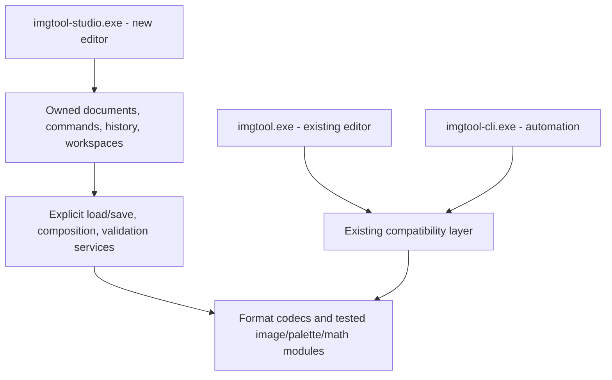

# Imgtool redesign assessment

2026-10-11 · source baseline `eab8366` · branch `feature/bddtool-style`

**Recommendation: retain the format knowledge and tested editing algorithms; build a separate editor application with new document ownership, command handling, and UI.** Keep `imgtool.exe` as the existing editor. Add `imgtool-studio.exe` as a separate target when implementation begins. Retain `imgtool-cli.exe` for automation. A full format/algorithm rewrite would discard valuable compatibility work. A theme or panel rearrangement would preserve the state and workflow problems described below.

This records the investigation made before implementation. The abandoned red-theme edits were reverted. The isolated `build-ui-audit` build contains the restored classic application. The earlier `build-bdd-style` executable is an obsolete experiment, not the fork.

**Implementation checkpoint (2026-10-11):** the first separate `imgtool-studio` target now lives in `platform/studio`. It reuses format/math code behind a scoped adapter, owns each library and its history, and provides an artwork workspace with red accents. Classic's overlay is not part of that target. See the [README preview section](README.md#studio-preview-separate-application) for build instructions, supported workflows, and limits. The broader migration below remains a roadmap, not a claim of implemented parity.

**Marked palette merge checkpoint (2026-10-16):** Palette manager now has local
palette marks, Space/Shift+M/M controls, Mark shown/Clear marks and automatic
keyboard-row reveal. Selecting a destination and typing * or keypad multiply
reviews all marked sources, ignoring the destination's own mark. Per-source
exclusions retain marks; no marks keeps the existing single-source workflow.
One final palette is built before calculating every source mapping. Combined
preview, growth/depth, per-source skipped/retained/removed summaries, PPP impact
and explicit approximation approval precede one atomic Undo step. Approval stays
visible beside Apply at the minimum window size and resets after mapping changes.

Alternate-palette sprites are skipped, and optional removal keeps any remaining
primary/alternate references. Unused marked sources stay unchanged. Metadata,
pixel padding, baselines, stable sprite IDs, default alternate references and
terminator tails are preserved; retained palette references are remapped once.
Owned snapshots and Apply revalidation reject stale, raw-mutated and forged
reviews. All allocations/history preparation precede nonthrowing installation;
allocation failure leaves bytes, history, selection and generation unchanged.
Marks clear when structural edits/history restores invalidate their palette
identities. Classic's layer L action remains unmigrated. Help and shortcut docs
were updated; verification is in the current Studio checkpoint.

**Shortcut and Help checkpoint (2026-10-16):** Classic shortcuts were audited
against `ui_main.cpp` and its Help. Studio now uses shared command/tool binding
tables for dispatch, menu hints and a generated searchable keyboard reference,
with compile-time duplicate checks. H/F1 opens a bounded topic browser: updated
quickstart, all previous Studio workflow notes, frame-origin/anchor explanations,
corrected format guidance and retained original DMA2 technical text. F9 provides
read-only diagnostics. H/V/E/K regain Help/Variant/Smart erase/playback meanings;
Shift+H/V/E/K selects Pan/Move/Erase/Line. Existing T/U aliases remain.

Marks, sprite ordering/rename/deletion, extraction/paste-as-new, palette assignment,
manager clipboard/navigation/history/deletion, reduction review, import/export,
keypad zoom, preview reordering and source Redo aliases are bound. Ctrl+Tab sets
the tab bar selection as well as the active document. Paste H/V, arrows, Ctrl+T,
Ctrl+E, Ctrl+J and Enter use frozen destination-color mapped previews with explicit
coverage, one Undo commit and stale/raw destination rejection. Clipboard/source
pixels, indices, anchors and IMG layouts retain their existing boundaries.

Help and [shortcut migration notes](doc/STUDIO_SHORTCUTS.md) explicitly distinguish
review-based equivalents from remaining sprite-layer L and multi-palette-mark
behavior. Tap Space marks; Space+left drag pans without painting or marking. These remain gaps, not claims of full shortcut/feature parity.
Classic UI and game assets are unchanged. Verification is recorded in the current
Studio migration checkpoint.

**Animation/alignment checkpoint:** Studio now has name-inferred sequence groups,
numeric frame order, multipart reconstruction, a timeline with per-frame preview
ticks, fixed World View, onion skin, normal/flipped/both facing previews, a floor
guide, reference sprites from open libraries, and undoable primary-anchor dragging.
The model has separate tests for grouping, playback, placement and whole-frame
anchor changes. Hidden UI checks exercise real pointer and keyboard gestures at
both window sizes. Preview settings do not alter IMG sequence data. The project
checkpoint below completes the authored composition part of Slice 2. The embedded
checkpoint adds stored sequence playback/editing; ASM and script runtime remain outstanding.

**Everyday editing checkpoint:** new libraries and sprites, rename/duplicate/delete,
reordering, resize/canvas-size/trim/rotate/flip, palette assignment/isolation, and
PNG import/export are implemented. History now owns complete sprite/palette
records, pixel and baseline buffers, points/alternate palettes, sequence bytes,
stable identities and selection. Reordering remaps sequence image indices while
leaving script indices untouched; deletion reports embedded references. PNG
quantization is shared with classic through a bounded memory adapter. Additional
tests cover structural/geometry history, reference remapping, Unicode PNG paths,
opaque black/transparency and metadata round-trips; hidden UI checks exercise
duplicate/undo/redo and applying/undoing the resize dialog. ASM animation,
legacy imports and additional paint tools,
batch operations and game-pipeline exports remain pending.

**Marked TGA sheet checkpoint (2026-10-14):** `studio_sheet` and its dedicated
review UI add Marked/Shown/All/Selected whole-sprite sheet export with stable-ID
exclusions, exact-color indexed palette merging or RGBA output, deterministic
height-first shelf packing, bounded layout dimensions and a zoom/pan preview.
Rectangles and selected primary-anchor crosses expose the actual layout. Packing
cannot crop, overlap or omit included sprites; block rows remain available for
exclusion. Identical palette words preserve indices, while mixed used RGB555 colors
merge without approximation; opaque black stays nonzero. Indexed color overflow
blocks instead of degrading the art. Source IMG format, pixels, metadata, dirty
state, history and marks are unchanged.

Optional classic ANF uses width 256, sprite coordinates up to 256×256, at most
1000 faces and 6000 rows. Actual DOS `doc/it/itimg.asm:4358` writes count-minus-one
and library-order faces after height sorting for layout; Studio follows those
rules rather than the port's count and sorted-face differences. The TGA uses
bottom-up indexed pixels and raw 15-bit palette words. General RGBA output has
32-bit BGRA pixels with alpha and no ANF. Golden AFACE fields include signed anchors,
legacy negative X words, four offsets and packed corner bytes. Different 8-bit RGB
expansion rules in stb are accounted for while direct RGB555/index round-trips stay
exact. Source-compatible formats are tested; no VUNIT runtime validation is claimed.

Reviewed source/destination snapshots are re-derived before writing. Unicode paths,
source/output aliases, foreign/tampered reviews, stale files and packing/color limits
fail without source edits. Both replacements and existing-byte backups are staged
before committing. Failed second replacement rolls back the first when it still
matches the new bytes. If an external change prevents rollback, retain the backup
and report it; two paths are not globally atomic against crashes/power loss/races.
A Windows read-only ANF test forces this real second-replacement failure and checks
both original files plus staging cleanup. Classic code is unchanged.

All 60 Windows suites pass. Layout occupancy, indexed/RGBA color/transparency,
ANF headers/order/coordinates, blocked/excluded rows, limits, stale/alias/tampered
inputs, destination rollback and read-only CAGE1/CAVEYES/KITANA11/PURPRAIN fixtures
are covered. ASAN model and compact software UI checks pass; hidden UI checks at
both sizes exercise cancellation, marks/exclusions, row selection, actual paired
export, stale outputs/sources and RGBA/ANF switching. The intermittent user launch
memory exception remains unconfirmed; passing checks do not establish its cause.

**Indexed legacy media checkpoint (2026-10-14):** `studio_legacy_media` and its
review UI add full-canvas LBM/IFF and indexed TGA import, plus separate selected
sprite LBM/TGA exports. Owned bounded readers handle PBM and 1–8-plane ILBM,
raw/ByteRun1 rows and mask/transparent-color normalization; TGA handles raw/RLE,
map origins, 15/16/24/32-bit palette entries and both orientations. Unmasked
source index zero follows IMG transparency; explicit mask/alpha relocates opaque
zero only when needed and reports it. RGB555 quantization preserves palette order.
HAM/EHB, ANIM, destination plane merging, partial palette alpha and an unrepresentable
256 opaque colors plus transparency are rejected. New imports keep secondary
anchors unused (also fixes the batch importer default). Existing IMG format remains
immutable on save, including after imports into the older CAVEYES library.

Import reviews palette choice, name, full-canvas pixels and anchor (click or numeric),
then uses the existing staged batch transaction with one Undo. LBM hotspot anchors
survive export/reimport. TGA has no IMG anchor representation. LBM writes PBM with
BMHD/CMAP/GRAB/BODY; TGA writes indexed 32-bit BGRA palette entries with alpha zero
for index zero. Export reviews snapshot/source generation and destination contents,
rechecks source and output bytes at write time, rejects source/open-library aliases,
and writes atomically. Neither dirty state nor history changes. Filesystem Unicode
paths, bounds, malformed runs, every truncated exported prefix, masked bitplanes,
palette origins/orientations, alpha and pixel/color round-trips have model coverage.
Truevision colors are cross-checked with the bundled stb_image decoder. Readers
follow the [Amiga ILBM specification](https://wiki.amigaos.net/wiki/ILBM_IFF_Interleaved_Bitmap)
and the source format adapters; classic UI/IO remain untouched.

All 59 Windows CTest suites pass. Model export/import/save/reopen checks use read-only
CAGE1, CAVEYES, KITANA11 and PURPRAIN fixtures. ASAN covers those and all 85 older
IMG round-trips. Hidden UI checks exercise cancel/import/Undo, source palette versus
matching, export and changed-destination refusal/rebuild at both window sizes,
including the software renderer/memory build. This is single-sprite indexed exchange;
the sheet checkpoint above completes marked TGA export; advanced IFF modes remain separate work.

**Older IMG compatibility checkpoint (2026-10-13):** Studio accepts validated
WIMP near layouts `0x60a`–`0x631`, in addition to existing `0x634`–`0x654`
layouts. `studio_img_codec` checks the owned byte snapshot and loads directly
from it, removing the checked-path/reopened-path gap. Classic loading/writing
and its UI remain unchanged. Near records map frame/Z and point/alternate fields
separately; 58-byte headers and 16-byte entries expand to the existing owned
98/18-byte model and project back on save. Pointer placeholders, padding/spares,
raw names, palettes, points, alternate tables, sequence order and script calls
survive that translation. Pre-alternate reserved words and empty-pool header
sentinels remain with stable sprite identities / source provenance.

**User requirement: IMG format must never change.** Save / Save As retain the
source version and record layout for every existing IMG. The format-conversion
menu and save API option are removed. The serializer uses the captured source
version and validates it again before atomic replacement; codec-state changes
cannot upgrade or downgrade the output. The footer identifies older libraries. Saves
block unrepresentable far pointers, sequence damage metadata, damage tables or
alternate palettes before their format threshold, leaving the destination intact.
The shared writer's scratch fields are restored so save/failure does not create
untracked metadata edits. Saves can repack payload placement; this is format and
content preservation, not a promise that every first save keeps physical offsets.
Near files with unaccounted trailing bytes are rejected. Pre-`0x60a`, pre-WIMP 5
and transitional `0x632`/`0x633` records still need separate adapters.

All **58/58 Windows CTest suites pass**. Independent near-format golden fixtures,
every truncated prefix, pointer/range errors, Unicode paths, sentinel/reserved
words, compressed rows, sequence editing/reorder/undo and format-preserving Save As
are covered. Tests check all 33 supported far-format version values and refuse
unrepresentable older edits on existing and new destinations. All **85 older MK2 libraries** open/edit/save/reopen in temporary
folders; inverse conversion reproduces their original bytes and originals remain
untouched. ASAN passes those fixtures and modern CAGE1/KITANA11/PURPRAIN regressions.
Hidden UI checks pass at both sizes, including the memory build/software renderer,
embedded playback/edit/undo, format-preserving copies and File menu. LOD UI regression
and a real KANG2 older-library launch also pass. The user's intermittent Windows
memory exception is still unconfirmed; these checks do not establish its cause.

**Pipeline export checkpoint (2026-10-13):** `studio_export.{h,cpp}` and its review
UI provide TBL, IRW and ANILST exports in one library. Marked/Shown/All/Selected
whole-sprite scopes, stable-ID exclusions and library order are explicit. Source
pixels/palette fields are owned snapshots; no classic globals or IMG mark flags
are borrowed. Writing re-derives rows, sources and output bytes, checks owner/
generation and destination contents, then replaces one output file atomically.
Wrong extensions, source paths/aliases, open-library destinations, changed sources/
targets and tampered plans are rejected. Dirty state/history/marks remain intact.
Only successful settings/scope/exclusions persist in the current tab's session.

One uncompressed layout drives both TBL addresses and IRW packing. Depth uses
fixed 1-8, palette size or visible indices; insufficient fixed depth blocks instead
of truncating. Word/nibble/packed padding, word-aligned base, 32-bit range checks
and optional dual-bank record/SAG adjustment are supported. TBL runtime CTRL is
(bpp & 7) << 12; editor flags do not become DMA flags. Every included record gets
its optional palette pointer, primary signed anchors and optional MK3 secondary
anchors. Invalid/duplicate sprite labels and conflicting palette labels block.
ANILST is the classic sequential sprite list, not embedded animation/script export.

Inspection of DOS source and shipped CAVEYES/BOSSHAM IRWs established the true
44-byte header (16-bit checksum/magic) + 24-byte record, rather than the classic
port's 48-byte header. Studio emits that DOS layout and one contiguous payload,
which the existing MK2 makevrom.parse_irw function accepts. Word checksums and all
1-8 depths, cross-word packing and source padding are tested. Classic code stays
unchanged. Reviews, output and prior-destination snapshots are bounded to 128 MiB.

57/57 Windows tests pass, including golden assembly/binary, mixed depths and
alignment, bank addresses, label/index errors, history/metadata/global preservation,
stale/tampered/foreign plans, Unicode and destination/source-alias guards. CAGE1,
KITANA11 and PURPRAIN exports decode every pixel exactly and leave original files
unchanged. Hidden export checks pass at both sizes with real inclusion, depth/MK3,
scope, rebuilding, exporting/reusing settings, cancel and stale source/target checks.
LOD/batch/tools/home checks also pass. AddressSanitizer export fixtures and the
compact export UI check pass without memory errors. No new user crash dump exists;
startup's specific intermittent fault remains unconfirmed.

This is a new raw layout, not a preservation of shipped ROM allocation or LOAD2
compression/deduplication/scaling/multipart-box builds. Palette definitions remain
separate. Legacy formats and specialist game/script/source workflows still remain.

**LOD loading checkpoint (2026-10-13):** `studio_lod.{h,cpp}` and its owned
review dialog load references into separate tabs. Unicode/BOM/quotes/comments,
manifest-relative/as-written/IMGDIR resolution and forced basename overrides
are supported. PPP is per occurrence and carries forward, defaulting to LOAD2's
0 (auto). Duplicate paths are reported and open once; open tabs retain their
current PPP and unsaved state. Missing/invalid rows must be fixed or explicitly
excluded. Manifest bytes and every selected Artwork disk baseline are rechecked
before any tabs are installed. Staged libraries are independent of classic/global
state; opening cancels no dirty document. Other directives remain visible but do
not run a packing/build/export or subset selection. Review limits: 1 MiB manifest,
128 rows, 64 MiB per IMG, 128 MiB accepted sprite/baseline pixels. Larger direct
IMG loading remains available. File picker, drop, recent and CLI paths dispatch
through the same review; non-Windows path entry remains supported. Tab activation
now retains the requested document while ImGui applies its queued selection.

55/55 CTest suites pass. LOD tests cover per-file/default/auto PPP, Unicode and
mixed separators, duplicate/conflicting PPP, unresolved/invalid rows, folder
priority/override/fallback, changed manifest/library rejection, bounds/syntax,
and preservation of open dirty artwork/global packing state. Read-only CAVEYES,
BOSSHAM and FLAPJACK LOD fixtures pass. Hidden mouse checks at both sizes cover
Cancel/Escape, selecting/excluding rows, opening/reusing dirty tabs, source changes
and rebuild/failure. Home/tools/project/anchor checks also pass. TBL/IRW/ANILST
exports and remaining legacy/specialist workflows are still outstanding.

**Startup diagnostics (2026-10-13):** the user reported Studio crashing while
launching. Current and older workspace executables stayed running in local checks;
the exact failing launch path was requested and has not yet been supplied. The
current build rendered with existing user preferences using both Direct3D and
software, then closed through WM_CLOSE with exit 0. The user's specific failure
is not confirmed resolved. `launch-studio.{bat,ps1}` targets the current build,
checks required SDL2.dll, and offers `-SoftwareRenderer`. `--software-renderer`
explicitly bypasses accelerated renderer initialization. App state lives on the
heap; startup logging records stages, renderer, exceptions and initialization
errors, with error dialogs for normal launches. A forced unavailable SDL video
driver returned 1 and logged the precise reason in a quiet smoke launch. No
user preferences were deleted. The next failing startup.log should guide a
specific fix, rather than assuming the report was caused by an obsolete binary.

Startup memory follow-up: the user clarified a Windows memory-error message,
but its application name and wording are still unknown. A separate MSVC
AddressSanitizer build passes document/project/LOD model tests and hidden home,
tool-rail, LOD, project and editing checks. The current standard build remains
unchanged. An earlier direct LOD test run did have a memory fault after a malformed
test BOM caused planning failure; that test fixture and its failure guard were
fixed before the final 55/55 result. Its Windows dialog could explain the report
if titled `studio_lod_test.exe`; that identity is unconfirmed and was requested.
No matching Studio crash event was found. Do not equate clean tested paths or
ample current system memory with resolution of an intermittent user failure.

**Memory-fault capture checkpoint (2026-10-13):** the user confirmed the Windows
read/written error wording; application and exception code remain unavailable.
Studio now logs the faulting memory operation/address and writes a uniquely named
MiniDumpNormal beside startup.log, with precomputed Unicode paths and a one-writer
reentry guard. DbgHelp remains a Windows system dependency. Release Studio and its
core library compile with debug information and retain optimization; the Studio
executable links a matching imgtool-studio.pdb for dump interpretation. Windows
exception handling continues after capture; this does not recover a corrupt process.
A Windows-only test supplies a fabricated exception record plus real CPU context
to the dump writer and verifies the resulting exception stream, without generating
a Windows crash dialog. Normal/no-output, Unicode, reentry and missing-folder cases
are covered. 56/56 Windows tests pass; standard Direct3D/software startup with user
preferences and the home/open/close smoke check pass. This adds evidence capture;
it does not establish the cause or claim the user's intermittent failure is fixed.

**Batch restoration checkpoint (2026-10-13):** Sprite > Restore child sprites
adds an owned parent-to-child review in the current library, using existing stable
marks, shown search results or all sprites. Name rules use one parent-name capture
(default `^(.+)[A-Z]$`), full ASCII-case-insensitive matching, and explicit missing/
ambiguous-parent results. Short regex rules allow classes/simple wildcards while
excluding counted/repeated-group constructs; invalid rules leave the IMG intact.
One parent provides a searchable picker with dimensions and library position.

Reconstruct applies the parent-nonzero AND child-nonzero guard, preserving both
silhouettes. Diff copies parent indices changed since load, including zero, and
requires a valid baseline with the current dimensions; this prevents the classic
current-stride/old-baseline overread after resize. Replace clears visible child
pixels and copies overlap. Fill changes only child transparency. All modes require
the same primary palette; no implicit index reinterpretation crosses palettes.
Sampling uses parent.anchor - child.anchor, matching existing restoration math.

The review reports coverage, exact changes/additions/erasures and skipped reasons.
Partial pairs start unchecked; changes to settings reset their inclusion. Before/
After renders owned results with optional change/erasure tint; Parent context
shows child bounds and uncovered areas. A short table expands after several rows,
leaving room for the art. Build preview is explicit, and stale sources/settings
block Apply. Whole child sprites are affected; canvas masks remain view state.

All parent pixels are frozen, including parent-as-child chains. Apply re-derives
and compares every source snapshot/result, rejecting stale/foreign/tampered plans
and unfinished prior edits, then allocates every replacement before one history
command. No-op batches do not create history. Geometry, anchors, palettes, load
baselines, points/alternate tables, raw-name tails, padding and embedded references
remain unchanged. Closed reviews release their snapshots and textures. Classic
restoration code is unchanged; cross-library and cross-palette force restore remain
outside this slice.

All three x64 Release targets build; **54/54 CTest suites pass**. New tests cover
four mode outputs, opaque-black/transparency semantics, anchor offsets, partial/
zero overlap, palettes, missing/resized/mutated baselines, name rules/errors/
ambiguity, frozen chains/order, inclusion/no-op history, stale/foreign/tampered/
pending plans, metadata and save/undo exact bytes. CAGE1/KITANA11/PURPRAIN temporary
batch round-trips undo to exact saved bytes. Hidden checks at both window sizes
cover row inclusion, three views/change toggle, Apply/Undo/Redo/save, Diff/Replace
menus, explicit rebuild, chosen parent, partial guards, Cancel/Escape, invalid regex
and stale blocking. Batch/tool/wheel/repair/filter/paint/clone/variant/selection/
floating/regions/palette/editing/anchor regressions pass. LOD and TBL/IRW/ANILST
pipeline exports and specialist workflows remain.

**Batch geometry checkpoint (2026-10-13):** library checkboxes and a Marks
menu introduce per-library batch membership, separate from active sprite and
canvas selection. Stable-ID marks survive reorder/history restores; absent IDs
are omitted from counts and recover on Undo. They remain session view state and
do not alter IMG flag bits. Batch... / Sprite > Batch geometry opens a review for
Marked, Shown by search, or All sprites in one library.

The planner reuses existing trim/resize/canvas/transform commands on isolated
single-sprite scratch documents. Resize supports percent or exact size, nearest
or palette-aware smooth sampling and anchor/point scaling. Canvas has nine
placements and visible-pixel crop counts. Rotations/flips retain existing anchor
conventions and optional anchor/point transforms. Empty trims keep their canvas.
Before/After previews use one world anchor target, with per-row dimensions,
primary anchor changes and secondary/point tooltips. Rows can be excluded.
Controls finish editing before regenerating the preview; pending settings and
stale sources disable Apply. Preview and live decoded-pixel limits are enforced.

Apply re-derives every reviewed result against the unchanged owner/generation,
source fields/pixels/points/palette, then allocates every replacement buffer
before opening history. It refuses unfinished prior edits. All enabled changes
commit once; no-ops retain padding/history. Palettes, baselines, secondary Z,
alternate tables, raw-name tails, flags and embedded references remain intact.
Structural synchronization refreshes artwork previews after Apply/Undo. Cancel
and Escape discard the review, and classic code is unchanged.

All three x64 Release targets build; **53/53 CTest suites pass**. New tests cover
preview isolation, trim/empty/no-op behavior, percentage/exact/smooth resize,
canvas offsets/crops, rotation/flip anchor/point results, row exclusion, all-or-
nothing invalid plans, stale/foreign/pending sources, metadata/baselines/references,
history/save/reopen and exact undo bytes for CAGE1/KITANA11/PURPRAIN fixtures.
Hidden batch checks pass at both sizes: native marks, active/pixel scope separation,
row exclusion, before/after, Apply/Undo/Redo/save, operation/scope menus, Cancel/
Escape and stale-source blocking. Tool/wheel, repair/filter/paint/clone/variant/
selection/floating/regions/palette/editing/anchor UI regressions pass.
Batch restoration, LOD/export pipelines and specialist workflows remain.

**Healing/defringe checkpoint (2026-10-13):** Heal (J) and Defringe (F) bring
the rail to 18 tools. They reuse round/square radius, brush cursor and bracket
shortcuts. Heal diffuses selected opaque rim colors into the accumulated brush
coverage, recomputing from a frozen source each update. Fill depth controls
synchronous waves; a frontier avoids the classic quadratic region lookup.
Unreachable cells retain their original pixels instead of leaving holes.

Defringe classifies an eight-connected 1-4 pixel outline band, including canvas
borders, then diffuses clean interior colors outward. Brushing limits writes;
Clean all/selected edges cleans the full scope in one step. Thin regions without
an interior remain unchanged. Both tools match fractional RGB555 color averages
to existing opaque entries, with current indices winning ties. Transparency,
palette words/depth, sprite geometry and metadata remain intact. Selection
limits reads and writes, but selection boundaries do not define sprite edges.

Smart erase now stages matching erasure and optional edge cleanup together;
Clean erased edges defaults on. It samples original non-killed neighbors outside
the matching color range, inside selection, then picks a neighboring color near
their RGB mean. It cannot invent palette entries or erase additional pixels.
Disabling cleanup retains plain matching erase. Clicking transparency is a no-op.

Owned repair state checks owner/generation/stable ID, live pixels/palette,
coverage/shape/dimensions/indices and silhouette before writes. Actual changes
open history; release groups a gesture; Escape restores pixels and keeps the
mask. No classic paint or game asset changes. The compact wheel reserves less
unused space so the added tool row keeps a usable picker at minimum width.

All three x64 Release targets build and **52/52 CTest suites pass**. Independent
repair tests cover RGB means/aliases, depth and unreachable areas, frozen fast/
segmented strokes, transparency and excluded sampling, edge bands/thin features,
cleanup on/off/connectivity, malformed/stale/foreign snapshots, clipped extreme
paths, history/cancel, metadata/padding/baseline/reference preservation and save.
Temporary CAGE1/KITANA11/PURPRAIN repairs undo to exact saved bytes. Hidden checks
at both sizes cover native toolbar/inspector buttons, J/F shortcuts, fast brushes,
mask holes, Undo/Redo/Escape/save and the cleanup checkbox. Existing tools/wheel,
filters/paint/clone/variant/selection/floating/palette/editing/anchor checks pass.
Batch/pipeline and specialist animation/game-source workflows remain.

**Blur/smudge checkpoint (2026-10-13):** Blur (O) and Smudge (S) add two
working tools to the left rail, with inspector Strength, round/square radius,
brush cursors and bracket shortcuts. Bare O/S select tools; Ctrl+O/Ctrl+S retain
their file commands. Both blend actual RGB555 colors and select existing opaque
palette entries, retaining palette size/words/depth, transparency and silhouette.
The active selection limits both reads and writes, so excluded pixels cannot
bleed into a selected region. Sparse palettes may limit the visible effect.

Blur samples a frozen source and visits each covered pixel once per gesture;
another stroke builds up the effect. Smudge processes a bounded pixel-unit path,
using the preceding position and staged stamp writes to carry paint without
within-stamp feedback. Transparency and excluded gaps break the carry. Fractional
color means survive until nearest matching; destination indices win exact ties,
preserving duplicate-color aliases and avoiding rounding-induced oscillation.
Smudge lazily caches index-pair results; exact RGB555 matching is also cached.

Owned snapshots check dimensions, mask, indices, owner, generation, stable sprite
ID and matching live pixels/palette before writes. Only actual changes open
history. Release commits one gesture; Escape restores pixels and keeps selection.
Padding, load baselines, raw-name tails, anchors/points/alternate palettes and
embedded records remain intact. No classic paint implementation changed.

All three x64 Release targets build; **51/51 CTest suites pass**. Independent
color expectations cover fractional averages, strength, aliases, frozen passes,
fast/segmented carry, gaps, masks, footprints and extreme clipped paths. Tests
also cover invalid/stale/foreign snapshots, history/cancel, padding/metadata and
save/reopen; temporary CAGE1/KITANA11/PURPRAIN edits undo to exact saved bytes.
Hidden filter checks at 1440x900 and 1000x680 exercise icon clicks, O/S/bracket
shortcuts, fast drags, masks/transparency, grouped history, Escape and save/reopen.
Toolbar/wheel, paint/clone/variant/selection/floating/palette/editing/anchor UI
regressions pass. Healing/defringe and batch/pipeline workflows remain.

**Side-toolbar/color-wheel restoration (2026-10-13):** the user identified the
Photoshop-style left toolbar and wheel as essential missing editor controls.
Studio now places all 14 migrated tools in a two-column icon rail using the
existing Material Symbols family, red active state and explanatory shortcut
hover text. Pixel tools disable during alignment/embedded workspaces, flipped
preview or owned pixel previews. The current tool and Fit stay above the canvas;
that header reserves the same height during previews so gestures never shift.

The active indexed swatch, transparency toggle and visible hue/SV wheel sit below
the tools. Clicking the swatch or Edit opens RGB/HSV/hex controls. Edits quantize
through shared RGB555 math and update the library's palette entry; slot zero
stays locked. Per-tab float state avoids repeatedly feeding quantized values back
into a drag. Only changed words write; a complete drag commits one undo entry.
Escape/Undo cancels an unfinished gesture and preserves its selection mask.
Tab/sprite/swatch/history changes resynchronize ownership and color. Existing
palette assignment/isolation and the indexed swatch bar remain available.

CMake copies the existing icon font beside Studio, resolved relative to the exe;
missing glyphs/fonts use short labels. The four-column workspace keeps the rail
fixed and adjusts initial library/inspector widths at 1000x680. The old inspector
RGB sliders are replaced by the wheel and exact-value pop-out.
50/50 CTest suites pass. Hidden tool checks at both sizes exercise icon/hotkey
selection, hue drags, grouped history, locked transparency, toggle-back, Escape,
RGB pop-out, tab ownership and save/reopen. Related paint/clone/variant/selection/
floating/palette/editing/anchor regressions pass. Classic UI and source assets
remain unchanged. The rail contains implemented tools; blur/smudge/heal/defringe
and the rest of the migration still require their own workflows.

**Opening-screen refinement (2026-10-13):** replaced the full-height empty welcome
panel and edge-aligned content with a centered two-column home layout. Baked
32/20-pixel heading fonts keep title text sharp, and explicit gutters/padding
separate Open IMG, New library, Explore sample and Open Studio project actions.
The recent-files card adapts its height to the list and scrolls after four rows.
Each native selectable row shows filename, tail-preserving folder text, full-path
hover details and a file marker; identical filenames keep independent path IDs.
Unavailable entries are disabled and can be removed through their context menu,
without deleting files. Availability refreshes on home entry, list changes or Refresh.
Existing commands and native file dialogs handle all navigation.

A separate x64 Release build in `build-studio-welcome/build/Release` was used
while the user's Studio was running. After that window closed, the normal
`build-studio-motion/build/Release/imgtool-studio.exe` was rebuilt too. Hidden opening-screen captures pass at
1440x900 and 1000x680, including empty and ten-entry lists, long names and missing
files. Pointer checks exercise New library, Explore sample and opening a recent
library, returning to home after each. Core editing code is unchanged; all 50 CTest suites pass, along with hidden
paint, variant and structural-editing regression checks. Original assets and user settings were not
edited by the smoke runs, which use their own build-folder fixtures/preferences.

**Variant painting checkpoint (2026-10-13):** Variant (T) paints an owned preview
or reviews the active selection before applying. It recolors only the requested
opaque pixels in the target palette, using shadow indices that retain their
original words under every other library palette. Matching slots are reused;
otherwise globally unused slots are assigned. Current pixels and load baselines
reserve their indices, with baseline scans using their own dimensions after
geometry edits. Missing alternate entries use black. Transparency and selection
holes remain intact; original swatches and baseline buffers are retained.

The inspector reports changed pixels, assigned/reused slots, palette edits/growth,
and newly crossed LOAD2 PPP color limits. Show original and alternate-palette
preview compare appearances without editing the document. Release opens the
review; Apply/Enter commits pixels and palette updates together, one undo step.
Escape/Cancel/Undo discards the preview. No available slots blocks the complete
edit. Apply re-captures the source and checks owner, generation, stable sprite ID,
exact pixels/palette words/depths/used indices, then validates the reviewed plan.
All replacement buffers are allocated before history opens. Growth raises depth
as needed, while preserving palette/sprite metadata, padding, raw names, embedded
records and references. The minimum-width tool shelf now wraps Fit using its
actual width so adding Variant does not force a spare third row.

All three Release targets build; **50/50 CTest suites pass**. New tests exercise
alternate appearance preservation, slot allocation/reuse/exhaustion, masked
coverage/transparency, absent alternate colors, palette growth/PPP/depth, baselines
after geometry changes, stale/foreign/tampered plans, no-ops and metadata/history/
save. Temporary CAGE1/KITANA11/PURPRAIN edits and undo restore exact saved bytes.
Hidden checks at both sizes cover brush preview, selection review, Apply/Enter,
Cancel/Escape/Undo, redo/save, original/alternate previews and source invalidation.
Clone/paint/selection/floating/palette/editing/anchor regression checks pass.
Blur/smudge/heal/defringe and batch/pipeline workflows remain.

**Clone painting checkpoint (2026-10-12):** Clone (C) adds Alt-click source
placement and visible source/offset markers to the Artwork workspace. Aligned
strokes retain the offset; unaligned strokes restart at the source. Transparent
source pixels skip by default, with an explicit option to copy them as erasure.
One frozen indexed source and destination selection per stroke prevent overlap
feedback and protect selection holes; sampling may read outside the destination
mask. Paint and clone share bounded interpolation and round/square footprints.
Release groups the gesture into one history step; Escape restores the pixels and
preserves the selection. Sprite/dimension changes clear the source, and generation,
owner, stable ID and palette checks reject unavailable snapshots. Clone keeps
geometry, anchors, points, raw-name tails, padding and palette words intact.
This slice samples within one sprite; cross-sprite transfers remain clipboard based.

All three Release targets build and **49/49 CTest suites pass**. New tests cover
overlap and repeated stamps, masked source/destination, transparency, padding,
footprints, extreme endpoints/offsets, no-ops, invalid/stale/foreign snapshots,
history/cancel and save/reopen. CAGE1/KITANA11/PURPRAIN temporary edits and undo
restore exact bytes. Hidden clone checks pass at both sizes, testing real Alt-click,
fast strokes, mask holes, aligned/restarted offsets, Escape, undo/redo/save,
sprite switches and Ctrl+C routing. Paint/selection/floating/editing/anchor
regressions pass. Variant/blur/smudge/heal/defringe and batch/pipeline work remain.

**Masked editing checkpoint (2026-10-12):** rectangle/wand/lasso selections now
support replace, add, subtract, intersect, invert, select all and select artwork.
Wand uses the tested palette-color tolerance math and separates transparency from
opaque black, with connected/global modes. Lasso fills pixel centers by even/odd
scanline crossings. The canvas draws mask boundaries; the inspector exposes scope.
Painting, erasing and connected fill stay within selected pixels. Copy/cut/clear
respect holes; clipboard coverage distinguishes selected transparent pixels from
unselected areas. Masked paste clears covered transparency, shown tinted in its
placement preview; unselected holes retain destination artwork. Plain whole-sprite
copy keeps its transparent-overlay behavior. Alt+arrows nudges pixels without
changing anchors, with strict canvas bounds and one undo step. Escape cancels an
unfinished selection gesture back to its previous selection. Selection shapes are
session view state, independent of IMG pixel history.

All three Release targets build, **45/45 CTest suites pass**, and hidden gesture
checks pass at 1440x900 and 1000x680. Tests cover padded rows, duplicate palette
colors, tolerance/transparency, connectivity, polygons/holes, scoped painting/fill,
masked clipboard color mapping, overlap moves, no-op/invalid/stale commands,
undo/redo and save/reopen. Edits and undo on temporary CAGE1, KITANA11 and PURPRAIN
copies restore exact bytes. Floating move/transform, region/body extraction and
batch/pipeline work remain pending.

**Region extraction checkpoint (2026-10-12):** Studio now reviews selected shapes
or heuristic body-part boxes as child sprites. Enable/disable parts, edit names and
bounds, drag boxes/corners, trim transparent borders, and inspect Source/Extracted
pixels/Remaining source before copying or cutting. Undetected arms start off with
editable boxes. Names are resolved before apply, with duplicate `_COPY` suffixes;
overlapping visible pixels are counted. Mask holes remain transparent in children
and source cuts use the same masks. Children share palettes/alternate palettes and
rebase primary anchors. New children have no secondary anchor, point table or frame
metadata; source metadata and embedded references stay on the source sprite.
All children are staged before appending/cutting, and one undo restores the whole
operation. Source owner/generation/identity and apply-time validation reject stale
or invalid plans. Existing game tables and animations are not rewritten.

**46/46 CTest suites pass**, including extraction coordinates/reconstruction,
masked holes, alternate-palette isolation, new-child defaults, source metadata,
stable IDs, embedded references, collisions/overlaps, invalid/foreign/stale plans,
anchor overflow, undo/redo and save/reopen. CAGE1/KITANA11/PURPRAIN temporary copies
round-trip after extraction and restore exact bytes after undo. Hidden dialog checks
at both sizes cover drag/cancel, cut/copy, preview, history and save/reopen; selection,
structural editing and embedded-animation regressions also pass. `build-studio.ps1`
successfully builds x64 Release in `build-studio-motion/build/Release` using pinned
SDL2 2.32.10 through the existing build script. Floating transforms, batch geometry/
restoration and pipeline/specialist workflows remain pending.

**Selection transform checkpoint (2026-10-12):** Move (V), Ctrl+T and contextual
Move / transform start an owned floating preview from selected pixels. Drag to move,
drag corners to resize, edit numeric position/size, flip, rotate by quarter-turns,
reset, fit to canvas or duplicate. The canvas shows the complete composed result,
including covered transparency and overlap with the remaining source. Palette
indices and masks use pixel-center nearest sampling from frozen source pixels on
every change, preventing progressive resampling. Mask holes never overwrite the
destination. Enter/Apply commits one pixel-history step; Escape/Cancel/Ctrl+Z discards
the preview and retains existing history. Arrows move the preview without browsing
sprites. Anchors, point tables, alternate palettes, geometry, raw names, baselines
and embedded metadata remain unchanged. Apply revalidates source identity,
generation and exact frozen pixels/palette against the live sprite. Stale source or
workspace changes cancel the preview. Invalid dimensions/placement cannot apply.
Preview textures retire after the queued canvas render; apply/cancel controls sit
at the top of the inspector so they remain visible in the minimum window size.

All three x64 Release targets build and **47/47 CTest suites pass**. Tests cover
every rotation/flip combination, masked/transparent pixels, move/copy/overlap,
original-based scaling, degenerate masks, invalid/stale/foreign snapshots,
metadata/padding/embedded-reference preservation, history and save/reopen. Temporary
CAGE1/KITANA11/PURPRAIN edits/undo restore exact bytes. Hidden checks at both sizes
cover real drag/resize, flip/rotation/duplicate controls, apply/cancel, keyboard
history, source-change cancellation, invalid placement and save/reopen. Clipboard
paste retains its own placement flow; arbitrary-angle rotation and smooth selection
sampling are not implemented. More paint tools, batch edits and pipeline work remain.

**Paint checkpoint (2026-10-12):** round/square brushes now share bounded Bresenham
stroke interpolation across pencil, erase and replacement. Line (K) owns a frozen
source/selection/palette preview; Shift snaps eight directions, release applies one
undo step, and Escape/Undo cancels without changing artwork. Invalid/foreign/stale
snapshots cannot apply. Endpoint clipping bounds work even for extreme coordinates.
Replace (B) holds its source index for the full stroke, or replaces all matching
pixels on a click. Fill (G) and Smart erase (U) expose connected/global matching.
Exact index is the default; optional palette-color tolerance matches duplicate and
nearby RGB555 colors while keeping transparency separate from opaque black. Color
matches are cached per palette slot. Selection holes clip writes and traversal, so
connected fills cannot cross excluded areas. Shared palette words and sprite
metadata are retained. Bracket keys resize the brush; the cursor shows its footprint.
Escape now cancels artwork gestures/previews with held modifiers such as Shift.

All three x64 Release binaries build; **48/48 CTest suites pass**. Paint tests cover
lines/clipping/padding, round/square footprints, exact/alias/tolerant matching,
transparency boundaries, disconnected masks, seed-equals-output fills, locked
replacement source, no-op/invalid/stale plans, metadata/history and save/reopen.
CAGE1/KITANA11/PURPRAIN temporary line/save/undo checks restore exact bytes. Hidden
paint checks at both window sizes cover snapping/cancel/release, fast replacement,
global fill/erase, selection holes, square brush/brackets, history/save and stale
source cancellation. Floating selection, masked editing, extraction, palette,
embedded and anchor regressions also pass. Variant/clone, blur/smudge/healing and
eraser defringing remain pending, along with batch/pipeline/specialist work.

**Project checkpoint:** native `.ISTUDIO` documents now own scene placement,
playfield/background settings, actor lanes, cross-file/multipart frame references,
timing, facing and a separate saved revision/history. Project gestures never edit
IMG anchors. The inspector authors frame/lane lists; playback and PNG export use
one evaluator. Sources bind by stable runtime IDs and saved raw-name identity,
with file fingerprints disambiguating duplicate names. Loads stage dependencies
before installation, missing sources can be relocated, source tabs cannot close
while a project or its history uses them, and failed/cancelled saves leave close
or quit pending. Only used sources are serialized, while undo retains its earlier
bindings. Referenced IMG files must be saved before project saving.

Classic WAX import supports explicit sprite rows and converts anipoint-space
offsets to screen placement with the correct per-frame flips. It retains timing,
cross-file references, depth order, row opacity and solid background. Generator
defaults are distinguished from active animation rules. Active motion/visibility
schedules and second copies are covered by the motion checkpoint below. Uniform
spawn rows are covered by the effect checkpoint. Substituted entries,
magnification, ASM and embedded sequences are rejected explicitly. The original WAX is never overwritten by a
Studio save. Derived game placement and settings absent from WAX are not inferred.
Background BDD references and game-source exports remain later work.

Validation: x64 Release builds of classic, CLI and Studio; **33/33 CTest suites**;
project codec/history/dependency/save-failure checks and PNG samples under both
mirror conventions; hidden Studio checks for scene drag/undo/redo/cancel, cross-file
lanes, save/reopen, missing-file staging, source-close protection and quit cancellation
at 1440×900 and 1000×680. SHADOWKICK and BACKWARDSPLIT WAX rows were loaded from
read-only local fixtures, converted/reopened in a temporary folder and exported.
Complex WAX files report unsupported rules. Real CAGE1, KITANA11 and PURPRAIN IMG
round trips also pass; no original game assets were changed. These checks do not
establish complete classic WAX parity or in-game runtime fidelity.

**Motion/timing checkpoint:** Studio now evaluates inclusive Show/exclusive Hide
windows, overlapping scheduled entries, velocity with per-axis travel limits,
per-actor freeze ticks and second sprite copies with independent offset/depth.
Classic's current-entry ordering and motion accumulation across actor loops are
preserved. WAX motion is converted through the final per-entry facing; signed
anipoint bounds and large tick arithmetic are covered by tests. Native version 2
stores these rules, while version 1 projects still load with their original
disabled defaults. Older Studio builds reject version 2 instead of simplifying it.
The inspector keeps these controls under Motion & timing. Frame replacement
preserves the existing timing and placement; scheduled thumbnails seek to their
Show tick; non-looping playback reaches the exclusive Hide boundary before stopping.

Validation for this checkpoint: isolated x64 Release build in `build-studio-motion`
for both GUIs, CLI and tests; **34/34 CTest suites**; motion/schedule/depth/PNG,
history, file-version and WAX conversion fixtures; hidden UI checks for editing a
Show tick, undo/redo, replacing artwork, save/reopen and end-of-scene playback.
The 77 local WAX files were checked read-only; 22 contain importable stored row
rules, and 17 of those had all dependencies available for conversion/reopen/export
checks. Missing sources and unsupported rules are reported. This is not full WAX
or game-runtime parity.

**Effect binding checkpoint (2026-10-12):** Follow frame timing connects an effect
actor to a stable composition frame identity. Reordering/renaming frames and
actor rows preserves the binding; retiming a source changes the derived start
without mutating the effect schedule or creating playback history. Chained effects
resolve immediately. Cycles and missing source references are rejected, and source
frame/actor deletion is protected. Detach preserves the current evaluated start.
Timing follows the source's authored first frame tick, independently of its
visibility, freeze clock or position, matching the scope of classic's spawn rules.

Native version 3 preserves actor/frame identities and bindings; versions 1 and 2
load with independent clocks. Uniform WAX spawn schedules are converted to local
windows with a stable source binding. Moved/custom schedules or a spawn row with
a freeze tick still report an explicit import limitation. These are stricter
checks than classic's automatic detachment, which avoids silently dropping a link.

Validation: both GUIs, CLI and tests build in x64 Release; **35/35 CTest suites**.
New fixtures cover retiming, frame and lane reorder, chained effects, cycles,
missing/duplicate identities, detach/undo, native version compatibility, WAX spawn
conversion and exported pixels around a trigger tick. Hidden UI checks at both
window sizes exercise Follow/Detach, undo/redo, source retiming/reorder, deletion
protection, duplication and save/reopen; existing motion, project, anchor and
editing checks also pass. Original game assets remain read-only. ASM, script
runtime and other specialist workflows remain future migration work.

**Embedded animation checkpoint (2026-10-12):** IMG animations is a separate
workspace for owned SEQSCR records. It lists sequences/scripts, shows sequences
in reversed disk playback order, and supports record creation/rename plus entry
target/ticks/offset edits, insertion, duplication, reordering and deletion.
Script calls retain forward order and link to their called sequence preview;
the UI explicitly does not claim script runtime execution. Thumbnail playback,
scrubbing and flip preview are view operations. Edits use the IMG's history/save
boundary; history now retains sequence/script counts as well as the blob.

Record kind comes from the sequence/script counts, because some classic-created
sequences have zero flags. Sprite reorder remapping follows that distinction.
Headers, damage references, raw names on untouched records and opaque entry
bytes survive edits; entry metadata moves with the entry. Malformed/trailing
data disables embedded editing. New sequences append within the sequence block,
keeping existing sequence and script-local indices valid. Record removal and
advanced header editing remain pending.

Sequence snapshots retain playback order, exact holds, anipoint-space offsets
and facing in a separate scene. Both mirror conventions are checked. Stored
ticks remain 0–255; zero is previewed for one tick without rewriting its byte.
Native projects read versions 1–4 and use version 4 only for holds above 120,
so old builds reject those projects rather than clipping their durations.
WAX rows driven by embedded records, ASM, and full script playback are still
outside this migration slice.

Validation: x64 Release classic/CLI/Studio build; **36/36 CTest suites**.
The new suite covers byte preservation, reverse sequence/forward script order,
zero/255 ticks, malformed data, opaque entry reordering, count history, reference
remapping, damage/header preservation and scene version/mirror compatibility.
CAGE1 (4 sequences/5 scripts), KITANA11 (9/10) and PURPRAIN (5/5) were decoded,
edited, saved/reopened and undone in temporary copies; originals stayed read-only.
Hidden UI checks at 1440×900 and 1000×680 cover real duplicate/undo/redo and
script-to-sequence clicks, playback, new-record count history, save/reopen and
snapshot creation. Existing project, motion, effect, anchor and editing checks pass.

**Palette workflow checkpoint (2026-10-12):** Palette manager adds a searchable
library list, creation/rename/duplication, a separate cross-file color clipboard,
PAL/ACT import/export, explicit sprite assignment and palette isolation. Browsing
does not change a sprite's palette. Duplicate retains palette metadata; pasting
or importing creates a new palette from color words. New names avoid collisions.
Unused-palette removal remaps primary indices and signed-byte alternate references
in their original disk namespace (three default palettes), respecting terminators
and preserving trailing bytes. Unresolved alternate references block removal.

Color selection supports single, Ctrl-toggle, Shift-range, all opaque and colors
used by a preview sprite. RGB555 and HSL adjustments stage in owned buffers and
render into independent before/after textures. No IMG/history mutation occurs
until Apply; Reset and Close discard the preview. Applying checks its baseline
and creates one artwork history entry while preserving index zero, untouched
words, declared packing depth and metadata. Selection survives Apply/Reset.
Palette assignment explicitly chooses color matching or retaining pixel indices;
the color preview uses the existing indices. Matching to a palette with no opaque
color is rejected rather than making opaque pixels transparent.

Raw PAL preserves all word bits; ACT converts RGB555 to/from RGB triples and
supports its optional big-endian color-count/footer. Nonzero ACT transparency
tags are reported as unsupported. Exports use a temporary sibling and atomic
replacement with failure reporting. Classic's palette UI and codecs are unchanged.
The merge checkpoint below adds reviewed, single-source palette merging and growth.
General palette-size changes and material/ramp workflows remain
later migration work.

Validation: x64 Release classic, CLI and Studio; **37/37 CTest suites**. New tests
cover staged HSL scope, transparency/opaque black, metadata and history, copy to
another owned document, primary/alternate index remapping, malformed files,
PAL/ACT count variants, Unicode paths and failed exports. CAGE1, KITANA11 and
PURPRAIN palette edits save/reopen/undo in temporary copies with restored-byte
checks. Hidden UI checks at both sizes exercise real swatch/slider/button input,
Reset/Apply/Undo, cross-library copy/paste, explicit assignment, save/reopen and
discarding a pending preview. Existing artwork, animation and project checks pass.

**Palette merge checkpoint (2026-10-12):** Merge palettes in the manager reviews
a single source against the selected destination. A cached, document-bound plan
records used slots, exact/approximate mappings, changed indices, changed RGB pixels,
palette growth/depth and new PPP-limit crossings for source and existing target
sprites. Growth adds only used source colors and caps at 256; existing destination
indices never move. Nearest matching reuses pure palette math with the optional
perceptual distance. Opaque black never maps to transparent slot zero.

Before/after textures use the planned pixel remap. Apply recalculates from the
current document/options rather than trusting an editable mapping, rejects stale
or foreign previews, and requires explicit approximation authorization when used
pixels lose color accuracy. No preview operation changes IMG data or history.
One undo restores sprite assignments/pixels, target words/count/depth, metadata
and optional source removal. Original pixel padding, geometry, anchors, raw names,
point tables, source palettes and pristine packing baselines are retained.

This pass merges eligible primary sprites. Source sprites with active alternate
palettes are excluded and counted; source colors stay available for them and for
other sprites' alternate references. Removal is blocked until every source
reference is gone, and unresolved alternate indices block removal. Existing
destination alternate palettes remain valid because their old slots do not move.
Crossing a PPP color limit is advisory and visible; exact color preservation is
not a claim of unchanged LOAD2 allocation. Multi-source merges, alternate-aware
joint remapping and general palette resizing remain pending. Compaction follows
in the checkpoint below.

Validation: all three binaries build in x64 Release; **38/38 CTest suites**.
The new suite covers exact and approximate colors, opaque black/transparency,
used-only growth, 256-slot overflow, perceptual matching, actual RGBA versus preview,
PPP findings, zero-shape/baseline preservation, padding/metadata/history, stale
previews, source removal/index shifts, and skipped alternate sprites/references.
CAGE1, KITANA11 and PURPRAIN eligible palettes merged into exact copies, saved,
reopened and undone to byte-identical temporary files; game originals were read-only.
Hidden UI checks at both sizes exercise real merge/growth/approximation/apply input,
one-step undo/redo with source removal, save/reopen, and packing-limit findings.
The existing palette, artwork, embedded animation and project UI checks pass.

**Palette usage/compaction checkpoint (2026-10-12):** Usage / compact adds a
cached histogram of primary and alternate pixel references, exact before/after
preview, unused-slot/removal counts, index changes and PPP/depth effects. It packs
used colors in their original order or trims only the unused tail. Used duplicate
colors stay separate, slot zero retains its word and transparency, and opaque black
stays opaque. Declared bit depth is preserved by default; recomputation is explicit.

Alternate-palette references and primary sprites with active alternate tables pin
the palette's indices. Those palettes trim only a proven-unused tail, counting
every referenced sprite's indices, instead of performing an incomplete joint
remap. Unresolved color indices block compaction. Apply rechecks the document-bound
plan, records one IMG history step and preserves padding, baselines, geometry,
anchors, names, palette metadata and alternate tables. Stale/foreign previews are
rejected; an unchanged plan creates no revision. Preview/cancel never writes data.

Validation: all binaries build in x64 Release; **39/39 CTest suites**. New tests
cover primary/alternate usage, index locking/terminators, opaque black and raw-word
preservation, gaps versus tails, declared depth, PPP effects, padding/baselines and
metadata, no-op/stale plans, history, unused/transparent-only palettes, exact RGBA
and save/reopen. Temporary CAGE1, KITANA11 and PURPRAIN compaction/save/reopen/undo
checks restore exact original bytes. Hidden checks at both sizes exercise usage,
packing/depth options, cancel, apply/undo and save/reopen; existing Studio UI checks
also pass. Original game files and the classic interface remain unchanged.

**Background digitize checkpoint (2026-10-12):** source loading, matte rebuilding,
material fitting and later-frame reseeding now run in owned cancellable jobs.
Starting moves the current review into an immutable input snapshot, avoiding a
large copy on the UI thread; a worker copies/constructs its private output. Palette
matching receives copied words and never reads a live Artwork. The previous
source/matte/material/result previews and frame slider remain available while
editing is gated. Stage/frame progress, Cancel processing and Close review keep
the window responsive. Cancel/failure restores input buffers and flags; results
require matching owner, library generation and review epoch before installation.
Quit cancels and joins workers before renderer teardown.

Cancellation is checked between source files, matte stages, material/frame passes
and Lloyd iterations. Classic pure fitter calls keep their defaults. Matte rebuild
moves source RGBA into the new work only after complete success, avoiding an
extra source copy and preserving input on cancellation. Manual later masks and
tint/index behavior survive fitting. The fallback picker now accepts multiple
source paths. Final IMG import remains the existing one-undo command.

Validation: all three x64 Release targets build; **44/44 CTest suites pass**.
Worker tests compare matte/fitted output with the synchronous algorithms, including
source alpha, manual later masks and tint; test copied target words despite live
palette edits; reject foreign/stale epochs/generations/cancelled jobs; exercise
load failures and Unicode input, cancellation boundaries and Lloyd interruption.
Hidden digitize and video handoff checks now wait for actual jobs. A 24-frame
768x768 source fixture verifies visible progress, usable preview, real mouse cancel
and exact restoration of library generation/counts. Larger paint/region and pipeline
workflows remain on the migration list.

**Video capture checkpoint (2026-10-12):** File menu and video drops now open an
owned frame grabber. Metadata, scaled preview and full-resolution crop capture run
on one cancellable worker; the UI never reads result buffers before completion.
Scrub/step/play, In/Out, every-N range, individual picks, I/O/P shortcuts, zoom/pan/
fit, rectangle crop, shared floor, deinterlace and source/fixed holds are exposed.
The floor retains source coordinates, including legitimate negative crop-local
coordinates. Source-time intervals round cumulatively to MK2 ticks (minimum one).
The last hold ends at the selected range's boundary or uses the last picked gap,
bounded by the source end. Captured frames feed the existing digitize session;
only its final import changes the library, in one undo command.

Optional decoder controls provide UTF-8/wide Windows child paths, cancellation
while waiting on pipe output, preview scaling, allocation bounds, exact odd crop
and explicit first-video-stream mapping. Classic call defaults remain unchanged.
Probe output/frame estimates are bounded; Studio limits captures to 2000 frames,
four million pixels each and 128 MiB total RGBA, using overflow-safe arithmetic.
Size/mtime checks guard source changes. Partial/mismatched captures are rejected
atomically. Workers time out after 30 seconds without decoded progress. Frame
positions still use average FPS; variable-rate hints/estimated counts are exposed.
Studio's MSVC sources now compile as UTF-8; an available CJK fallback font improves
filename display while retaining the primary UI face.

Validation: classic, CLI and Studio x64 Release build; **43/43 suites pass**.
The video suite tests range/picks/timing/crop/floor/limits, blocked probe/capture
cancellation, oversized PAM rejection before allocation, partial-output protection,
Unicode real FFmpeg paths, seek/preview, odd RGB and YUV420 crops, multi-track
consistency, source-change rejection and capture -> digitize -> save/reopen/undo.
Procedural footage and copied CLI helpers stay in temporary/hidden-check folders.
Hidden capture and result checks pass at 1440x900 and 1000x680, using actual zoom/
pan/fit/crop/floor/pick and seed/fit/apply gestures. They also verify original
artwork remains untouched until import and restores through history. Existing
Studio UI checks are retained. The background checkpoint above completes
asynchronous digitize processing.

**Digitize/material checkpoint (2026-10-12):** Studio now has an owned source
session for multiple PNG/raster files and decoded GIF frames, including different
source dimensions and retained GIF timing. It reuses pure `digitize_matte`,
`material_mask`, `palette_ramp` and `ramp_remap` modules without the classic wizard
or document globals. Source/matte/material/result views expose key sampling,
backdrop blend removal, despill, source alpha, alpha-weighted scaling, alpha cut,
erosion, material fill/brush/erase, inclusion/range selection, holds and a shared
source-space floor point. Rebuilding the matte resets masks but keeps materials.
Frame zero learns material colors; later frames classify by hue. Manual later
frame corrections survive refitting; explicit reseeding can replace them.

New palettes fit linear/Lloyd ramps automatically by measured population error
or by the chosen method, with per-material color budgets and tinting. Tint changes
output words, preserving luminance-based index choices. Existing palettes supply
detected or explicit ranges, with exact colors/indices retained. Palette overflow
is an error; incomplete opaque coverage prevents import unless transparent gaps
are explicitly accepted. Empty included silhouettes report an actionable error.
Matte/material/palette snapshots prevent reuse of stale fitting results. Cropped
anchors must fit signed 16-bit values. Final sprites/palette/optional sequence use
the same single-step batch command as sheet/GIF import; staging never edits IMG
data. Closed source sessions release their decoded buffers and textures.

Validation: classic, CLI and Studio x64 Release targets build; **42/42 suites**
pass. New tests cover matte/alpha, different frame sizes, automatic classification,
manual correction/reseeding, tint/index invariance, existing ranges/raw words,
incomplete coverage and explicit gap acceptance, scale/trim/floor registration,
timing, Unicode multi-file input/GIF handoff, invalid/stale settings, full palette
budgets and save/reopen/undo. Temporary CAGE1/KITANA11/PURPRAIN imports undo to exact
bytes. Hidden digitize checks at 1440x900 and 1000x680 exercise real key sampling,
matte rebuilding, two material seeds, fitting, floor placement, apply/cancel and
history/save. The video checkpoint above completes the capture handoff.

**Guided sheet/GIF import checkpoint (2026-10-12):** Studio now owns decoded
sources, batch previews and one-step history commands independently of classic.
Buffer adapters reuse sheet detection, sampled-border flood cleanup, quantization
and GIF blend modes. Cleanup samples outside tight sprite bounds so zero padding
does not mistake solid artwork for its border. Classic call paths are unchanged.
The review provides automatic/island detection or fixed full-cell grids, margins/
gaps/padding, trimming, individual/range/every-N selection, source rectangles and
indexed previews, playback, new shared/existing palettes, names, source-space
shared anchors and optional embedded sequences. Crops rebase anchors and preserve
GIF registration. Source delays round to MK2 ticks; absent delays use 100 ms;
holds above 255 split into repeated sequence entries in playback order.

The command allocates complete sprite/palette/sequence data before touching the
library. Owner/generation guards reject stale/foreign/review-only batches. Limits
cover encoded input, canvas size, total decoded RGBA/pixels, palette indices,
names and embedded entries. GIF block preflight bounds allocation and validates
descriptor coordinates before decoding. Existing records/raw metadata and script
sequence references survive appended records; old stable sprite IDs remain fixed.
Invalid source loads disable apply. Apply is disabled until settings are rebuilt;
cancel leaves artwork unchanged. Digitize/material fitting is covered above;
video capture is covered by the checkpoint above.

Validation: all three x64 Release targets build; **41/41 CTest suites pass**.
The import suite covers grid/island extraction, opaque black/transparency, palette
matching, subsets, anchors, stale/foreign/invalid plans, generated naming, Unicode
PNG/GIF decoding, truncation/dimension rejection, GIF holds/shared crops, existing
script metadata, save/reopen and single-step undo/redo. Imports into temporary
CAGE1/KITANA11/PURPRAIN copies undo to exact original bytes. Hidden sheet and GIF
UI checks pass at 1440x900 and 1000x680, exercising real grid/rebuild/anchor/apply/
cancel mouse input and history/save. Original game assets remain untouched.

**Selected-color ramp checkpoint (2026-10-12):** Shading / gradients adds scoped
single-color shading and 2–11-stop palette gradients to the staged color manager.
Shading follows classic's source-brightness/tint/blend/brightness/contrast formula.
Gradients map by original brightness by default, with optional selected index
order. Stops can be seeded, resampled, reversed, shifted with absolute HSL offsets,
edited by hex/RGB or sampled from either sprite preview into the active stop.
Only selected opaque words change; unselected raw words, high bits and slot zero
are preserved. Preview is private; Apply is one IMG command, and Cancel writes
nothing. Pixel data/geometry, palette size/depth and metadata stay fixed.

Studio owns its `studio_gradients.txt` preset store in its separate preferences.
Named presets save/replace/delete atomically; its bounded, strict codec reads the
classic plain-text syntax without calling the classic global store. Malformed
data leaves loaded state and the file intact, with saving disabled for a malformed
Studio store. Palette export and presets now share a bounded atomic output helper.
Color selection is retained through Apply and same-palette Undo/Redo. This
recolors selected palette entries. Directional sprite-index gradients remain
pending; digitize material fitting uses its own source session above.

Validation: x64 Release builds for classic, CLI and Studio; **40/40 CTest suites**.
The new suite compares shading against the original formula, verifies selected
scope, raw bits/transparency, gradient brightness/index ordering, flat/single-color
cases, reverse, stop shifts/resampling, metadata/history/save/reopen and strict
preset round trips, Unicode paths, malformed input and failed saves. Temporary
CAGE1, KITANA11 and PURPRAIN shading edits save/reopen/undo to exact original bytes.
Hidden UI checks at both window sizes exercise real range selection, mode/strength/
reverse/apply/cancel/undo and preview sampling; controller checks cover preset
save/replace/reload/delete. Existing Studio palette, artwork, animation and project
UI checks also pass. Classic source and original game assets remain unchanged.

## Brief and scope

The user supplied the original BDDTool brief: the application had become scrappy, common tasks still required an agent, useful features were difficult to find, some interfaces were bloated, and sensible behavior should often be the default. The explicit request was to investigate the folder, tools, and scripts before choosing between reusing the core and rebuilding.

For imgtool, the product constraints are:

- Retain imgtool's identity as an indexed sprite, palette, animation, and alignment editor. BDDTool's stage-placement workflow is not its replacement.
- Borrow BDDTool's clarity and visual polish, with red accents. Do not copy its workspace one-for-one.
- Preserve the existing application as a separate executable and working reference.
- Make routine editing understandable without an agent explaining hidden state, selecting obscure menu options, or repairing output manually.

The BDDTool assessment in the sibling repository was used as a methodological reference. Its stage/runtime findings were not assumed to apply to IMG editing.

### Investigation coverage

[The file inventory](tools/ui_redesign_inventory.csv) records all 187 tracked files plus locally available historical references and top-level notes: 234 files total at the time of capture, with sizes, text line counts, tracking status, categories, and quoted local includes.

| Area | Files | Text lines | What was inspected |
|---|---:|---:|---|
| First-party editor/UI C/C++ | 40 | 57,803 | Includes, state definitions, layout, input, editing entry points, import/export UI, dialogs, animation and palette workflows |
| First-party core/platform C/C++ | 79 | 20,328 | Public interfaces and dependencies; close tracing of document ownership, I/O, rendering, packing, mirrors, platform lifecycle |
| Tests | 30 | 6,535 | Build registration, fixture coverage, important ownership/rendering tests; 29 configured executables run |
| Historical/reference files | 45 | 43,957 | Inventory plus selected format, LOAD2 and mirror references; historical batch files classified |
| Build/automation | 7 | 1,234 | CMake, build scripts, presets and CI/release workflow |
| Tooling and wiki fragments | 3 | 345 | Keyboard-reference generator and its input/output model |
| Vendored code | 16 | 60,991 | Inventoried as dependencies; not audited line by line |

The 119 first-party C/C++ files contain 78,131 physical lines, including comments and blanks. These categories describe location and responsibility, not purity: `img_io.cpp` and `world_render.cpp` still depend on editor state.

Build trees (`build`, `build-bdd-style`, `build-ui-audit`, `codex-build`, `tmpimgtool-build-worldremap`), `prototype_outputs`, emulator `cfg`/`nvram`, and generated BDD test artifacts were identified separately. They are not additional maintained editor implementations. No additional modern helper scripts were found outside the four tracked scripts and historical DOS batch files. Agent-private directories and Git internals were excluded.

This is an architecture and workflow assessment, not a claim to have reviewed every implementation line. UI findings are source-traced. There was no new interactive usability study, exhaustive real-asset round trip, or MAME comparison. Those are acceptance gates for the fork, not accomplishments of this audit.

## What the current application already does well

The current baseline is considerably newer than the checkpoint in `AGENTS.md`. `last.md` and `refactoring_plan.md` are absent. The old mirror proposal is no longer a reliable feature-status list: mirror previews and separate engine conventions now exist.

Preserve these achievements:

- Indexed pixels and RGB555 palettes, including transparency at index zero, palette-aware image operations, and cross-palette remapping.
- IMG metadata preservation: raw name bytes, primary and secondary anipoints, point tables, alternate palettes, sequence/script blobs, damage references, and header fields that affect LOAD2.
- Tested geometry, resizing, matching, ramp transfer, matte/material processing, body splitting, packing estimates, and mirror math.
- World View's multipart reconstruction, cross-file frame references, floor placement, opponent/effect lanes, tick-based timing, WAX projects, and assembly export knowledge.
- Stable document UIDs and tests for close/reorder behavior.
- Marquee on open, paused composition playback, grouped subframes, game placement, and visible anipoints are already sensible defaults. Do not present them as missing features.
- LOAD2 drift checks, subframe alignment checks, TBL comparison, CPU composition/PNG export, and the existing headless commands.

Evidence: [format structs](platform/img_format.h), [document identity](platform/document.h), [document tests](test/document_test.cpp), [World View state](platform/ui_canvas.h), [mirror conventions](platform/anipoint_mirror.h), [core test registration](CMakeLists.txt).

## Findings that determine the architecture

### 1. Documents have identities, but editing history is still application state

`ActivateDocumentTab()` in `ui_modals.cpp:816` normally calls `ResetPerDocumentUiState(false)` when changing documents. `ui_undo.cpp:297` clears the legacy history, pixel history, full-document history, timeline, selection, transform state, and several tool states. Cross-document World View playback has a special bypass.

**Consequence:** switching from sprite file A to B and back can remove A's undo history. A more attractive tab bar cannot solve this. The three history mechanisms are merged by sequence numbers, but their storage does not belong to each document. The bypass also means behavior depends on the active workspace.

**Fork requirement:** each artwork document owns its history, saved revision, selection, and view state. A composition has its own history for lane/timing/placement edits. Cross-document operations record exactly which documents they touch. Tab switching does not mutate or discard history. Keep stable document UIDs and introduce stable sprite identities above the index-based disk representation.

Evidence: [tab activation](platform/ui_modals.cpp#L816), [history reset and routing](platform/ui_undo.cpp#L297), [document structure](platform/document.h).

### 2. Save success is not a dependable application contract

`SaveImgFile()` returns `void`. It silently returns if `fopen(..., "wb")` fails; its main write path does not propagate individual write or close failures. The normal save dialog and the unsaved-changes Save action subsequently clear `g_dirty`; the latter can continue the pending close/open/quit action.

**Consequence:** the caller cannot distinguish a completed save from failure. This is a source-confirmed failure path, not a reproduced disk-failure experiment. The same API also temporarily flattens sprite layers into the live data for writing, then restores them.

**Fork requirement:** an explicit `SaveResult` with destination and error details; write a snapshot to a temporary sibling file, check writes and close, and replace the destination only after success. A failed save leaves the original document dirty and does not complete a pending close. Loading should similarly parse into temporary owned data before replacing a document. Do not treat a new file picker as sufficient modernization.

Evidence: [save implementation](platform/img_io.cpp#L490), [save completion](platform/img_io.cpp#L715), [normal save caller](platform/ui_modals.cpp#L2050), [unsaved save caller](platform/ui_modals.cpp#L9595).

### 3. Artwork, compositions, and game source have different persistence models

IMG contains sprites and palette/sequence metadata. World placement, lane bindings, timing overrides, and preview choices also live in global `WorldViewState` and `WorldMarkedSequenceState`. WAX writes references and composition settings through private helpers in `ui_modals.cpp`. The background BDD is deliberately not carried in the current WAX project. MK2 strike tables and fatality source have their own source-backed documents and dirty flags.

`LoadWorldProjectFile()` clears the open IMG workspace before resolving and loading all referenced files. That is another reason to stage and validate project loading rather than use live UI state as the loader's workspace. The audit did not prove every possible caller's unsaved-change behavior, so this is a transactional-loading requirement rather than a blanket claim that every WAX open loses edits.

**Fork requirement:** explicit artwork and composition documents, plus optional game-source documents. Show what is unsaved and which file an operation changes. Saving a scene must not imply that referenced IMG edits or assembly edits were also saved. Missing scene dependencies should be repairable before a destructive workspace replacement. Preserve WAX compatibility through an adapter and version any new persistence fields deliberately.

Evidence: [composition state](platform/ui_canvas.h#L535), [WAX save](platform/ui_modals.cpp#L3700), [WAX load](platform/ui_modals.cpp#L3986), [strike document](platform/mk2_hitbox.h), [fatality document](platform/mk2_fatality.h).

### 4. There are several useful previews, not one guaranteed game view

The pixel canvas, anipoint-relative World View, embedded SEQSCR editor, assembly animation preview, and BDD backdrop each describe a different aspect of the result. `bdd_bg.h` explicitly documents that its raw BDB composition does not implement MK2's full camera, parallax, plane offsets, draw order, or floor interpretation.

The two supported mirror paths intentionally differ by one pixel: multipart `ani2` uses `size - anchor`; single-part `ganiof` uses `(size - 1) - anchor`. Current helpers preserve that distinction. A generic horizontal flip would discard it.

**Fork requirement:** use one explicit composition/evaluation model for the live preview and exported frames. Label imported game metadata, user-authored placement, and reference-only backdrops. Present left/right facing checks alongside anipoint editing. Never label an estimated reference composition as emulator-verified. Game-specific timing and mirror behavior belong to a named profile; retain MK2's existing tick convention when that profile is selected.

Evidence: [backdrop limits](platform/bdd_bg.h), [mirror math](platform/anipoint_mirror.h), [World View defaults](platform/ui_canvas.h#L87), [CPU renderer](platform/world_render.cpp), [render/export tests](test/world_blit_test.cpp).

### 5. Workspace and input routing are spread across independent flags

The canvas chooses among Image, World, Anim, Link, React, and Browse using multiple booleans with precedence and synchronization code. The sidebar separately switches Assets, Sprite, and Animation, and synchronizes some selections with the canvas. Clipboard/navigation shortcuts can change meaning after palette-list focus (`g_palette_nav`). Modal and file-dialog checks are repeated in input paths; recent changes fixed click-through behavior.

**Consequence:** the user must remember both a visible workspace and hidden focus/mode state. Adding another panel or shortcut requires auditing several gates. This is not an argument that all six capabilities should disappear.

**Fork requirement:** explicit workspace and interaction states; one command registry with labels, shortcuts, enabled reasons and a declared target. Menu, context action, shortcut and command search invoke the same command. Modal capture and gesture cancellation are centralized. Palette focus should visibly say that copy/delete applies to palettes. Keep known muscle memory where meanings are unambiguous.

Evidence: [mode routing](platform/ui_canvas.cpp#L12478), [shortcuts](platform/ui_main.cpp#L713), [sidebar layout](platform/ui_main.cpp#L2090), [canvas input guard](platform/ui_canvas.cpp#L11931).

### 6. Useful operations are distributed across competing surfaces

There are top-level Image, Operations, Palette, View and Tools menus, a 28-pixel icon rail, nested list context menus, a bottom palette strip, and many specialist dialogs. A thumbnail Browse workspace already exists, but browsing, marking, pixel editing, palette assignment, and animation composition are separate navigation surfaces. Color work is particularly rich: HSL, ramp transfer, costume variants, indexed gradients, isolation, reduction and material fitting deserve organization rather than deletion.

**Fork requirement:** a persistent searchable sprite library; a central work area; an inspector whose contents follow the selected object; a labeled tool shelf with only the active tool's options; a palette panel with explicit edit scope. Advanced actions remain discoverable through a searchable command list and contextual groups. Keep marking as a visible batch concept distinct from the active sprite and canvas selection.

The exact panel arrangement is a prototype hypothesis. It should be evaluated on both the current 1024×768 starting size and larger displays, including scaling and long sprite names. Do not simply widen every control while leaving fixed-size docks unchanged.

Evidence: [main layout](platform/ui_main.cpp), [tool rail](platform/ui_tools.cpp), [thumbnail browser](platform/ui_browse.cpp), [palette UI](platform/ui_palette.cpp), [ramp transfer](platform/ui_ramp_transfer.cpp), [costume UI](platform/ui_alt_costume.cpp).

### 7. There is reusable core code, but not a clean core library yet

The extracted pure modules are a strong starting point. However, `get_img()`, `get_pal()` and allocators resolve through `g_doc`; `img_io.cpp` calls undo and populates UI messages; `world_render.cpp` includes `ui_internal.h` for renderer state. WAX serialization and animation interpretation still live inside large UI translation units. The CLI target compiles the same source list, including the UI, and changes entry behavior with `IMGTOOL_CLI_ONLY`.

The largest first-party files are `ui_canvas.cpp` (21,568 lines), `ui_modals.cpp` (10,717), `ui_palette.cpp` (6,484), `ui_main.cpp` (5,441), and `img_io.cpp` (4,877). The earlier file split reduced the overlay's size; it did not fully separate state, commands and rendering.

**Fork requirement:** extract narrow services on demand, with explicit inputs and results. A temporary active-document adapter may be necessary at the compatibility boundary, but it must not become the new UI's state model or run concurrently. Do not make the first milestone a huge shared-code refactor or copy all the UI files into a second directory.

Evidence: [allocators and lookups](platform/img_format.h#L169), [I/O API](platform/img_io.h), [renderer dependencies](platform/world_render.cpp), [target source list](CMakeLists.txt#L79).

### 8. Validation knowledge exists but is not presented as a continuous workflow

LOAD2 verification already separates geometry, palette/PPP fallback and zero-shape drift, with baselines and click-to-image diagnostics. Save currently reports it as an advisory toast. TBL comparison and subframe checks exist separately, including CLI access. An asset can therefore be saved successfully while still needing a build-specific check; these are different results.

**Fork requirement:** a persistent, navigable findings panel with the active game/packing profile, affected sprites, and clear distinction between save errors, packing compatibility, and unverified game presentation. Recompute relevant checks after edits using revisions; do not run every expensive scan every frame. Include “no baseline” and missing dependency states instead of showing a reassuring empty result.

Evidence: [LOAD2 report API](platform/load2_verify.h), [CLI](platform/main.cpp), [TBL comparison](platform/tbl_diff.cpp), [subframe analysis](platform/subframe_align.cpp).

## Proposed product shape

The editing loop to optimize is: **find a sprite or move → edit its pixels/colors → check placement and facing in context → undo/refine → save/reopen → inspect export compatibility**.

| Surface | Responsibility |
|---|---|
| Library | Searchable list/thumbnail view, sequence/subframe grouping, active sprite, visible batch marks, palette usage and dependencies |
| Sprite workspace | Pixel canvas, indexed-color tools, floating selection/transform, precise zoom/pan, contextual tool settings |
| Animation workspace | Named sequences, explicit frame duration, scrubbing, multipart grouping, actor/opponent/effect placement, floor and facing checks |
| Inspector | Sprite geometry/anchors or selected lane settings; labels state whether an edit affects one sprite, its sequence, or the scene |
| Palette panel | Active palette, selected swatches, RGB555 values and ramp/material tools, with preview/apply/cancel for bulk changes |
| Checks/export panel | LOAD2 profile and findings, subframe checks, TBL comparison and explicit output destinations |

Link and React become focused tasks reachable from animation/anchor context, not mandatory top-level tabs for every user. Raw SEQSCR and assembly editing remain specialist views. A WAX file should open in Animation; a plain IMG should open with the library and selected sprite. Remember per-document view choices.

Use dark neutral surfaces and red interaction accents, readable type and consistent spacing. Keep sprite colors, transparency indicators, anipoint guides and diagnostic overlays semantically distinct from application chrome. A red selection should also have a shape/border/label cue so it is not confused with a validation error. This is a direction for the prototype, not a finished mockup.

### Defaults and migration decisions

| Existing capability | Studio treatment | Default / rationale |
|---|---|---|
| Marquee/select on open | Retain | Already prevents accidental painting |
| Native pixels, palette transparency, RGB555 | Retain | Fundamental format behavior |
| Anipoints and multipart reconstruction | Retain, improve scope labels | Show relevant anchors in alignment; grouping already defaults on |
| Paused scene, floor placement | Retain | Already useful defaults; preserve scene overrides |
| Onion skin | Contextual toggle | Useful for alignment, obscures some pixel/color tasks; do not force globally |
| Mirror preview | Visible facing controls / comparison | Keep explicit engine convention; do not rewrite stored anchors to preview |
| Browse thumbnails and name search | Integrate into persistent library | No workspace switch just to find the next sprite |
| Marked image/palette batches | Retain with visible counts and scope | Separate batch membership from active selection |
| Pencil, fill, eraser, wand, lasso, clone | Primary tools | Labeled, shared command model and active-tool options |
| Blur, smudge, heal, smart remap | Group as advanced paint tools | Preserve indexed-color semantics; avoid a permanently crowded rail |
| Palette copy/assignment and swatch edits | Primary palette workflow | Show which sprites share the palette |
| HSL, ramps, transfer, costume, gradients | Consolidated color tasks | Reuse algorithms; preview and scope before committing |
| Video/PNG/GIF digitizing | Guided import | Keep frame selection, crop, floor point, keying and material fit; use existing worker decoder |
| Trim, resize, canvas size | Contextual geometry actions | Show anchor and packing effects; never auto-trim on open/save |
| Auto-chop / body split / parent-child restore | Specialist sprite tasks | Preview affected sprites and coverage; keep reconstruct semantics |
| WAX composition and cross-file frames | First-class composition document | Own history, dependencies and saved revision |
| Embedded sequences / ASM animation | Explicit source types | Preserve ticks, control operations and unresolved-reference diagnostics |
| TBL, IRW, ANILST, LOD | Export/check tasks | Preserve hardware options in advanced settings and CLI |
| MK2 strike and fatality source | Later game-integration workspace | Separate save destination; do not imply they are IMG data |
| BDD/BDB background | Reference import | Label fidelity limits; stage editing remains BDDTool's job |
| Raw debug fields, DMA overlay | Advanced inspection | Available on demand; not the main editing surface |
| LOAD2 checks and missing dependencies | Automatic findings | Report exact profile and unavailable baselines |
| Destructive cleanup/repacking | Explicit reviewed action | Never silently “modernize” stock asset data |

The existing application remains available for features not yet migrated. This table is a migration ledger, not a promise that the first Studio preview has every legacy feature. Unsupported operations must be stated honestly; do not ship decorative buttons that invoke the wrong legacy context.

## Implementation boundary: two GUIs, shared knowledge

The diagram is the target architecture, not today's build graph. Initially the codecs still need compatibility adapters.

1. Add a separate CMake target and entry point. `imgtool.exe` retains its title, startup defaults, commands and packaging identity. Keep the CLI target; “two binaries” means two GUI choices, not removing automation.
2. Give Studio its own settings, recent-files list, session restore, window layout, title/icon identity and recovery storage. Current recent/session files live beside the executable, ImGui has its own layout file, and native directory memory uses an imgtool-specific location. Separate names must work even when both GUIs ship in one folder.
3. Share pure source modules through a library or source collection first. Preserve `IMG`/`PAL` disk semantics behind a compatibility boundary. Avoid changing the old editor's behavior as a side effect of a new adapter.
4. Use explicit document/sprite/palette handles in Studio. Disk indices are assigned during serialization; they are not the identity of an editing command or scene reference. Keep original raw bytes and metadata with loaded assets.
5. Implement owned artwork history and a separate composition history, with a saved-revision marker. A drag is one undoable transaction. A tab switch, preview flip or view zoom is not an artwork edit.
6. Move serialization, animation interpretation and scene evaluation out of widget drawing only as each workflow needs them. Inputs and outputs must be testable without ImGui. Preserve existing parsing behavior with fixtures before broadening it.
7. Keep SDL2 and Dear ImGui for the first prototype. The traced problems concern state ownership, workflow and layout, not an inability of the existing renderer to draw this interface. Reassess framework choice only if a concrete prototype exposes a missing requirement.

### First delivery and acceptance gates

**Slice 1 — foundation and usable artwork loop.** Both GUI targets build side by side. Studio opens an IMG, browses/searches sprites, paints, edits a palette, copies/pastes, changes anchors, undoes, saves and reopens. Classic behavior remains unchanged. No fake game-preview claim.

**Slice 2 — animation/alignment loop.** Named sequences, explicit ticks, multipart frames, facing comparison, a ground reference and a minimal opponent/reference lane. Scene edits have their own undo and saved state. Reuse the existing mirror and composition math. Preview and image export consume the same evaluated scene.

**Slice 3 — independent everyday workflows.** Guided imports, material/ramp workflows, batch geometry/restoration, persistent checks, WAX migration and export destinations. Only then expand game-source authoring and specialist tools according to the ledger.

Required checks before calling the fork usable:

- Open A, edit, open/switch B, return to A, undo/redo; document identity, history and dirty state stay correct.
- A failed write, a missing dependency or a cancelled dialog does not clear dirty state, replace live data, or run a pending close.
- Reorder/close document tabs and sprite rows while a composition references them; references remain attached to the intended asset.
- Palette edits and clipboard transfers preserve palette ownership and transparency; a shared-palette edit reports its scope.
- Load/save fixtures preserve raw names, points, secondary anchors, alternate palettes, sequences, damage data and LOAD2-sensitive fields. Compare outputs semantically and byte-for-byte where the format permits.
- Both mirror conventions, negative anchors, multipart alignment and tick timing have executable fixture coverage; real-game checks are recorded separately.
- Save/reopen a composition and compare evaluated transforms and exported pixels, including cross-file references and unavailable resources.
- Exercise modal capture, text input shortcuts, palette focus, paste/transform cancel, scrolling and clipping at 1024×768 and scaled displays.
- Launch both GUIs from the same directory and confirm separate settings/recent/session files.

## Tooling, scripts, build and documentation decisions

| Item | Decision |
|---|---|
| `build.ps1`, `build.bat`, `build.sh`, CMake/presets | Extend deliberately for side-by-side GUI output; keep existing commands functional. Do not overwrite classic with a renamed Studio binary. |
| `imgtool-cli` | Preserve and gradually move behind the same explicit services. The current CLI compiling all UI sources is technical debt, not a reason to remove it. |
| `tools/wiki/gen_keyboard_reference.py` | Preserve classic generation. For Studio, generate help/shortcut descriptions from the command registry; the present generator reads prose, not live bindings. |
| `.github/workflows/c-cpp.yml` | It builds test targets but contains no CTest invocation. Add execution and distinct Studio packaging when implementing. Current `feature/bddtool-style` pushes do not match the listed push branches; PRs/manual runs do. |
| Historical `doc/it`, `doc/load2`, `doc/wimp`, `doc/blimp` | Keep as format and engine reference. The DOS batch scripts are not modern workflow services to expose as buttons. |
| README/help/checkpoint notes | Reconcile against code. Some descriptions lag implemented features and current input behavior; do not use old TODOs as the feature inventory. |
| Build outputs/prototypes/emulator state | Keep out of product source and acceptance claims. Existing screenshots or executable names do not prove which revision is running. |

## Validation performed for this assessment

- Reverted the first theme experiment; application and CMake source match baseline `eab8366`.
- Fresh x64 Release build using SDL2 2.32.10 succeeded in `build-ui-audit/build` for the classic GUI, CLI and test targets.
- CTest: **29/29 passed**. The real `MKSTK.ASM` round-trip target is optional and was not configured.
- Ran `video_decode_test.exe` directly: all checks passed, with no missing-FFmpeg skip reported.
- Ran `imgtool-cli.exe --help` to confirm the available automation entry points.
- No source IMG, WAX, assembly or ROM assets were edited. No release, push or deployment was performed.

These checks establish a working baseline and reusable tested components. They do not validate a Studio implementation, the complete GUI interaction model, or in-game fidelity. The next implementation should start with Slice 1 and its ownership/save contracts, rather than another styling patch.

## Studio migration — reference staging and inspection (October 14, 2026)

Completed BDD/BDB read-only scenery, cross-library feature-based anchor linking,
IMG ten-point table editing, and existing TBL comparison. User-facing details and
limits are documented in README.md; STUDIO_MIGRATION_CHECKPOINT.md is the active
handoff. IMG source versions/layouts remain immutable; classic UI/IO are unchanged.

Stage pixels are owned snapshots; draw/export share camera/opacity. References
remain session-only, as in classic; no promise of game parallax/runtime floors.
Link review changes only the chosen target's primary anchor, in one undo, with
explicit target history/save. Point tables remain their native optional 40-byte
block, not a substitute for game strike sources. TBL differences use the existing
pure parser/diff and explicitly exclude unknown runtime flags/ROM allocation.

64 Release suites and the four ASAN model suites pass. Real stage comparisons
match classic pixels; DSRT1 missing colors are disclosed. MK1SKULL has 42 matches,
zero drift. New UI checks cover both window sizes; compact ASAN checks pass.
Malformed/source-stale/duplicate/overflow/foreign plans refuse work or show a
refresh requirement. No user assets changed. Next game work remains ASM/script
runtime, strike/fatality/reactions sources, unsupported WAX rules; specialist
palette and bulk-library commands also remain.

## Studio migration — MK2 strike source workspace (October 14, 2026)

Added an independent owned ASM document, record/fighter browsing, shared alias
awareness, staged operands and corner-based preview, source-specific undo/redo,
reviewed exact-byte Save/As, and dirty close/reload/quit guards. IMG history and
format are untouched. Read-only real source parses 257 editable strike records;
one non-record table declaration remains disabled. Original game assets stay
read-only; edits and failure injection use generated fixtures.

The source core adds a pure parse_text entry point to the existing classic parser;
classic load/save behavior is verified by field parity and roundtrip checks. The
new writer only replaces changed operand spans and preserves original byte layout.
The preview uses the actual JOY.ASM object-origin/facing collision formula. Manual
sprite selection is explicit; animation/script binding, phase-table execution,
includes/conditional evaluation and sidecar editing remain pending.

65 suites pass; new ASAN model and compact UI checks pass. UI scenarios exercise
preview cancellation, alias updates, target-independent history, reviewed write,
external destination refusal, quit cancellation and saving before source replacement.

## Studio migration — ASM source preview and strike associations (October 14, 2026)

Added a bounded, owned, read-only ASM source inspector with animation/anitab
browsing, alias groups, multipart frames, signed word adjustments (including
facing-dependent X direction), flips, segment boundaries, source jump traversal,
local anchor tables and visible runtime/unsupported-command notices. No includes,
assembly conditions, arbitrary routines or game phase timing execute. The original
classic viewer is unchanged; Studio uses its owned Artwork identities instead of
classic global document lists. Ambiguous pieces require an explicit library choice.

Preview transport, origin/facing/floor placement and cross-library lookup feed
the existing strike source editor. Name suggestions reuse the tested strike_bind
logic; explicit overrides are session associations. Strike overlays do not imply
active-frame timing. Sidecar persistence, phase rules, runtime calls, slave-object
commands and fatality/reaction tooling remain pending. IMG IO is unchanged.

66 Release suites pass. Model tests use real MKJC/CAGE1 read-only fixtures and
verify byte-identical IMG saves; generated fixtures cover malformed operands,
aliases, branches, loops, local tables, duplicate/missing/renamed/reordered pieces
and bounds. GUI checks cover both window sizes, source load failure retention,
transport, multipart resolution and animated strike dragging/apply/history.
Compact ASAN model/UI checks pass; real Cage source/strike rendering is inspected.

## Studio migration — persistent strike associations (October 14, 2026)

Added owned classic .imgtool sidecar documents keyed by strike source path, with
explicit disabled associations (`-`), independent history, source-switch retention,
reviewed atomic saves, external-change refusal, dirty reload and application quit
resolution. The ASM picker reads these documents and preserves overrides across
animation source replacement; missing bound labels do not silently fall back.
Tools > Strike associations exposes all cached documents, original/unmodified text
and warnings. Source Save As uses another sidecar while retaining older edits.

The byte-span editor preserves comments, BOM, whitespace, mixed endings, unknown
lines and other fighters. All duplicate assignments change consistently; removing
an override restores name suggestions. Unusual assignment lines are preserved and
refuse targeted changes. Writes protect open IMG/project/ASM aliases and recheck
both destination contents and aliases when confirmed. Source ASM/IMG IO and the
original classic tool remain unchanged. Bounds: 256 KiB, 2048-byte lines, 4096
lines/pairs, 100 / 16 MiB history per sidecar, 32 retained documents.

67 Release suites pass. Generated fixtures check classic parser compatibility,
Unicode, duplicate/case matching, disabled/default rules, history, exact byte
preservation, foreign/tampered/stale reviews, external changes, alias refusal and
write failure. Both GUI sizes exercise save/reload/undo/redo, stale destinations,
source replacement with two dirty sidecars, quit cancellation/save/discard, and
subsequent strike-source quit protection. ASAN model and compact GUI checks pass.
Runtime active-frame/phase rules and game execution remain pending.

## Studio migration — strike phase inspection (October 14, 2026)

Added a read-only inspector for source phase directories, threshold pairs and
countdown-based record selection. It uses the actual `get_stk_phases`,
`pick_stk_phase` and `striker` rules from MKSTK/JOY, including two-long directory
entries, two-word thresholds, signed long -1 terminators, native sign extension,
PHASE_MAX bounds/fallback, and no strike at countdown zero. Profile choices resolve
stkphase/wunit, negation, literal 0/1 and else nesting; includes, arbitrary symbols,
other build conditions and assembly assertions are not evaluated. Contiguous slot
walking includes inline labels and conditional appended rows. Ambiguous or
unavailable results do not produce a guessed overlay.

The UI exposes manual window length and step/play/reset, conditional slot numbers,
selected/base outlines, sprite/ASM frame selection and an existing strike-editing
handoff. Phase lists are not authored in this pass. Artwork selection is separate
from active countdown; startup/recovery/hit interruption and runtime timing are not
inferred. Source snapshots refresh on geometry edits/undo/replacement. Browsing and
preview flags never dirty or save ASM, sidecars or IMG. IMG IO/format and classic
UI remain unchanged.

68 Release suites pass. New model tests exercise the real low-kick phase records,
slot 23/24 shifts, signed sentinels, directory padding refusal, bounded fallback,
unknown/symbolic data, aliases, duplicate labels, malformed nesting, DOS EOF,
compound rows and input limits; real source bytes/history remain unchanged.
Both GUI sizes cover countdown boundaries, playback ending, unsupported external
tables and geometry edit/undo refresh. Compact ASAN model/UI checks pass. Real Liu
Kang multipart artwork is inspected; strike/binding/ASM regressions pass.

## Studio migration — existing strike phase editing (October 14, 2026)

The phase inspector now stages edits to existing threshold / strike-slot word
pairs and previews their countdown selection before Apply. Active consumer lists
are reviewed for the explicit stkphase/wunit assumptions; shared lists must resolve
all affected character/base slots and all candidate strikes must be complete,
editable local records. Unknown or external consumers refuse review. Neither
build settings nor includes/assertions are evaluated. Existing list size stays
fixed within PHASE_MAX, thresholds decrease strictly and finish at zero, and
literal thresholds/slots must fit 0..32767 / 0..255. Conditional or symbolic rows
cannot be rewritten. Directories, labels and declarations are not authored.

Validated patches replace only operand byte spans, preserving comments, spacing,
BOM, mixed line endings, compound rows and DOS EOF. Foreign, stale or altered
patches are rejected. Geometry and phase edits share one bounded ASM history and
the existing reviewed atomic source save, external-change checks and dirty-source
quit guard. Unchanged UI values keep their exact literal spelling. Apply never
writes a file; Cancel discards the staged preview. IMG data/history/format and
classic UI remain unchanged. Validation describes the selected profile only;
automatic active timing, artwork synchronization and runtime execution are pending.

68 Release suites pass. Model coverage adds byte-exact edits, aliases/shared
consumers, invalid thresholds/slots/layout, profile/external-table refusal,
foreign/tampered/stale patches, no-ops, interleaved geometry history and reviewed
save/reopen. Real MKSTK is reviewed without applying or saving edits. GUI checks
at both sizes cover Apply/Cancel, integer overflow refusal, undo/redo, reviewed
save, source quit cancellation and unchanged IMG history. Compact ASAN model/UI
checks and phase/strike/binding/ASM UI regressions pass. Generated fixtures only;
no original game files are written. New smoke mode: phases-edit (104 frames).

## Studio migration — batch sprite rename (October 14, 2026)

Sprite > Batch rename now migrates classic's numbered, prepend and tail-numbered
marked-image rename, adding explicit Marked/Shown/All scope, zero padding, stable-ID
exclusions, old/new row review and final-state case-insensitive collision checks.
Numbering follows library order and does not move when rows are excluded. Names
must fit 1..15 printable ASCII characters without spaces; no truncation or automatic
suffixing occurs. Conflicts with excluded or out-of-scope sprites block Apply.
Existing duplicate names do not prevent unchanged/excluded rows from being kept.

The owned plan validates owner/generation, source visible/raw names and regenerated
results before one history transaction. Pending edits, stale sources and modified
reviews are refused. No-op previews create no history or dirty changes. Only the
visible name buffer changes; stable sprite IDs, selection identity, pixel/palette
buffers, anchors/points, alternate palettes, opaque metadata and embedded indices
remain attached to the same images. The shared writer retains trailing raw-name
bytes with its existing splice behavior; renames can affect name-based LOAD2 hashes.
External ASM/TBL references are not rewritten. IMG format/layout never changes.

69 Release CTest suites pass. Tests cover metadata and byte-level save fidelity,
near 0x610/far 0x634 layout retention, classic naming modes, library order/padding,
exclusions/collisions/atomic shifts, no-ops, stale/foreign/tampered plans, pending
edits, Unicode paths, embedded references and exact undo saves. CAGE1 edits write
temporary copies only and confirm the original source remains unchanged. Generated
GUI checks at both sizes cover real prefix text input, Apply/Cancel, exclusions,
collision refusal, undo/redo, save/reopen, search scope, rule switching and stale
review refusal. Compact ASAN model/UI checks pass; batch geometry, embedded,
alignment and phase-editing GUI regressions pass. Mode: batch-rename (92 frames).
Remaining bulk delete/assignment/copy and game runtime workflows remain separate.

## Studio migration — bulk palette assignment (October 14, 2026)

Palette > Assign to multiple sprites migrates classic's SetPaletteOfMarked to an
owned review for Marked/Shown/All scope, destination selection, matching or raw
index retention, stable-ID exclusions and primary-palette before/after previews.
Rows expose incompatible indices and active alternate-palette conflicts. Color
matching uses the existing nearest opaque RGB555 slot helper and retains index zero.
Approximate matching requires the review checkbox. Keep indices permits intentional
recoloring and can resolve indices undefined by a valid old palette if the target
contains them. Missing palettes cannot be guessed. Same-palette rows are no-ops,
including duplicate-color indices that must not be collapsed by matching.

Active alternate palettes prohibit index-changing matches; exact matches that keep
indices and raw assignments retain alternate appearances. No palette grows, shrinks,
changes color, or changes order/depth. Geometry, anchors/points, raw names, baselines,
row padding, alternate buffers, stable IDs, selection identity and embedded references
stay intact. The loaded near/far version and layout remain fixed. PPP reports newly
crossed color limits only; other palette-size changes can also affect LOAD2 packing.
Build settings remain unchanged and Apply never saves automatically.

Owned pixel/field/palette snapshots and regenerated-result comparison refuse stale,
foreign or modified plans before one atomic history transaction. Pending edits and
included incompatible rows refuse Apply; excluded errors remain visible. No-op
reviews create no dirty/history changes. Limits: 2000 sprites, 256 MiB before/after
pixel snapshots, 4 million pixels per sprite, palettes up to 256 colors, PPP 0..8.
Textures and pixel plans are released on close/quit.

70 Release suites pass. Model tests cover opaque/transparency matches, duplicate
colors, primary recoloring, padded rows, unknown source indices, alternate guards,
approximation opt-in, PPP threshold findings, unchanged palettes and metadata,
embedded indices, exclusions/no-ops, owner/generation/tampered/pending guards,
Unicode save/reopen and byte-exact undo. Near 0x610/far 0x634 layout retention is
verified; real CAGE1 edits write temporary copies and preserve the original asset.
GUI checks at both window sizes cover destination/mode selection, alternate conflicts,
exclusions, exact/approximate/raw assignment, Apply/Cancel, save/reopen, undo/redo,
search scope, stale refusal and retained pixel selection. Compact ASAN model/UI pass.
Rename, palette editing/merge/compaction and embedded UI regressions pass. New smoke
mode: batch-palette (118 frames). Bulk deletion/cross-library copy remain pending.

## Studio migration — bulk sprite deletion (October 14, 2026)

Sprite > Delete multiple sprites now reviews Marked/Shown/All scope, stable-ID
exclusions, row dimensions, embedded/open-scene references and the source sprite.
Exclude referenced sprites handles blocked rows in one click. The button deletes
only reviewed rows, retains at least one sprite, and commits in one undo step.
Family/subframe expansion and automatic unused-palette cleanup are separate work.
External ASM/TBL files, closed scenes and project history are not scanned.

The model parses bounded embedded data, counts per-sequence references, rejects
invalid positive image indices, and distinguishes script sequence targets from
sprite targets. Referenced sprites cannot be deleted. Remaining sequence indices
are remapped through the existing helper without changing script indices, negative
sentinels or opaque entry bytes. Current scene uses are checked through document
and sprite IDs each frame and again at Apply. Scene save resolves surviving IDs
at their new disk slots. Selected surviving IDs stay selected; a removed selection
moves to the next survivor (or last if no later sprite remains).

Owned source fields/pixels/colors and the full embedded snapshot are regenerated
before mutation, rejecting stale, foreign, modified or pending reviews. All-excluded
reviews create no history. Survivors retain their original geometry, metadata,
palettes and identity. Existing complete artwork history restores removed pixels,
baselines, raw name tails, point/alternate tables, indices and selection. Near/far
IMG versions and record layouts remain unchanged; deletion naturally changes counts
and can affect game allocations. Review limits: 2000 sprites, 128 MiB preview pixel
snapshots, 4M pixels per sprite, existing embedded 32 MiB / 4096 record-entry limits.
Preview textures and pixel plans are released on close/quit.

71 Release suites pass. Tests cover embedded counts and remapping, opaque/script/
negative bytes, scene document/ID resolution, referenced-row refusal, exclusions,
last-sprite protection, no-op/pending/stale/foreign/tampered plans, selected fallback,
metadata/history, Unicode save/reopen, near 0x61d/far 0x634 retention and exact undo
saves. CAGE1 tests write temporary copies only and confirm the original asset stays
unchanged. Both GUI sizes cover blocked deletion, exclusions, undo/redo, IMG/scene
save, newly added scene references, search/all scopes, stale review and last-sprite
protection. Compact ASAN model/UI pass; rename, palette assignment, embedded, project
and alignment GUI regressions pass. Smoke mode: batch-delete (112 frames).
Cross-library copy and remaining specialist workflows are still pending.

## Studio migration — cross-library sprite copy (October 15, 2026)

Sprite > Copy to another library appends Marked/Shown/All source sprites to a
second open document. Destination selection, source preview, exact copied names,
prefixes, exclusions and palette assignments form the review. Collisions block
rows instead of replacing sprites or auto-truncating names. Copies get new stable
identities and select the first appended sprite. Source data/history stay intact;
all destination additions share one undo step. Nothing is saved automatically.

Primary and active alternate palette dependencies are collected by source index.
Each required palette is copied once, retaining colors, depth and opaque metadata.
Optional exact reuse requires matching normalized PAL fields and color words;
reusing colors alone is insufficient. Alternate references are rebased with default
references 0..2 and trailing bytes preserved. Unrepresentable byte references and
alternate blocks in pre-0x61d destinations are refused. Pixel indices/padding,
anchors, points, baselines, raw name bytes and opaque fields are copied; the writer
retains name-tail bytes where not occupied by the reviewed new name. Active source
overlay layers and unresolved primary/alternate palettes are refused. No colors are
quantized, palette slots reordered, or destination formats changed.

Owned snapshots of both generations, sprite fields/buffers and palette fields/
colors are regenerated and compared before staging. Pending edits, stale/foreign/
modified plans refuse Apply. All objects and ID capacity are staged before linking
into the destination; all-excluded reviews are no-ops. Exclusions rebuild dependencies
so unused palettes are not appended. Limits remain 2000 destination sprites,
4093 palettes, 128 MiB destination decoded pixels, 4M pixels per sprite and 256 MiB
review pixel/baseline snapshots. Close/quit release review textures and snapshots.

72 Release suites pass. Model tests cover exact indices/padding/baselines/metadata,
shared and alternate palettes, default/sentinel bytes, raw name tails, name conflicts,
reuse/exclusions, no-ops, stale/source/destination/pending/foreign/tampered reviews,
new identities/history, unchanged embedded records, Unicode saves and byte-exact
undo. Near 0x610 and far 0x634 destination retention is verified, including blocked
unsupported alternates. CAGE1 tests copy into temporary documents and leave the
original untouched. Both GUI sizes cover copy, destination switching, real prefix
input, collisions, reuse choices, exclusions, source/search/all scope, undo/redo,
save/reopen and mutations of either document during review. Compact ASAN model/UI
pass; deletion, palette assignment/editing, embedded and project UI regressions pass.
Smoke: library-copy (110 frames). Automatic child expansion, embedded record
transfer and a clipboard surviving source closure remain separate work.

**Child-piece review checkpoint (2026-10-15):** Bulk library copy and deletion now
share `studio_sprite_scope.*`. Include child pieces defaults off, expands only
direct children of explicitly scoped sprites, follows the classic split-letter /
underscore / dash / trailing-number rules, and requires equal source-library
labels. No sibling promotion or recursive expansion. Duplicate visible parents
and competing naming-rule parents are ambiguous: skip, count, and show names on
hover rather than guessing. Explicit scope membership wins; rows remain in
library order, with stable parent IDs and parent labels for added pieces.

The original scope, expansion choice, ambiguity list and per-row origins are
captured and regenerated at Apply in both models. Tampered/stale scope refuses
mutation. Changing the option preserves row exclusions; excluding a parent does
not cascade. Copy still rebuilds required palettes from included rows. Embedded
and current open-scene references still protect every included deletion row,
including implicitly added children. Existing one-step history and IMG
version/layout retention are unchanged. Source labels are runtime provenance;
reopening an IMG gives its sprites the same source-library label. No on-disk
relationship fields are added.

73 Release suites pass. The family model suite covers direct/nonrecursive scope,
source namespaces, word suffixes, case sensitivity, duplicate/overlapping parent
ambiguity, explicit overrides, invalid IDs, copy/delete exclusions, scope
snapshots, child references, remapping, undo/redo and save/reopen. Family UI smoke
(74 frames) covers both dialogs, toggles/exclusion persistence, reference refusal,
apply/history at wide and compact sizes. Compact AddressSanitizer model/UI and
existing copy/delete UI regressions pass. Embedded record transfer, a persistent
sprite clipboard, split/move-to-library and unused-palette cleanup remain pending.

**Unused-palette cleanup checkpoint (2026-10-15):** Palette > Remove unused
palettes adds a whole-library review in `studio_palette_cleanup.*` plus UI/smoke.
All owned palettes are listed with primary sprite use counts, active alternate
reference counts, color swatches and old/new indices. Only unused hides used
rows. Unused rows initially selected; keep individual palettes, Keep all or Select
all unused. Referenced rows are protected. Names/raw metadata, exact words,
color counts and bit depth remain unchanged in retained palettes; no merging,
color-slot compaction or pixel-index changes. Default alternate references 0..2
and bytes at/after the first terminator >=128 remain verbatim. Remap the owned
alternate slots only, including full sixteen-slot tables without a terminator.

Owner/generation, all palette fields/words and sprite fields/alternate buffers are
re-derived at Apply. Foreign, pending, stale and modified reviews refuse mutation.
Unresolved primary/alternate references, invalid palette data, invalid keep choices
and removal of the last palette are blocked. Keep-all is a no-op with no history.
Relink survivors and remap references in one artwork Undo step. Stable sprite IDs,
selection, pixel/baseline data, anchors, point tables and embedded records remain
intact. No automatic cleanup as a side effect of deletion; no automatic save.
Existing format retention remains unchanged. External palette-name references
in ASM/TBL files or closed projects are not scanned; keep those palettes explicitly.

74 Release suites pass. New model tests cover partial/all/no-op choices, repeated
and default alternate refs, trailing bytes, full sixteen-entry alternates, highest
active byte reference 127, raw metadata, unchanged pixels/baselines/points/embedded
records, ownership/stale/pending/tamper guards, malformed references/colors,
selection/history, Unicode save/reopen, near 0x61d / far 0x634 format retention and
byte-exact saved undo. Real CAGE1 input stays read-only; outputs use temp files.
Both GUI sizes plus compact ASAN model/UI pass. UI tests cover keep/protected rows,
filter/swatches, reference remapping, Apply, undo/redo, save/reopen, Keep all no-op,
Cancel and stale refusal. Existing palette/compaction/family/project UI regressions
pass. Smoke: palette-cleanup (92 frames). Persistent sprite clipboard, embedded
record transfer, split/move and specialist/runtime tooling remain pending.

**Sprite clipboard checkpoint (2026-10-15):** Sprite > Copy sprites to clipboard
adds a reviewed Marked/Shown/All capture with optional direct child expansion and
per-row exclusions. Sprite > Paste sprites from clipboard reviews the fixed
captured set against any open destination, including the original library.
Names/prefixes, exact palette reuse, exclusions, alternate dependencies, capacity
and existing-format guards use the existing library-copy model. Normal live
library copy keeps its original behavior. Clear sprite clipboard is available
from Sprite and Edit; the paste tooltip reports captured count/source.

`SpriteClipboard` owns an independent Artwork, palettes and scope provenance,
without borrowing tabs or copying embedded sequences/scripts. Palette references
are normalized to its owned set; default/trailing alternate bytes remain intact.
Capture validates the original review and builds detached objects through the
same staging helper as ordinary copy. No source mutation/history and no extra
history snapshots in clipboard storage. A failed capture or Cancel leaves the
previous clipboard. Successful capture replaces it atomically. Paste reviews
hold a shared immutable snapshot so clearing/replacement cannot dangle the review.
Source edits/closure cannot alter captured data. Session memory only; no OS
clipboard integration or restart persistence. Pixel and palette-color clipboards
remain separate. No change to any existing IMG version/layout. Paste appends in
one destination undo step; it never transfers source embedded records or saves.

75 Release suites pass. The clipboard suite verifies owned buffers/raw metadata,
child provenance/exclusions, stale/pending/tampered capture refusal, source edits
and destruction, repeated paste/collisions/prefix/exact reuse, shared lifetime,
replacement, near 0x610 unsupported-row refusal, far 0x634 save/reopen and exact
saved undo. Wide/compact GUI tests cover capture, child inclusion, Cancel preserving
the old clipboard, actual source-tab closure, paste with no source tab, exclusions,
undo/redo/save/reopen, conflicts/typed prefix, replacement, stale refusal, Clear,
and unchanged pixel clipboard. Compact ASAN model/UI pass, plus existing live-copy
and family UI regressions. Smoke: sprite-clipboard (144 frames). Embedded transfer,
split/move-to-library and broader specialist/runtime features remain pending.

**Split-library checkpoint (2026-10-15):** Sprite > Split to new library extends
the reviewed transfer UI with a separate unsaved IMG tab. Marked/Shown/All scope,
optional direct children, exclusions and required primary/alternate palette copies.
Copy defaults on; Move from source is explicit. The split target inherits the
source's exact version/header reserve policy, rather than offering conversion.
Near pre-0x61d per-sprite reserve words are copied by old-to-new stable ID mapping.
New data owns its buffers, has no initial undo snapshot or placeholder sprite,
and is dirty so normal close/quit guards protect it. Embedded records stay in
source and are not transferred; palette counts/colors/depth are retained.

Preparation reuses validated copy snapshots and detached staging. The UI allocates
and initializes the new tab, inferred sequences, tab capacity and status before
source removal. Move requires equal copied/removed ID sets and revalidates source
and deletion reviews; referenced and last-sprite removal is refused. Current open
scene uses are checked continuously and again at Apply. Exclude referenced sprites
mass-keeps protected rows. Per-row/preview provenance and uses stay visible.
Remaining embedded sprite indices remap with ordinary deletion logic. Source
palettes remain. One source undo restores removed sprites; the new library remains
independent. Copy leaves source history unchanged. No automatic saves; external
references/closed projects are not scanned. No change to existing IMG formats.

76 Release suites pass. Split model tests cover owned metadata/pixels/padding/
baselines/points/alternates, source-unchanged copy, dirty initial tab, reference
blocking, mismatched/tampered/stale/pending/empty/occupied reviews, source selection,
survivor indices/scripts, history, near 0x610 reserves, far 0x634 save/reopen and
byte-exact source Undo. Real CAGE1 stays read-only. Both UI sizes and compact ASAN
model/UI pass: copy, unsaved-close guard, child pieces, Move protection/exclusion,
publication, source Undo/Redo, save/reopen, added scene refs, stale refusal and
scopes. Existing live-copy, clipboard and family UI regressions pass. Smoke:
library-split (114 frames). Embedded transfer, move to an existing library and
broader specialist/runtime workflows remain pending.

**Embedded animation-copy checkpoint (2026-10-15):** File > Copy IMG animations
to library, plus Animation > Copy to another library in IMG animations mode,
adds `studio_animation_copy.*` with an independent review controller. Select
sequences/scripts, auto-include called sequences, review unique name-based sprite
bindings already in destination. A separate destination sprite prefix supports
prefixed artwork without renaming it. An animation-name prefix resolves record
collisions. Missing/ambiguous names, unresolved targets, oversized names/records,
active source sequence damage-table bindings and near-layout-incompatible fields
block Apply. Source duplicate sprite names are rejected even if destination has
one match, avoiding conflation of distinct raw-name-tail sprites.

Both raw embedded blobs/counts and owners/generations are captured. Sprite IDs,
indices and full fields are snapshotted for every required binding. Apply
re-derives and compares rows/bindings/output, refuses pending/foreign/stale or
modified reviews, then installs the complete output as one destination history
step. Existing sequences remain first, incoming sequences append, then existing
scripts, then incoming scripts. Existing record bytes and call indices remain
unchanged. Incoming entry +4 target words are the only entry bytes changed.
Sequence disk order stays reversed; scripts stay forward. Prefix edits preserve
name tails beyond the new terminator. Negative sentinels stay opaque. Source,
sprite/palette data, selection and existing game tables are not modified. The
destination opens at its first new sequence/script for inspection and Undo.
No automatic save, no on-disk format change, no artwork creation/replacement,
no damage/global binding transfer and no script engine execution.

77 Release suites pass. Model tests include dependency closure, repeated matches,
reordered destination sprites, raw headers/entries/timing/offsets, exact existing
record bytes, prefixes and prefixed sprite bindings, empty/no-op records,
collision/missing/ambiguous/invalid references, case matching, ownership/pending/
stale/tampered guards, negative calls, damaged metadata refusal, near 0x610 / far
0x634 save/reopen and byte-exact saved Undo. Both GUI sizes and compact ASAN
model/UI pass, including typed animation prefix, sprite prefix, dependencies,
selection clearing, missing/collision refusal, destination inspection, Undo/Redo,
save/reopen and mutations of either library. Embedded/project/live-copy UI
regressions pass. Smoke at this checkpoint: animation-copy (120 frames).
Automatic artwork dependencies, combined clipboard/split animation transfer,
move to existing libraries and specialist/runtime tooling remain pending.

**Manual animation sprite-binding checkpoint (2026-10-15):** Animation copy now
supports explicit destination choices for each required source sprite. Dropdowns
search case-insensitive name substrings or exact sprite indices, show index and
dimensions, and expose anchors in tooltips. The review labels Auto/Manual and
retains geometry/anchor warnings. Different names and duplicate visible names can
be bound deliberately, including source sprites with distinct raw-name tails.
Multiple source sprites may intentionally share one destination. Existing artwork
is required; no automatic artwork copying or pixel-content comparison is added.

Overrides use source/destination stable IDs. Every ID is validated, including
inactive overrides retained across animation selection changes. Prefix changes
keep manual choices; changing the destination clears them because IDs belong to
a particular library. Automatic name match resets one row; Reset sprite choices
clears all overrides. Automatic binding retains unique trimmed, case-insensitive
name matching. Unresolved rows still block Apply. Review revalidation compares
manual state, IDs, full sprite fields and remapped output, retaining all existing
owner/generation/pending/record/format guards. One destination history step; source,
sprites and palettes unchanged; no automatic saves or IMG format/layout changes.

77/77 Release suites and the ASAN animation-copy suite pass. Added model cases
cover duplicate names/raw tails, different names, explicit shared targets, invalid
IDs, inactive choices, prefix retention, tampering, stale edits/reordering,
undo/redo and save/reopen with original near 0x610/far 0x634 layouts. Original saved
files remain byte-exact. Extended animation-copy smoke (244 frames) passes at both
window sizes and compact ASAN: typed name/index searches, manual/automatic/reset,
selection retention, destination switch clearing, applying remapped records,
history and save/reopen. Automatic artwork dependencies, combined clipboard/split
records, move to an existing library and specialist/runtime workflows remain.

**Animation artwork-dependency checkpoint (2026-10-15):** Copy IMG animations
now offers Copy missing artwork (off by default). It identifies required sprites
from selected sequences and called sequences, dedupes repeated refs, and appends
only unique names missing in the destination. Existing name matches/manual
bindings remain in place. Ambiguity requires a manual choice; no replacements,
child-family expansion or pixel-content comparison. The sprite prefix also names
new sprites. Review labels Copy/Auto/Manual, shows future indices and addition
counts; a summary tooltip lists primary/active alternate palette mappings,
reuse and color counts. Palette reuse requires identical metadata and words.

The animation plan owns a LibraryCopyPlan with all required sprite fields,
padded pixels, baselines, point/alternate tables and palette snapshots. Existing
copy validation and limits apply, including alternate-slot and original-layout
constraints. Apply re-derives and compares the full review and records before
allocating detached buffers, replacement blob, history state and ID/history
capacity. Publication splices artwork and swaps records without further
allocation. Existing destination pointers/selection stay intact; all new sprites,
palettes and records share one Undo step. Records-only transfer also uses this
publication path. No autosave, source modification or IMG format/layout changes.
Shared append and history-trimming helpers retain normal copy/retention behavior.

78/78 Release suites pass. New tests verify only required artwork, repeated refs,
script closure, existing/manual matches, palette reuse/remapping, independent raw
buffers/metadata, reviewed-plan tampering and mutation refusal, pending/stale
state, names/prefixes/empty selections, near 0x610 constraints/save, far 0x634
save/reopen, original bytes and whole-history stable IDs. Injected C++ allocation
failures verify unchanged target contents, generation and Undo state before the
first successful publication. ASAN animation-artwork, animation-copy and
library-copy suites pass. New animation-artwork UI smoke (140 frames) passes at
both sizes and compact ASAN: option toggles, cancellation, manual/automatic
fallback, art/palette/entry verification, Undo/Redo, saving/reopening, prefixed
copies, clearing choices and source/target stale refusal. Existing manual-copy
and live sprite-copy compact UI regressions pass. Clipboard/split animation
records, move to existing libraries and specialist/runtime integration remain.

**Owned animation clipboard checkpoint (2026-10-15):** File > Copy IMG animations
to clipboard captures selected records/called sequences and their required art
and palettes. Paste IMG animations from clipboard works after the source tab
closes. The Animation menu includes both commands in IMG mode; Edit/Animation can
clear the session clipboard. Capture preserves names/source state; unique source
sprite names and existing unsupported-damage/layout constraints apply. Paste
starts with all captured records and Copy missing artwork enabled, preserving
the transfer review, manual mappings, prefixes, palette rules and one destination
Undo step. Neither IMG format/layout changes and nothing saves automatically.

AnimationClipboard owns a const Artwork snapshot, label and included source-row
origins. It validates the original review through extracted private
validate_animation_copy, then re-plans/applies into detached source-layout storage
and removes unused history/dirty state. It retains no source tab pointers or disk
paths for loading. Source mutation/closure cannot affect the snapshot. Empty,
pending, stale, modified or failed captures keep the old clipboard. UI capture
uses an owned empty staging library; paste holds shared ownership, so clearing or
replacing the session clipboard cannot invalidate a live paste review. Cleanup
releases plan before snapshot/staging. Contents last until replaced, cleared or
Studio closes. Pixel, palette and sprite clipboards and shortcuts are independent.

79/79 Release suites pass. New model tests cover closure/art exclusion, raw record
and image metadata, independent pixels/baselines/points/alternates/palettes,
source mutation/closure, invalid/pending/stale/empty reviews, injected allocation
failures, shared review lifetime, reuse/prefixes, one-step Undo/Redo/stable IDs,
empty sequences and negative-sentinel scripts without artwork, near 0x610/far
0x634 saves/reopen and exact original files. ASAN clipboard/copy/artwork suites
pass. New animation-clipboard UI smoke (152 frames) passes at both sizes and
compact ASAN: actual source closure, paste into a new library, record choices,
metadata/entry/art/palette checks, history and saving, clearing a held clipboard,
replacement, conflict refusal/typed prefix, cancellation/empty/stale refusal and
preservation of the other three clipboards. Existing manual-animation,
artwork-dependency and sprite-clipboard compact UI regressions pass. Split
animation records, move to existing libraries and specialist/runtime work remain.

**New IMG from native animations checkpoint (2026-10-15):** File > Split IMG
animations to new library and Animation > Split to new library create an
independent IMG tab from selected records. Scripts include called sequences;
only required sprites/primary+active alternate palettes are copied, with repeated
refs deduped and indices remapped. Names and raw metadata remain intact. The
new tab inherits the source IMG version/layout and opens in native IMG animations
mode. It starts dirty without a creation Undo entry; subsequent edits use normal
history and the unsaved-close guard applies. The source and all clipboards remain
unchanged. No automatic save, source removal or format conversion. At least one
selected record must reference artwork; empty sequences may accompany it. Unique
source names, damage-binding and other transfer constraints remain explicit.

Artwork::prepare_animation_split shares private prepare_animation_snapshot with
clipboard capture. The helper validates/re-plans against detached matching-layout
storage, preserves supported header/legacy reserve metadata under new sprite IDs,
and drops detached history. Split keeps dirty state; clipboard clears it. Full
review, owner/generation/pending/raw-data guards and transfer limits remain.
Tab allocation/alignment/native-record parsing/status/capacity complete before
publication, so preparation failure leaves source/tabs unchanged. UI uses the
existing animation-copy controller's owned staging target with split_library mode;
no clipboard replacement. Scene projects and external game bindings stay separate.

80/80 Release suites pass. New tests verify dependency closure/repeated refs,
unused-art/palette exclusion, raw timing/entry/header and sprite/baseline/point/
alternate metadata, independent edits/history, fresh dirty/no-history state,
empty/artless/unsupported/mismatched/pending/stale/tampered refusal and injected
C++ allocation failures. Near 0x610/far 0x634 save/reopen retain layouts, including
near opaque header/reserve words mapped to new sprite IDs. Original generated
sources remain byte-exact. ASAN split/clipboard/artwork/copy suites pass. New
animation-split UI smoke (130 frames) passes at both sizes and compact ASAN:
record choices/dependencies, Cancel, no-art/empty refusal, native new-tab inspection,
unsaved-close guard, save/reopen/close, all-record copies, independent edit/Undo,
stale/damage refusal and source/clipboard preservation. Existing animation
clipboard, artwork-dependency and sprite split UI regressions pass. Moving to
existing libraries, optional animation-aware sprite splitting and specialist/
runtime integration remain.

**Move sprites between open libraries checkpoint (2026-10-15):** Sprite > Copy /
move to another library adds optional Move from source to the live transfer review.
Copy remains the default. Marked/Shown/All scopes, direct child pieces, exclusions,
prefixes, exact palette reuse and destination selection remain available. Move
shares the deletion review's embedded-reference and last-source-sprite guards;
current open-scene references are shown and checked again at Apply. Exclude
referenced sprites keeps them in the source. External references/closed projects
are not scanned. Source palettes stay, retained sequence sprite indices remap,
and native records remain in their original libraries.

Artwork::apply_library_move validates both complete reviews and their identical
included stable-ID sets. It stages destination buffers, source remapping, legacy
reserve metadata and both Undo snapshots/capacities before publishing either
library. Allocation/preparation failure changes neither. The destination receives
new stable IDs; source survivors retain theirs. Each document has independent
Undo/Redo and unsaved state; undo each separately to reverse the move, and save
both separately. No grouped cross-document Undo or paired disk save is implied.
Existing IMG versions/layouts remain fixed. No clipboard replacement or auto-save.

81/81 Release suites pass. New model coverage includes allocation injection,
metadata/points/baselines/alternates/raw tails, primary/alternate palette mapping,
source refs/selection/stable IDs, independent history, stale/tampered/mismatched
plans, native reference/last-sprite refusal, children/exclusions/no-ops, collision
prefixes and incompatible layout refusal. Far 0x634 and near 0x610 round trips
retain layouts, opaque near headers/reserve words and byte-exact original inputs.
ASAN move/copy/split/delete suites pass. New 160-frame move UI check passes at
1440x900, 1000x680 and compact ASAN: real controls, references added after review,
Cancel, paired publication, independent Undo/Redo, unsaved-close guard, save/reopen,
original byte restoration, stale source/destination refusal and clipboard guards.
Compact copy/split/sprite-clipboard/delete UI regressions pass. Optional
animation-aware sprite splitting and specialist/runtime integration remain.

**Include native animations in a sprite split checkpoint (2026-10-15):** Sprite >
Split to new library adds optional Include IMG animations with Copy. The reviewed
sprite set remains authoritative; no additional artwork is pulled in. Sequences
must reference artwork and have all positive sprite indices in the included set.
Scripts must call sequences and have all positive calls included. Negative index
sentinels remain opaque. Empty, partial, unresolved and damage-bound records are
skipped with reasons in an expandable record list. Invalid/colliding included
record names block publication. Scope/children/exclusion changes rebuild records.
Move and this option are mutually exclusive. The separate native-animation split
remains available for explicit record choices and empty accompanying records.

studio_library_split_animations builds detached artwork through the existing
sprite split, maps stable IDs explicitly into the native-animation transfer, then
retains the canonical source/result blobs, rows, IDs and generations for review.
Apply regenerates and compares the complete review before returning detached
storage. Source/history/selection/files and all clipboards remain unchanged.
The new tab keeps every reviewed sprite, inherits the source IMG version/layout
and legacy reserve metadata, starts dirty without creation history, and uses the
normal save and unsaved-close flow. Subsequent edits have normal Undo. Nothing
saves automatically. Scene projects/external game bindings are not transferred.

82/82 Release suites pass. New model coverage includes fully-contained versus
partial dependencies, empty/unsupported/unresolved reasons, repeated/negative
sprite and script indices, retained extra artwork, raw timing/record bytes,
allocation injection with unchanged source, stale/pending/tampered reviews and
changed exclusions, independent edit/Undo/save/reopen and near 0x610 metadata
preservation. Generated original source files remain byte-exact. The new 140-frame
library-split-animations UI check passes at wide and compact sizes: opt-in controls,
child/exclusion rebuilds, disabled Move, record details, Cancel, new-tab/history,
unsaved-close guard, save/reopen, stale refusal, all scopes/no eligible records and
independent clipboards. Existing compact sprite split, library move and native
animation split checks also pass.
ASAN sprite-split-animations, sprite split and animation split model suites pass,
as does the new compact UI check under ASAN.

**Reaction browser and frame-anchor checkpoint (2026-10-15):** Tools > Reactions
opens a mode of the existing ASM inspector. A cached owned directory reuses the
classic ReactionClassify vocabulary, grouped by family with other animations
hidden initially. Source comments, labels, classification rules and spelled-out
throwers are searchable. Family/Show other animations filters expose missed or
misclassified entries; selected classification reasons are visible. These are
suggestions, without persistent overrides or game-runtime claims. The original
ASM mode and strike association controls remain available separately.

studio_reactions owns directory rows and bounded per-frame/piece anchor reviews.
Resolution uses existing cross-library stable-ID/preferred-library matching;
positions use place_asm_piece at object origin 0,0 with per-library mirror math,
source offsets and horizontal/vertical facing. Stored anchors remain signed.
Missing/ambiguous entries remain explicit. Reviews stop at 32768 rows with a
visible truncation notice. The UI cache includes source selection, open library
UIDs/generations/order, preferred library, facing and each mirror convention.
Source reload rebuilds directory storage before replacing the current source.
No borrowed sprite pointers survive review; source/IMG files are never saved by
browsing. Selecting a row scrubs; Open selected sprite revalidates its stable ID,
closes the inspector and opens artwork with anchors shown. Subsequent explicit
edits use normal IMG Undo/save. The table refreshes after edits, Undo or library
changes. Existing IMG versions/layouts and the classic binary remain unchanged.

83/83 Release suites pass. New model tests cover real MKJC classifications,
attacker/victim distinctions, thrower/comment/rule searches, group ordering and
filters, multipart and repeated pieces, missing/ambiguous/preferred/closed library
resolution, signed anchors, source adjustments/flips, ani2/ganiof placement,
independent owned snapshots after edits, Undo/deletion identity, empty reviews
and explicit row bounds. Real source bytes remain exact. New 140-frame reactions
UI checks pass wide/compact: actual filters/group controls, scrubbing/facing,
open-artwork navigation, edit/Undo refresh, ambiguity refusal, library changes,
failed/replacement loads, source sprite deletion/Undo, relative coordinates and
unchanged generated IMG/ASM files and clipboards. Real Cage source/artwork compact
inspection passes. Compact ASM, strike bindings and phase editing regressions
pass. Targeted reactions/ASM model suites and compact reactions UI pass under ASAN.
This is reaction inspection and artwork-anchor navigation; fatality source
editing, synchronized attack/reaction runtime and other specialist work remain.

**Fatality source block editor checkpoint (2026-10-15):** Tools > Fatality source
opens one ASM document with Command/Combo/Animation data groups, search, kind and
body-ending filters. Classic mk2fatal::reparse supplies the catalogue and command
routine/trigger/transfer/combo hints. A linked combo can be opened within the
current file. The label line remains fixed; indented body edits are reviewed and
applied in one source Undo step. New labels, including indented colon labels, are
refused. Inline label data remains read-only. Reset/block navigation discards
unapplied review text; saving requires Apply/Reset first. Raw source edits are not
assembler-validated and may remove a command from the catalogue; Undo restores it.

studio_fatality is an owned, bounded single-file adapter. It never calls the
legacy load/save or line-edit functions. Two in-memory parser views allow both
command/combo and animation inspection regardless of filename. Original byte
ranges preserve the preamble, label and following blocks. No-op mixed endings
stay exact; changed bodies use their label line's ending and retain a separating
newline before following source. Source size/line/block/body bounds are 4 MiB,
100000 lines, 2048 bytes/line, 4096 blocks and 256 KiB/body. History keeps at most
64 entries / 64 MiB. Apply/history preallocate and reparse detached data before
publication, including injected-allocation failure checks.

Reviewed saves compare actual destination text, reject stale/tampered reviews,
external source/destination changes and Save As aliases, and use atomic sibling
replacement. Baseline/path storage is prepared before writing. Failed writes
leave dirty state/destination intact; successful Save and history transitions
invalidate old reviews. Source close/reload/quit have Review save / Discard / Keep
editing guards. IMG/project/strike destinations are protected by UI checks.
The ASM inspector can preview an applied in-memory animation snapshot and return
to its retained source editor; an unsaved source stays in the quit guard chain.
No IMG data/history/format changes or automatic source/game-asset saves.

84/84 Release suites pass. New model checks cover generated mixed/BOM/CRLF/EOF
fixtures, command/combo/animation catalogues, exact surrounding bytes, no-ops,
label/line/body bounds, stale/foreign/tampered patches, allocation injection in
Apply/save, failed history allocation, Undo/Redo and clean-baseline transitions,
external edits, destination races, aliases and failed writes. Real MOVES/MKJC
source inspection leaves original bytes exact. New fatality UI checks pass at
both sizes, exercising typing/Apply/Undo/Redo, reviewed Cancel/write/Save As,
close/reload/quit cancellation, linked combo navigation, preview/return, failed
loads and invalid-body Reset. The extended 230-frame check also verifies discard
on source replacement and reviewed save on close. Compact real MOVES inspection
and reactions/ASM/bindings/phase-edit regressions pass. ASAN model and compact UI
checks pass. Multi-file source coordination, label authoring, fatality asset
staging and synchronized attacker/victim runtime remain separate migration work.

**Fatality source workspace checkpoint (2026-10-15):** Add source keeps up to 16
ASM documents resident. A source selector marks modified files and restores the
last selected block; each file retains its source Undo/Redo and baseline. Existing
paths/aliases activate the same document without rereading unsaved edits. Reload
is explicit, as is Close source. Done retains the other sources. Quit traverses
all modified resident documents, including inactive ones, with independent save,
discard and cancel decisions. No implicit batch save or source manifest.

studio_fatality_workspace owns shared source documents with monotonic IDs and
replacement epochs. Add/replace prepare ownership/capacity before publication;
failed preparation never evicts old edits. Replacing a dirty source requires an
explicit discard flag or a preceding save. Save review/write reject destinations
owned by another resident source, including aliases and sources opened after the
review. Save As changes are reflected by live path lookup. Closed IDs never
recycle. Linked combos prefer current-file matches; otherwise all loaded sources
participate, with explicit choices for ambiguity. Match snapshots validate document
ID, replacement epoch, source generation, block index, kind and label, including
reloads that restart a source generation. UI source switching never changes IMG
history. Reload after a guard save rereads newly saved bytes rather than installing
the snapshot prepared before that save.

85/85 Release suites pass. New model coverage includes path/alias deduplication,
independent dirty/history state, cross-file/preferred/ambiguous/stale/reloaded/
closed links, transactional allocation failures during add/replace, guarded close,
Save As identity/collisions, destinations claimed after review, file limits and
monotonic IDs. New 230-frame fatality-workspace UI checks pass wide/compact:
actual add/source/ambiguity controls, independent Undo, cross-file combo jumps,
Save As refusal, quit proceeding from one dirty source to the next, canceling
close, save/reload freshness, reviewed save-and-close, close-last/reopen, retained
block selection, preview/return and unchanged IMG fixture bytes/history/format.
Existing compact fatality, real MOVES browsing, reactions, ASM and bindings checks
pass. Targeted workspace/fatality model and compact workspace checks pass under
ASAN. The collection is session-only; label authoring, asset staging and synchronized
attacker/victim runtime remain pending. Cross-file animation preview is described below.

**Linked fatality animation preview checkpoint (2026-10-15):** Inspect animation
now snapshots applied text from all resident sources and expands just the selected
animation. The bounded ASM parser keeps independent per-file label scopes; each
reference prefers its defining file, then a unique external definition. Duplicate
labels in different files are allowed. Ambiguous jumps/frame groups stop visibly;
ambiguous local anchor tables are skipped with a notice. Traversal retains offsets,
flips, no-sleep and segment state across jumps and stops on repeated bodies.
Unsupported runtime instructions/conditions remain explicit partial previews.

Frame operand paths and original line numbers survive external jumps. Preview
shows filename plus a full-path hover; reaction anchor tooltips use the same
provenance. Source bytes are copied before parsing; the expanded result owns its
strings and survives subsequent edits/Undo/close. No source or IMG history changes
are needed for preview. Inspect again to refresh; no automatic file discovery,
assembler execution, asset copying or synchronized fatality runtime was added.
Bounds: 16 files, 4 MiB/file, 16 MiB total, 200000 total operands, existing frame/
piece expansion limits; notices are bounded. A parse failure retains the previous
preview and leaves the source editor open.

Verification: 85/85 Release suites pass, including extended ASM tests for local
preference after external jumps, unique/ambiguous groups and targets, cycles,
provenance, snapshot isolation, shared anchor tables, bounds and real MKJC+MOVES
inspection. Hidden linked-preview UI checks pass wide/compact and verify applied
unsaved external edits, independent source Undo and exact IMG fixture history/
bytes. Compact workspace, source editor, real ASM and reaction regressions pass.
Targeted ASM/reaction model tests and compact linked UI pass under ASAN.

**Animation artwork review checkpoint (2026-10-15):** Review artwork in the ASM /
Reactions preview lists each required symbol across the selected expanded
animation, with use counts, first frame/source location, resolved library and all
matching candidates. Case-insensitive artwork symbols are grouped in first-use
order (ASM label lookup remains case-sensitive). Name/unresolved filters, complete
unresolved-name clipboard output, first-frame navigation, IMG library loading and
Open selected sprite make dependencies accessible without stepping every frame.
Partial ASM previews explicitly limit the inventory to expanded frames.

Per-symbol choices use stable document/sprite IDs and affect the canvas and
reaction anchor table. Automatic restores preferred-library / unique-name lookup.
A move preserves the choice; rename, deletion or library closure makes it visibly
unavailable instead of substituting a different match. Undo can restore it, while
reopening the same path gets a new document ID and does not revive an old choice.
Choices survive animation switches within one loaded ASM, and reset on successful
source reload/new snapshot; failed source loading retains them. Inventory Refresh
retains choices. They are session-only; neither ASM nor IMG is rewritten. Existing
IMG formats and classic binary behavior remain fixed. Asset copying/staging and
unopened-library discovery are still separate.

studio_asm_assets builds owned reviews before publication, bounded to 32768
symbols, 262144 references and 65536 matching candidates. Failure retains the
previous review but disables its actions; Refresh permits retry. UI caching tracks
animation, preferred library, document order/identity/generation and explicit
choice changes. Nested sprite navigation closes both modals before activating the
artwork workspace. Candidate/library hover paths distinguish identical filenames.

86/86 Release suites pass, plus ASM/artwork/reaction models under ASAN. New model
coverage checks repeated names/use counts, first-use provenance, preference and
manual resolution, canvas/table agreement, stale-name/closure behavior, stable-ID
moves, Undo restoration, invalid IDs, bounds, failed-review preservation and no
artwork mutation. New 164-frame asm-assets UI checks pass wide/compact and compact
ASAN: actual choice/filter/clipboard/frame/open controls, source closure/reopen,
automatic reset, reaction-table consistency, failed/successful ASM reload and
exact generated IMG/source bytes/history. Windows clipboard CRLF is normalized
only by the check. Compact ASM, reactions and linked fatality regressions pass.

The existing Studio executable was running and locked by Windows during linking.
It was left running. The verified updated Release binary and SDL2.dll are in
`build-studio-artwork/build/Release`; rebuild/launch helpers accept
`-BuildRoot .\build-studio-artwork`. No game assets were modified.

**Collected ASM artwork library checkpoint (2026-10-15):** Prepare artwork library
in the animation artwork review gathers all resolved symbols into an owned
snapshot, then reviews source provenance, uses, sprites and palette/anchor details
before Create unsaved IMG opens a separate tab. Missing, ambiguous and unavailable
symbols block preparation; partial ASM expansion requires Include expanded frames
only. Every contributing source must use the same IMG version. The new library
inherits that version/header; no existing IMG or layout changes. Save As is a
separate normal save. No ASM, native sequences/scripts or game runtime is copied.

studio_asm_artwork_library owns all captured buffers. It resolves again at capture,
groups source copies and uses the existing reviewed-copy/split validators. Exact
palette reuse compares fields and words; alternate tables remap to the aggregate.
Primary/secondary points, padded pixels, baselines, point tables, raw name tails
and per-sprite legacy reserved words survive collection. Sources and their
histories/selections are never changed. The captured result remains usable after
source edits or closure. Preview/create failures do not publish a tab or destroy
an existing review. A new tab is dirty, with no placeholder or artificial creation
Undo. Normal edits then use its own history. Collection remains bounded by 2000
symbols, normal copy memory/palette limits and the inventory's dependency bounds.

The UI prepares a detached tab and reserves publication capacity before adding it.
Review textures remain owned through the rendered frame: Back disposes them on
the next frame, Create moves them into the live tab, and shutdown clears any
remaining detached preview before destroying SDL. Partial reviews retain their
scope notice. Creating from the nested modal closes both review and ASM modals.

87/87 Release suites pass. New model coverage includes multi-source palette reuse/
remap, repeated pieces, source-order vs first-use provenance, points/raw tails/
secondary anchors/padded pixels, creation history, independent clones after source
edit/closure, partial consent, unresolved/manual/stale choices, pending source
edits, mixed-version refusal, real CAGE artwork, save/reopen and exact source-byte
checks. Allocation injection covers 180 capture and 60 clone positions without
source mutation or loss of a retained review. Near-layout aggregation preserves
0x610 and distinct reserved words from two sources. Model checks pass under ASAN.

New asm-library UI checks pass wide/compact: actual prepare/cancel/select/create,
closing and editing sources after capture, creation dirty/no-Undo state, save/
reopen, normal edit Undo, disabled partial preparation, explicit partial consent
and repeated create. asm-library-review captures the owned review at both sizes.
Compact inventory and linked-fatality regressions pass. Both compact new modes
pass ASAN, including shutdown while a textured review is still open. Only fixture
outputs were written. Binary: build-studio-artwork/build/Release/imgtool-studio.exe.
Remaining work includes copying reviewed dependencies into an existing IMG,
source/build packaging and specialist runtime/legacy-format workflows.

**Copy captured ASM artwork into an existing IMG checkpoint (2026-10-15):** Copy
to existing IMG in the captured artwork review enters the existing library-copy
review using its owned multi-source snapshot. Choose an open destination, review
names/palettes, prefix names or exclude rows, then append in one destination Undo
step. Existing sprites are never replaced. Prefixes do not rewrite ASM references;
exclusions produce a subset. Destination version must match the snapshot. The
same original IMG format remains on Save and Save As. No disk writes happen on
Copy. Sources and the unrelated session sprite clipboard remain untouched.

AsmArtworkLibrary now plans and applies destination copies through existing
validators, adding layout checks. Plans revalidate source/destination identity,
generation and bytes; stale/forged/foreign/pending edits refuse safely. Captured
sources can close. Cancel returns to the retained owned review; a missing target
automatically returns there too. Reopening a target path has a new document ID
and requires a fresh review. Target changes require cancel/reopen. Successful
copy releases the captured preview on the next frame and activates the destination
by default. Partial-expansion scope remains visible in the copy review.

The shared apply_library_copy path prepares reserved metadata and the complete
Undo state/capacity before appending buffers. It preserves pre-0x61d per-sprite
reserved words on newly assigned IDs. Allocation failure cannot leave appended
sprites without their Undo state. Copy-preview textures now survive the frame in
which the dialog closes and are freed before the following frame draws; this also
covers ordinary copy/paste. Quit releases the new held snapshot explicitly.

88/88 Release suites pass. New model checks cover multi-source append, collisions,
prefix/exclusions, palette reuse/remap, original sprite/ID/pixel preservation,
single Undo/Redo, save/reopen, source closure, pending/stale/forged refusal,
180 injected allocation positions and exact near-layout reserved-word copy/
undo/redo bytes. The snapshot and original IMG layout remain unchanged.
Targeted artwork-copy/shared-copy model tests pass under ASAN.

New asm-copy UI (120 frames) passes wide/compact with actual prepare/transition,
collision review, prefix typing, exclusions, target close/reopen with a new ID,
stale destination refusal, cancel/back, source rename/closure after capture,
copy, Undo/Redo and Save As/reopen. The unrelated clipboard and original fixture
IMG/ASM disk bytes remain intact. asm-copy-review (81 frames) captures destination
review at both sizes. Compact ordinary copy, move and collected-library regressions
pass. Both new compact modes plus ordinary copy pass ASAN, including shutdown with
a textured destination review open. Binary stays in build-studio-artwork/build/Release.
Further work includes explicit reuse/replacement of existing artwork, source/build
packaging and remaining specialist/runtime or legacy adapters.

**Reuse existing animation artwork checkpoint (2026-10-16):** The destination
artwork copy review now offers an opt-in Reuse identical named sprites setting.
A unique same-name destination with matching stored artwork is reused, and its
existing sprite number is shown. Different or ambiguous matches remain collisions;
no replacement happens. User exclusions are tracked separately from reused rows.
Only missing artwork and its palettes are appended. One Undo reverses that append.
All-reused operations use Use existing artwork and change no IMG data, selection,
generation, dirty state or history. Existing formats stay fixed.

AsmArtworkLibrary compares effective on-disk names (including raw tails), padded
pixel indices, primary/secondary anchors, flags and stored data/lib/frame fields,
point tables, primary palettes and each alternate appearance. Palette comparison
uses stored names/metadata and RGB555 words, allowing remapped numeric slots.
Alternate table terminators/tail bytes and legacy reserve words must also match.
Editor baselines, file offsets, source grouping, pointers and rewritten point/alt
pool indices do not determine equality. Overlay layers refuse reuse. The original
snapshot is never mutated. Reuse metadata stores requested options and source/
target stable IDs alongside the append plan. Apply regenerates and compares both
the reuse decisions and copy data before mutation; erased/forged/stale choices
are refused. Requested exclusions cannot silently become reuse exclusions.

89/89 Release suites pass. New model tests cover mixed/all reuse, loaded-vs-owned
name/baseline state, prefix matching, exclusions, original pointer/ID retention,
no-op history, modified pixel/anchor/secondary-point/flags/frame/lib/data/name-tail/
palette/point rejection, duplicate names, raw changes without a generation update,
forged/erased/stale choices, alternate palette slot remapping and tail checks,
150 allocation-failure positions, and 0x610 reserved-word agreement/refusal. Existing
artwork-copy model tests pass too; both targeted suites pass ASAN.

New asm-reuse UI checks (126 frames) pass wide/compact: actual reuse setting and
row exclusion toggles, restoring collisions by disabling reuse, mixed append,
Undo/Redo/save/reopen, then all-reused no-op followed by Undo proving no extra
history entry was added. Fixture bytes, source generations, original destination
baseline pointer and unrelated clipboard stay intact. asm-reuse-review captures
the mixed review at both sizes; asm-reuse-all captures the compact no-change CTA.
Compact destination-copy and ordinary library-copy regressions pass. Compact full
reuse and all-reused modes pass ASAN. Classic, CLI and Studio build successfully.
Binary remains build-studio-artwork/build/Release/imgtool-studio.exe. Only temporary
fixture outputs were saved. Replacement/difference review, packaging and other
specialist/runtime or legacy workflows remain separate.

**Paste overlay checkpoint (2026-10-16):** L during a pixel paste or transformed
clipboard preview creates one independent sprite overlay. Inspector controls
visibility, position/nudges, flips, flatten and remove, all undoable. Pixel zero
is transparent; paint/Copy target base pixels. Save writes the visible composite
in the original IMG layout and restores live pointers/base/layer; reopened IMG
contains flattened pixels. Hidden overlays are excluded. No on-disk layer format
or format conversion. Source index remapping and geometry require explicit
flatten/remove; marked merge/Variant guard library layers. Sprite duplication
owns a copy. New model staging/history mutations allocate before changing data,
and save prepares every composite before borrowing pointers from the document.

91/91 Release suites pass, including layer ownership/history, clipping, masks,
palette mapping, invalid/stale guards, failed-save restoration, exact Undo saves
for five supported versions, and injected allocation failures during creation,
two-overlay save staging and flatten. Layers, selection-transform and marked
merge pass ASAN. Actual L/inspector/Undo/Redo/save/reopen/modal UI checks pass at
1440x900 and 1000x680, compact under ASAN too. Compact shortcut, floating paste,
marked palette, sheet, indexed media and project regressions pass. Screens live
under build-studio-artwork/layer-checks; binary remains its build/Release folder.
Help/README/shortcut notes describe session-only editability. Direct layer drag,
multiple stacked layers and a multiple-palette clipboard remain separate work.

**Direct overlay movement checkpoint (2026-10-16):** Move (Shift+V) has explicit
Overlay / Base selection targets in the inspector; L-to-overlay selects the
Overlay target automatically. Canvas dragging previews the visible composite
without mutating artwork, then releases as one Undo step. Shift locks an axis;
arrows nudge one pixel (Shift=10) rather than browsing when the visible overlay
is targeted. Escape/Undo cancels without history changes. Focus/source/modal/
sprite/workspace changes invalidate safely. Hidden overlay targets cannot move
base selections accidentally. Space drag still pans without marking. Off-canvas
placement clips for display/save; coordinates recover fully off-canvas layers.

Base selection transforms and line previews keep a stationary overlay visible;
Apply updates base pixels only. Overlay bytes/ownership survive Undo. Original
IMG format and session-only layer save semantics stay fixed. Full sprite geometry
and palette-index operation guards remain. Multiple stacked layers and overlay
replacement are separate work.

91/91 Release suites pass, with additional base-transform/overlay pixel checks.
Layers, selection-transform and paint models pass ASAN. New actual-input movement
and held-preview modes pass at 1440x900 and 1000x680; compact also passes ASAN.
The full 284-frame mode covers single history edits, cancellation/invalidation,
axis locks, target switching, base transforms, arrows, hidden layers, off-canvas
placement, no-op clicks, Space pan and exact appearance after same-format reopen.
Compact original layer, hotkey, floating paste and painting regressions pass.
Screens are in build-studio-artwork/layer-drag-* and build-studio-memory equivalents.
The verified binary remains build-studio-artwork/build/Release/imgtool-studio.exe.

**Marked palette clipboard checkpoint (2026-10-16):** Palette manager Ctrl+C
copies all marked palettes in library order, or the selected one with no marks;
search does not omit marked rows. Right-click Copy chooses selected-only capture.
Ctrl+V appends every captured entry in one Undo step, selects the first addition
and assigns no sprites. Counted Copy/Paste buttons and Clear make its scope
visible. Source edits, Undo and closure leave the owned clipboard intact. Other
clipboards and PAL/ACT exchange remain separate; existing preview/input guards
apply. Copy failures retain the old clipboard; paste failures append nothing.

The snapshot owns colors, depth, flags, stored metadata and raw name tails.
Destination and within-batch name collisions receive numbered variants; renamed
entries clear obsolete raw tails. Unique names retain their tails. Pasting stages
all palette buffers, names, history and history capacity before changing linked
lists/revision. Existing sprite/alternate references, layers, IDs, selection and
baseline pointers remain intact. The complete batch must fit the 4093-palette
limit. Save/Save As retain the existing IMG format; no conversion is introduced.

92/92 Release suites pass. New model tests cover metadata, closure, full-batch
Undo/Redo, references/layers, invalid/pending/forged state, capacity, 160 allocation
failure positions in capture/paste and five original-layout save/Undo round trips.
Clipboard/palette/marked merge models pass ASAN. New actual-input clipboard check
passes at 1440x900/1000x680 and compact ASAN: marks/filter, Ctrl+C/V, selected-only
context menu, source edit/Undo/destruction, paste/history/repeated names, pending
preview guards, Clear, unmarked fallback and Save/reopen. Compact palette/hotkeys/
marked-merge/layer-move/animation-clipboard regressions pass. Screens live in
build-studio-artwork/palette-clipboard-{small,wide}/result.png and the memory build.
Help/README/shortcut notes are updated; verified binary remains the artwork build.

**Swatch clipboard checkpoint (2026-10-16):** right-click a palette color or use
Copy / paste colors to capture one color or Ctrl/Shift-selected slots with their
original indices. The owned capture survives source edits/closure and stays
separate from whole-palette Ctrl+C/V and all artwork clipboards. Paste reviews
original indices, appended colors, or one existing opaque slot. The mapping and
before/after sprite preview show shared primary/alternate references, changed
slots, growth/depth and PPP impact. Visible overlays participate in preview and
used-color sampling. Pending edits block context menus; reviews block unrelated
palette commands. A changed library invalidates its review. Clear releases only
copied swatches; Cancel leaves clipboard and artwork unchanged.

Destination zero stays untouched; its copied color may become an opaque slot.
Same-index growth fills new gaps with black. Append requires every copied color
to fit within 256 slots, with no silent truncation. Apply replans/compares its
review and prepares colors/history before mutation. It records one Undo step,
retains high bits and leaves pixels, assignments, metadata, layers and original
IMG version/layout intact. No-op records no step; failed capture retains the
previous clipboard, and failed paste changes no data/history. Save separately.

New model suite passes, including source closure, gaps/transparency/capacity,
stale/foreign/forged/pending rejection, layers/references, pointer/history guards,
130 injected allocation positions and five original-layout save/Undo round trips.
Swatch, whole-palette clipboard, palette and layer models pass ASAN. Actual-input
228-frame swatch check passes wide/compact Release and compact ASAN, with palette,
clipboard, marked merge, ramps, layers and Help/hotkey regressions passing. Full
Release run: 92/93; existing strike-phase integration check expects 25 WOLF rows
in the neighboring modified MK2 source, which now has 26 with Stryker added. Its
self-contained fixtures pass without that optional external source. No game files
or existing tests were changed to conceal this external fixture drift.

Screens: build-studio-artwork/palette-swatches-small/result.png,
build-studio-artwork/swatches-regression-palette-swatches-wide/result.png and
build-studio-memory/palette-swatches-check/small.png. Help, README and shortcut
notes updated. Current binary remains the artwork build. No commits/pushes.

**Selected palette effects checkpoint (2026-10-16):** Palette manager restores
Invert selected and Reverse selected order using its staged before/after editor.
Invert complements RGB555 while retaining stored high bits; Reverse moves complete
words across selected nonadjacent slots, including odd selections. Both always
preserve destination zero. None selected disables both; Reverse needs two opaque
slots. Use All opaque explicitly for the whole palette. Effects build on current
RGB/HSL stages, bake offsets once and can compose. Apply colors commits the combined
preview in one Undo step; Reset/Close discards it. No-op records no history.
Existing pending-preview guards protect clipboard/library mutations. Palette
size/depth, pixel indices, assignments, metadata, layers, IDs/baselines and original
IMG format stay intact. Small palette grids contract to keep compact controls
accessible; large palettes retain a capped scroll area.

Expanded palette model checks pass Release and ASAN: complements/high bits, sparse
odd/even order, invalid/zero/single-slot cases, involution, preview purity, buffer/
metadata/layer/reference retention, Undo/Redo, no-op and same-format save/reopen/
byte-exact Undo. The 176-frame --smoke-palette-effects actual-input check passes
wide/compact Release and compact ASAN. Palette/swatches/ramps/hotkeys-Help compact
regressions pass. Full Release remains 92/93: only the previously described external
MK2 roster test fails (25 expected, 26 present). Classic/CLI/Studio build. No game
assets, original UI or format adapters changed. Help, README and shortcut notes
updated. Screens: build-studio-artwork/effects-palette-effects-{small,wide}/result.png
and build-studio-memory/palette-effects-check/small.png. Current binary remains
the artwork build. No commit/push.
