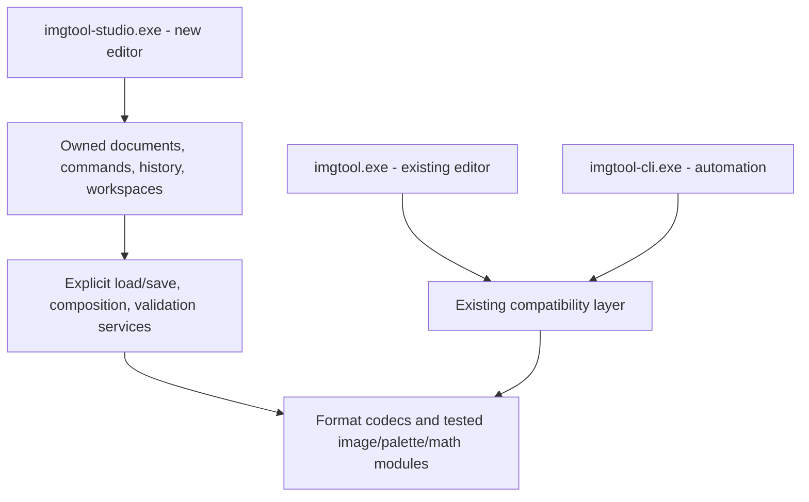

# Imgtool redesign assessment

2026-10-11 · source baseline `eab8366` · branch `feature/bddtool-style`

**Recommendation: retain the format knowledge and tested editing algorithms; build a separate editor application with new document ownership, command handling, and UI.** Keep `imgtool.exe` as the existing editor. Add `imgtool-studio.exe` as a separate target when implementation begins. Retain `imgtool-cli.exe` for automation. A full format/algorithm rewrite would discard valuable compatibility work. A theme or panel rearrangement would preserve the state and workflow problems described below.

This records the investigation made before implementation. The abandoned red-theme edits were reverted. The isolated `build-ui-audit` build contains the restored classic application. The earlier `build-bdd-style` executable is an obsolete experiment, not the fork.

**Implementation checkpoint (2026-10-11):** the first separate `imgtool-studio` target now lives in `platform/studio`. It reuses format/math code behind a scoped adapter, owns each library and its history, and provides an artwork workspace with red accents. Classic's overlay is not part of that target. See the [README preview section](README.md#studio-preview-separate-application) for build instructions, supported workflows, and limits. The broader migration below remains a roadmap, not a claim of implemented parity.

**Animation/alignment checkpoint:** Studio now has name-inferred sequence groups,
numeric frame order, multipart reconstruction, a timeline with per-frame preview
ticks, fixed World View, onion skin, normal/flipped/both facing previews, a floor
guide, reference sprites from open libraries, and undoable primary-anchor dragging.
The model has separate tests for grouping, playback, placement and whole-frame
anchor changes. Hidden UI checks exercise real pointer and keyboard gestures at
both window sizes. This is the preview/alignment part of Slice 2; embedded/ASM
sequence interpretation, authored composition history, WAX persistence and scene
exports remain outstanding. Preview settings do not alter IMG sequence data.

**Everyday editing checkpoint:** new libraries and sprites, rename/duplicate/delete,
reordering, resize/canvas-size/trim/rotate/flip, palette assignment/isolation, and
PNG import/export are implemented. History now owns complete sprite/palette
records, pixel and baseline buffers, points/alternate palettes, sequence bytes,
stable identities and selection. Reordering remaps sequence image indices while
leaving script indices untouched; deletion reports embedded references. PNG
quantization is shared with classic through a bounded memory adapter. Additional
tests cover structural/geometry history, reference remapping, Unicode PNG paths,
opaque black/transparency and metadata round-trips; hidden UI checks exercise
duplicate/undo/redo and applying/undoing the resize dialog. WAX persistence,
sequence authoring, other imports, advanced selections/paint, full palette tools,
batch operations and game-pipeline exports remain pending.

## Brief and scope

The user supplied the original BDDTool brief: the application had become scrappy, common tasks still required an agent, useful features were difficult to find, some interfaces were bloated, and sensible behavior should often be the default. The explicit request was to investigate the folder, tools, and scripts before choosing between reusing the core and rebuilding.

For imgtool, the product constraints are:

- Retain imgtool's identity as an indexed sprite, palette, animation, and alignment editor. BDDTool's stage-placement workflow is not its replacement.
- Borrow BDDTool's clarity and visual polish, with red accents. Do not copy its workspace one-for-one.
- Preserve the existing application as a separate executable and working reference.
- Make routine editing understandable without an agent explaining hidden state, selecting obscure menu options, or repairing output manually.

The BDDTool assessment in the sibling repository was used as a methodological reference. Its stage/runtime findings were not assumed to apply to IMG editing.

### Investigation coverage

[The file inventory](tools/ui_redesign_inventory.csv) records all 187 tracked files plus locally available historical references and top-level notes: 234 files total at the time of capture, with sizes, text line counts, tracking status, categories, and quoted local includes.

| Area | Files | Text lines | What was inspected |
|---|---:|---:|---|
| First-party editor/UI C/C++ | 40 | 57,803 | Includes, state definitions, layout, input, editing entry points, import/export UI, dialogs, animation and palette workflows |
| First-party core/platform C/C++ | 79 | 20,328 | Public interfaces and dependencies; close tracing of document ownership, I/O, rendering, packing, mirrors, platform lifecycle |
| Tests | 30 | 6,535 | Build registration, fixture coverage, important ownership/rendering tests; 29 configured executables run |
| Historical/reference files | 45 | 43,957 | Inventory plus selected format, LOAD2 and mirror references; historical batch files classified |
| Build/automation | 7 | 1,234 | CMake, build scripts, presets and CI/release workflow |
| Tooling and wiki fragments | 3 | 345 | Keyboard-reference generator and its input/output model |
| Vendored code | 16 | 60,991 | Inventoried as dependencies; not audited line by line |

The 119 first-party C/C++ files contain 78,131 physical lines, including comments and blanks. These categories describe location and responsibility, not purity: `img_io.cpp` and `world_render.cpp` still depend on editor state.

Build trees (`build`, `build-bdd-style`, `build-ui-audit`, `codex-build`, `tmpimgtool-build-worldremap`), `prototype_outputs`, emulator `cfg`/`nvram`, and generated BDD test artifacts were identified separately. They are not additional maintained editor implementations. No additional modern helper scripts were found outside the four tracked scripts and historical DOS batch files. Agent-private directories and Git internals were excluded.

This is an architecture and workflow assessment, not a claim to have reviewed every implementation line. UI findings are source-traced. There was no new interactive usability study, exhaustive real-asset round trip, or MAME comparison. Those are acceptance gates for the fork, not accomplishments of this audit.

## What the current application already does well

The current baseline is considerably newer than the checkpoint in `AGENTS.md`. `last.md` and `refactoring_plan.md` are absent. The old mirror proposal is no longer a reliable feature-status list: mirror previews and separate engine conventions now exist.

Preserve these achievements:

- Indexed pixels and RGB555 palettes, including transparency at index zero, palette-aware image operations, and cross-palette remapping.
- IMG metadata preservation: raw name bytes, primary and secondary anipoints, point tables, alternate palettes, sequence/script blobs, damage references, and header fields that affect LOAD2.
- Tested geometry, resizing, matching, ramp transfer, matte/material processing, body splitting, packing estimates, and mirror math.
- World View's multipart reconstruction, cross-file frame references, floor placement, opponent/effect lanes, tick-based timing, WAX projects, and assembly export knowledge.
- Stable document UIDs and tests for close/reorder behavior.
- Marquee on open, paused composition playback, grouped subframes, game placement, and visible anipoints are already sensible defaults. Do not present them as missing features.
- LOAD2 drift checks, subframe alignment checks, TBL comparison, CPU composition/PNG export, and the existing headless commands.

Evidence: [format structs](platform/img_format.h), [document identity](platform/document.h), [document tests](test/document_test.cpp), [World View state](platform/ui_canvas.h), [mirror conventions](platform/anipoint_mirror.h), [core test registration](CMakeLists.txt).

## Findings that determine the architecture

### 1. Documents have identities, but editing history is still application state

`ActivateDocumentTab()` in `ui_modals.cpp:816` normally calls `ResetPerDocumentUiState(false)` when changing documents. `ui_undo.cpp:297` clears the legacy history, pixel history, full-document history, timeline, selection, transform state, and several tool states. Cross-document World View playback has a special bypass.

**Consequence:** switching from sprite file A to B and back can remove A's undo history. A more attractive tab bar cannot solve this. The three history mechanisms are merged by sequence numbers, but their storage does not belong to each document. The bypass also means behavior depends on the active workspace.

**Fork requirement:** each artwork document owns its history, saved revision, selection, and view state. A composition has its own history for lane/timing/placement edits. Cross-document operations record exactly which documents they touch. Tab switching does not mutate or discard history. Keep stable document UIDs and introduce stable sprite identities above the index-based disk representation.

Evidence: [tab activation](platform/ui_modals.cpp#L816), [history reset and routing](platform/ui_undo.cpp#L297), [document structure](platform/document.h).

### 2. Save success is not a dependable application contract

`SaveImgFile()` returns `void`. It silently returns if `fopen(..., "wb")` fails; its main write path does not propagate individual write or close failures. The normal save dialog and the unsaved-changes Save action subsequently clear `g_dirty`; the latter can continue the pending close/open/quit action.

**Consequence:** the caller cannot distinguish a completed save from failure. This is a source-confirmed failure path, not a reproduced disk-failure experiment. The same API also temporarily flattens sprite layers into the live data for writing, then restores them.

**Fork requirement:** an explicit `SaveResult` with destination and error details; write a snapshot to a temporary sibling file, check writes and close, and replace the destination only after success. A failed save leaves the original document dirty and does not complete a pending close. Loading should similarly parse into temporary owned data before replacing a document. Do not treat a new file picker as sufficient modernization.

Evidence: [save implementation](platform/img_io.cpp#L490), [save completion](platform/img_io.cpp#L715), [normal save caller](platform/ui_modals.cpp#L2050), [unsaved save caller](platform/ui_modals.cpp#L9595).

### 3. Artwork, compositions, and game source have different persistence models

IMG contains sprites and palette/sequence metadata. World placement, lane bindings, timing overrides, and preview choices also live in global `WorldViewState` and `WorldMarkedSequenceState`. WAX writes references and composition settings through private helpers in `ui_modals.cpp`. The background BDD is deliberately not carried in the current WAX project. MK2 strike tables and fatality source have their own source-backed documents and dirty flags.

`LoadWorldProjectFile()` clears the open IMG workspace before resolving and loading all referenced files. That is another reason to stage and validate project loading rather than use live UI state as the loader's workspace. The audit did not prove every possible caller's unsaved-change behavior, so this is a transactional-loading requirement rather than a blanket claim that every WAX open loses edits.

**Fork requirement:** explicit artwork and composition documents, plus optional game-source documents. Show what is unsaved and which file an operation changes. Saving a scene must not imply that referenced IMG edits or assembly edits were also saved. Missing scene dependencies should be repairable before a destructive workspace replacement. Preserve WAX compatibility through an adapter and version any new persistence fields deliberately.

Evidence: [composition state](platform/ui_canvas.h#L535), [WAX save](platform/ui_modals.cpp#L3700), [WAX load](platform/ui_modals.cpp#L3986), [strike document](platform/mk2_hitbox.h), [fatality document](platform/mk2_fatality.h).

### 4. There are several useful previews, not one guaranteed game view

The pixel canvas, anipoint-relative World View, embedded SEQSCR editor, assembly animation preview, and BDD backdrop each describe a different aspect of the result. `bdd_bg.h` explicitly documents that its raw BDB composition does not implement MK2's full camera, parallax, plane offsets, draw order, or floor interpretation.

The two supported mirror paths intentionally differ by one pixel: multipart `ani2` uses `size - anchor`; single-part `ganiof` uses `(size - 1) - anchor`. Current helpers preserve that distinction. A generic horizontal flip would discard it.

**Fork requirement:** use one explicit composition/evaluation model for the live preview and exported frames. Label imported game metadata, user-authored placement, and reference-only backdrops. Present left/right facing checks alongside anipoint editing. Never label an estimated reference composition as emulator-verified. Game-specific timing and mirror behavior belong to a named profile; retain MK2's existing tick convention when that profile is selected.

Evidence: [backdrop limits](platform/bdd_bg.h), [mirror math](platform/anipoint_mirror.h), [World View defaults](platform/ui_canvas.h#L87), [CPU renderer](platform/world_render.cpp), [render/export tests](test/world_blit_test.cpp).

### 5. Workspace and input routing are spread across independent flags

The canvas chooses among Image, World, Anim, Link, React, and Browse using multiple booleans with precedence and synchronization code. The sidebar separately switches Assets, Sprite, and Animation, and synchronizes some selections with the canvas. Clipboard/navigation shortcuts can change meaning after palette-list focus (`g_palette_nav`). Modal and file-dialog checks are repeated in input paths; recent changes fixed click-through behavior.

**Consequence:** the user must remember both a visible workspace and hidden focus/mode state. Adding another panel or shortcut requires auditing several gates. This is not an argument that all six capabilities should disappear.

**Fork requirement:** explicit workspace and interaction states; one command registry with labels, shortcuts, enabled reasons and a declared target. Menu, context action, shortcut and command search invoke the same command. Modal capture and gesture cancellation are centralized. Palette focus should visibly say that copy/delete applies to palettes. Keep known muscle memory where meanings are unambiguous.

Evidence: [mode routing](platform/ui_canvas.cpp#L12478), [shortcuts](platform/ui_main.cpp#L713), [sidebar layout](platform/ui_main.cpp#L2090), [canvas input guard](platform/ui_canvas.cpp#L11931).

### 6. Useful operations are distributed across competing surfaces

There are top-level Image, Operations, Palette, View and Tools menus, a 28-pixel icon rail, nested list context menus, a bottom palette strip, and many specialist dialogs. A thumbnail Browse workspace already exists, but browsing, marking, pixel editing, palette assignment, and animation composition are separate navigation surfaces. Color work is particularly rich: HSL, ramp transfer, costume variants, indexed gradients, isolation, reduction and material fitting deserve organization rather than deletion.

**Fork requirement:** a persistent searchable sprite library; a central work area; an inspector whose contents follow the selected object; a labeled tool shelf with only the active tool's options; a palette panel with explicit edit scope. Advanced actions remain discoverable through a searchable command list and contextual groups. Keep marking as a visible batch concept distinct from the active sprite and canvas selection.

The exact panel arrangement is a prototype hypothesis. It should be evaluated on both the current 1024×768 starting size and larger displays, including scaling and long sprite names. Do not simply widen every control while leaving fixed-size docks unchanged.

Evidence: [main layout](platform/ui_main.cpp), [tool rail](platform/ui_tools.cpp), [thumbnail browser](platform/ui_browse.cpp), [palette UI](platform/ui_palette.cpp), [ramp transfer](platform/ui_ramp_transfer.cpp), [costume UI](platform/ui_alt_costume.cpp).

### 7. There is reusable core code, but not a clean core library yet

The extracted pure modules are a strong starting point. However, `get_img()`, `get_pal()` and allocators resolve through `g_doc`; `img_io.cpp` calls undo and populates UI messages; `world_render.cpp` includes `ui_internal.h` for renderer state. WAX serialization and animation interpretation still live inside large UI translation units. The CLI target compiles the same source list, including the UI, and changes entry behavior with `IMGTOOL_CLI_ONLY`.

The largest first-party files are `ui_canvas.cpp` (21,568 lines), `ui_modals.cpp` (10,717), `ui_palette.cpp` (6,484), `ui_main.cpp` (5,441), and `img_io.cpp` (4,877). The earlier file split reduced the overlay's size; it did not fully separate state, commands and rendering.

**Fork requirement:** extract narrow services on demand, with explicit inputs and results. A temporary active-document adapter may be necessary at the compatibility boundary, but it must not become the new UI's state model or run concurrently. Do not make the first milestone a huge shared-code refactor or copy all the UI files into a second directory.

Evidence: [allocators and lookups](platform/img_format.h#L169), [I/O API](platform/img_io.h), [renderer dependencies](platform/world_render.cpp), [target source list](CMakeLists.txt#L79).

### 8. Validation knowledge exists but is not presented as a continuous workflow

LOAD2 verification already separates geometry, palette/PPP fallback and zero-shape drift, with baselines and click-to-image diagnostics. Save currently reports it as an advisory toast. TBL comparison and subframe checks exist separately, including CLI access. An asset can therefore be saved successfully while still needing a build-specific check; these are different results.

**Fork requirement:** a persistent, navigable findings panel with the active game/packing profile, affected sprites, and clear distinction between save errors, packing compatibility, and unverified game presentation. Recompute relevant checks after edits using revisions; do not run every expensive scan every frame. Include “no baseline” and missing dependency states instead of showing a reassuring empty result.

Evidence: [LOAD2 report API](platform/load2_verify.h), [CLI](platform/main.cpp), [TBL comparison](platform/tbl_diff.cpp), [subframe analysis](platform/subframe_align.cpp).

## Proposed product shape

The editing loop to optimize is: **find a sprite or move → edit its pixels/colors → check placement and facing in context → undo/refine → save/reopen → inspect export compatibility**.

| Surface | Responsibility |
|---|---|
| Library | Searchable list/thumbnail view, sequence/subframe grouping, active sprite, visible batch marks, palette usage and dependencies |
| Sprite workspace | Pixel canvas, indexed-color tools, floating selection/transform, precise zoom/pan, contextual tool settings |
| Animation workspace | Named sequences, explicit frame duration, scrubbing, multipart grouping, actor/opponent/effect placement, floor and facing checks |
| Inspector | Sprite geometry/anchors or selected lane settings; labels state whether an edit affects one sprite, its sequence, or the scene |
| Palette panel | Active palette, selected swatches, RGB555 values and ramp/material tools, with preview/apply/cancel for bulk changes |
| Checks/export panel | LOAD2 profile and findings, subframe checks, TBL comparison and explicit output destinations |

Link and React become focused tasks reachable from animation/anchor context, not mandatory top-level tabs for every user. Raw SEQSCR and assembly editing remain specialist views. A WAX file should open in Animation; a plain IMG should open with the library and selected sprite. Remember per-document view choices.

Use dark neutral surfaces and red interaction accents, readable type and consistent spacing. Keep sprite colors, transparency indicators, anipoint guides and diagnostic overlays semantically distinct from application chrome. A red selection should also have a shape/border/label cue so it is not confused with a validation error. This is a direction for the prototype, not a finished mockup.

### Defaults and migration decisions

| Existing capability | Studio treatment | Default / rationale |
|---|---|---|
| Marquee/select on open | Retain | Already prevents accidental painting |
| Native pixels, palette transparency, RGB555 | Retain | Fundamental format behavior |
| Anipoints and multipart reconstruction | Retain, improve scope labels | Show relevant anchors in alignment; grouping already defaults on |
| Paused scene, floor placement | Retain | Already useful defaults; preserve scene overrides |
| Onion skin | Contextual toggle | Useful for alignment, obscures some pixel/color tasks; do not force globally |
| Mirror preview | Visible facing controls / comparison | Keep explicit engine convention; do not rewrite stored anchors to preview |
| Browse thumbnails and name search | Integrate into persistent library | No workspace switch just to find the next sprite |
| Marked image/palette batches | Retain with visible counts and scope | Separate batch membership from active selection |
| Pencil, fill, eraser, wand, lasso, clone | Primary tools | Labeled, shared command model and active-tool options |
| Blur, smudge, heal, smart remap | Group as advanced paint tools | Preserve indexed-color semantics; avoid a permanently crowded rail |
| Palette copy/assignment and swatch edits | Primary palette workflow | Show which sprites share the palette |
| HSL, ramps, transfer, costume, gradients | Consolidated color tasks | Reuse algorithms; preview and scope before committing |
| Video/PNG/GIF digitizing | Guided import | Keep frame selection, crop, floor point, keying and material fit; use existing worker decoder |
| Trim, resize, canvas size | Contextual geometry actions | Show anchor and packing effects; never auto-trim on open/save |
| Auto-chop / body split / parent-child restore | Specialist sprite tasks | Preview affected sprites and coverage; keep reconstruct semantics |
| WAX composition and cross-file frames | First-class composition document | Own history, dependencies and saved revision |
| Embedded sequences / ASM animation | Explicit source types | Preserve ticks, control operations and unresolved-reference diagnostics |
| TBL, IRW, ANILST, LOD | Export/check tasks | Preserve hardware options in advanced settings and CLI |
| MK2 strike and fatality source | Later game-integration workspace | Separate save destination; do not imply they are IMG data |
| BDD/BDB background | Reference import | Label fidelity limits; stage editing remains BDDTool's job |
| Raw debug fields, DMA overlay | Advanced inspection | Available on demand; not the main editing surface |
| LOAD2 checks and missing dependencies | Automatic findings | Report exact profile and unavailable baselines |
| Destructive cleanup/repacking | Explicit reviewed action | Never silently “modernize” stock asset data |

The existing application remains available for features not yet migrated. This table is a migration ledger, not a promise that the first Studio preview has every legacy feature. Unsupported operations must be stated honestly; do not ship decorative buttons that invoke the wrong legacy context.

## Implementation boundary: two GUIs, shared knowledge

The diagram is the target architecture, not today's build graph. Initially the codecs still need compatibility adapters.

1. Add a separate CMake target and entry point. `imgtool.exe` retains its title, startup defaults, commands and packaging identity. Keep the CLI target; “two binaries” means two GUI choices, not removing automation.
2. Give Studio its own settings, recent-files list, session restore, window layout, title/icon identity and recovery storage. Current recent/session files live beside the executable, ImGui has its own layout file, and native directory memory uses an imgtool-specific location. Separate names must work even when both GUIs ship in one folder.
3. Share pure source modules through a library or source collection first. Preserve `IMG`/`PAL` disk semantics behind a compatibility boundary. Avoid changing the old editor's behavior as a side effect of a new adapter.
4. Use explicit document/sprite/palette handles in Studio. Disk indices are assigned during serialization; they are not the identity of an editing command or scene reference. Keep original raw bytes and metadata with loaded assets.
5. Implement owned artwork history and a separate composition history, with a saved-revision marker. A drag is one undoable transaction. A tab switch, preview flip or view zoom is not an artwork edit.
6. Move serialization, animation interpretation and scene evaluation out of widget drawing only as each workflow needs them. Inputs and outputs must be testable without ImGui. Preserve existing parsing behavior with fixtures before broadening it.
7. Keep SDL2 and Dear ImGui for the first prototype. The traced problems concern state ownership, workflow and layout, not an inability of the existing renderer to draw this interface. Reassess framework choice only if a concrete prototype exposes a missing requirement.

### First delivery and acceptance gates

**Slice 1 — foundation and usable artwork loop.** Both GUI targets build side by side. Studio opens an IMG, browses/searches sprites, paints, edits a palette, copies/pastes, changes anchors, undoes, saves and reopens. Classic behavior remains unchanged. No fake game-preview claim.

**Slice 2 — animation/alignment loop.** Named sequences, explicit ticks, multipart frames, facing comparison, a ground reference and a minimal opponent/reference lane. Scene edits have their own undo and saved state. Reuse the existing mirror and composition math. Preview and image export consume the same evaluated scene.

**Slice 3 — independent everyday workflows.** Guided imports, material/ramp workflows, batch geometry/restoration, persistent checks, WAX migration and export destinations. Only then expand game-source authoring and specialist tools according to the ledger.

Required checks before calling the fork usable:

- Open A, edit, open/switch B, return to A, undo/redo; document identity, history and dirty state stay correct.
- A failed write, a missing dependency or a cancelled dialog does not clear dirty state, replace live data, or run a pending close.
- Reorder/close document tabs and sprite rows while a composition references them; references remain attached to the intended asset.
- Palette edits and clipboard transfers preserve palette ownership and transparency; a shared-palette edit reports its scope.
- Load/save fixtures preserve raw names, points, secondary anchors, alternate palettes, sequences, damage data and LOAD2-sensitive fields. Compare outputs semantically and byte-for-byte where the format permits.
- Both mirror conventions, negative anchors, multipart alignment and tick timing have executable fixture coverage; real-game checks are recorded separately.
- Save/reopen a composition and compare evaluated transforms and exported pixels, including cross-file references and unavailable resources.
- Exercise modal capture, text input shortcuts, palette focus, paste/transform cancel, scrolling and clipping at 1024×768 and scaled displays.
- Launch both GUIs from the same directory and confirm separate settings/recent/session files.

## Tooling, scripts, build and documentation decisions

| Item | Decision |
|---|---|
| `build.ps1`, `build.bat`, `build.sh`, CMake/presets | Extend deliberately for side-by-side GUI output; keep existing commands functional. Do not overwrite classic with a renamed Studio binary. |
| `imgtool-cli` | Preserve and gradually move behind the same explicit services. The current CLI compiling all UI sources is technical debt, not a reason to remove it. |
| `tools/wiki/gen_keyboard_reference.py` | Preserve classic generation. For Studio, generate help/shortcut descriptions from the command registry; the present generator reads prose, not live bindings. |
| `.github/workflows/c-cpp.yml` | It builds test targets but contains no CTest invocation. Add execution and distinct Studio packaging when implementing. Current `feature/bddtool-style` pushes do not match the listed push branches; PRs/manual runs do. |
| Historical `doc/it`, `doc/load2`, `doc/wimp`, `doc/blimp` | Keep as format and engine reference. The DOS batch scripts are not modern workflow services to expose as buttons. |
| README/help/checkpoint notes | Reconcile against code. Some descriptions lag implemented features and current input behavior; do not use old TODOs as the feature inventory. |
| Build outputs/prototypes/emulator state | Keep out of product source and acceptance claims. Existing screenshots or executable names do not prove which revision is running. |

## Validation performed for this assessment

- Reverted the first theme experiment; application and CMake source match baseline `eab8366`.
- Fresh x64 Release build using SDL2 2.32.10 succeeded in `build-ui-audit/build` for the classic GUI, CLI and test targets.
- CTest: **29/29 passed**. The real `MKSTK.ASM` round-trip target is optional and was not configured.
- Ran `video_decode_test.exe` directly: all checks passed, with no missing-FFmpeg skip reported.
- Ran `imgtool-cli.exe --help` to confirm the available automation entry points.
- No source IMG, WAX, assembly or ROM assets were edited. No release, push or deployment was performed.

These checks establish a working baseline and reusable tested components. They do not validate a Studio implementation, the complete GUI interaction model, or in-game fidelity. The next implementation should start with Slice 1 and its ownership/save contracts, rather than another styling patch.
